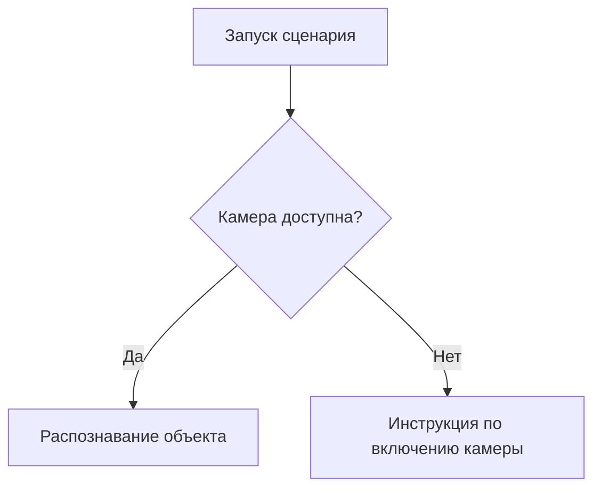

# Документы закупки цифровой экосистемы Музея

MkDocs Material с русскоязычным поиском и оглавлением двух исходных документов.

ТЗ разложено по 22 разделам и 12 приложениям. Разделы 9 и 15 дополнительно разбиты на подразделы. Порядок оценки разделён на три страницы. `verification/pages.json` задаёт порядок фрагментов для дословной сверки.

Для работы с требованиями открывайте нужный Markdown в `docs/technical-specification/` или `docs/evaluation/`: достаточно читать конкретный раздел. Оглавления находятся в `docs/technical-specification.md` и `docs/evaluation.md`. Старые браузерные закладки на якоря переводятся на новые страницы.

## Запуск

```sh
python3 -m venv .venv
.venv/bin/pip install -r requirements.txt
.venv/bin/mkdocs serve --dev-addr 127.0.0.1:8000
```

Открыть http://127.0.0.1:8000/.

## Блок-схемы в Markdown

Подключена встроенная поддержка Mermaid в Material через `pymdownx.superfences`.
Зависимость `pymdown-extensions` уже включена в `requirements.txt`.
Вставляйте схемы прямо в Markdown страницы:

````markdown

````

Схемы отображаются в браузере с помощью JavaScript. При первом открытии
страницы со схемой требуется доступ к CDN, используемому темой Material.

## Проверка сборки

```sh
.venv/bin/python scripts/verify.py
.venv/bin/mkdocs build --strict
```

Исходные DOCX в `documents/` исключены из Git и не публикуются на сайте. Локальные файлы сохранены для повторной сверки. Контрольные суммы и эталонное содержимое находятся в `verification/`.

## Работа в новом чате

Начальная карта проекта и выбор файлов для конкретной задачи — в `AGENTS.md`. Правила подготовки предложений — в `docs/proposal/AGENTS.md`. Эти инструкции не публикуются на сайте.
