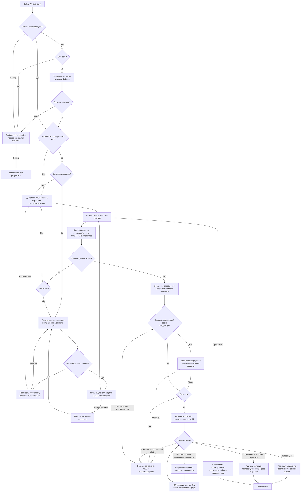
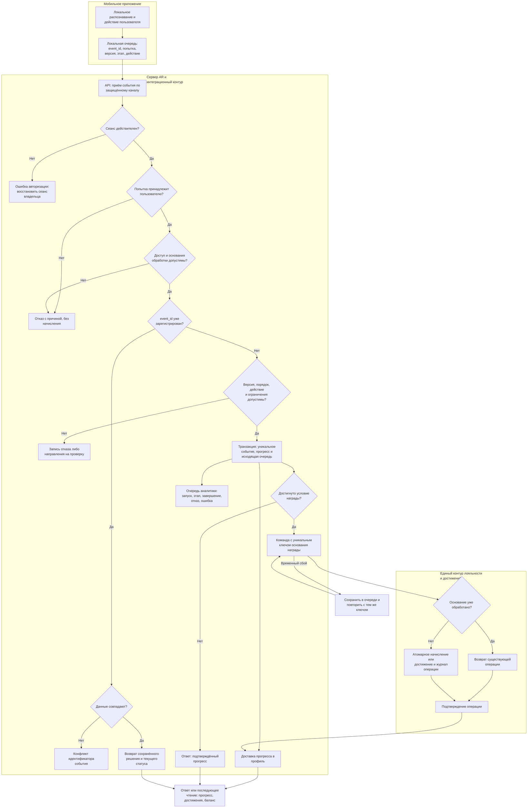

# Блок-схемы

Приложение к [материалам заявки](result.md) по [п. 2.1.1 порядка оценки](../../evaluation/03.md#quality-1). Схемы описывают предлагаемое решение для последующей реализации и согласования; музейный сюжет не влияет на общий порядок обработки.

## 1. Взаимодействие посетителя с приложением {#user-flow}

Пакет включает контент и доступную альтернативу. Ошибки загрузки позволяют повторить операцию или выбрать другой доступный сценарий. Согласованный способ распознавания задаётся для каждой цели; QR выбирает контент и не подтверждает физическое присутствие. События ставятся в очередь по мере действий, отправляются при наличии сеанса и сети; итоговый блок отправки также обеспечивает досылку накопленного остатка.

Гость может просматривать публичные материалы. Начисление возможно только после идентификации и серверной проверки. Прекращение сохраняет промежуточные данные; подтверждение такого прогресса использует тот же механизм синхронизации. Условие завершения альтернативного пути задаётся сценарием. Разрешение камеры и маркетинговые согласия не смешиваются.

Основания: [9.10.8](../../technical-specification/09-10.md#дополненная-реальность), [С-11](../../technical-specification/08.md#scenario-c-11), [9.8](../../technical-specification/09-08.md#мобильное-приложение).

## 2. Обработка AR-событий информационной системой {#system-flow}

Создание онлайн-попытки выполняется отдельным авторизованным запросом до отправки её событий. Для локальной попытки сервер сначала устанавливает соответствие идентификаторов после проверки владельца и допустимости прохождения. Схема показывает обработку одного события после этого сопоставления.

Проверка `event_id` на схеме поясняет алгоритм; защиту от гонки обеспечивает уникальное ограничение внутри транзакции. При одновременных запросах проигравшая транзакция читает уже сохранённое решение. Запись исходящей команды создаётся атомарно с прогрессом, а её фактическая доставка выполняется после фиксации транзакции. Временный сбой любого получателя — лояльности, профиля или аналитики — оставляет сообщение в очереди с повтором и наблюдаемым статусом. Постоянная ошибка фиксируется для разбора и не вызывает бесконечных повторов.

Уникальность события защищает от повторной доставки, уникальность основания награды — от повторного начисления через новое событие или новую попытку. Пример и состав ключей приведены в [описании результатов](result.md#results). Запрос клиента не содержит доверенной суммы баллов: её рассчитывает сервер по правилу. Проверка и аннулирование спорного результата выполняются уполномоченным сотрудником с причиной и журналом; операция отмены связана с исходным начислением.

Основания: [9.8.1](../../technical-specification/09-08.md#редизайн-и-доработка-мобильного-приложения), [9.10.10](../../technical-specification/09-10.md#защита-от-злоупотреблений), [9.10.11](../../technical-specification/09-10.md#аналитика), [11.4–11.5](../../technical-specification/11.md#требования-к-api-и-интеграционным-контрактам).
