# Наполнение главной страницы {#real-content}

Срез публичного сайта на **15 октября 2026 года**. Ниже — выбранные записи для [экранов Г-01–Г-09](screens.md), а не новая структура сайта. ID Р-С, Р-О, Р-Н и Р-Т — наши рабочие обозначения, не идентификаторы CMS музея. Названия, даты, цены и площадки взяты из источников; предложенные подписи кнопок и редакционные тексты отмечены отдельно. Период в афише не означает ежедневное наличие сеансов. Перед финальным экспортом даты, цены и ограничения нужно проверить повторно.

## Данные для подключения к макету {#json-data}

Подборка расширена **16 октября 2026 года**. Данные для макета хранятся отдельно от кода, в JSON. Материалы и оговорки исследования ниже сохраняются; расширенный набор записей находится в файлах:

| JSON | Содержание |
| --- | --- |
| [events.json](data/events.json) | 10 событий, общие записи для Hero и афиши; даты, возраст, тип и ссылка на площадку |
| [products.json](data/products.json) | 16 товаров с категориями, числовыми ценами в рублях и фотографиями |
| [collection-items.json](data/collection-items.json) | 12 предметов: три ранее выбранных и ещё девять из галереи отдела; подписи и изображения |
| [collections.json](data/collections.json) | Анонс коллекции и отдельные переходы к фондам и онлайн-каталогу |
| [places.json](data/places.json) | 10 объектов: шесть пространств квартала и четыре других филиала; Главный дом записан один раз |
| [news.json](data/news.json) | Три новости с датами публикации и изображениями |
| [promos.json](data/promos.json) | Промо олимпиады со ссылкой на общую запись новости |
| [navigation.json](data/navigation.json) | Меню, сервисы, социальные, официальные и правовые ссылки |
| [organization.json](data/organization.json) | Название, логотип, адрес и телефоны музея |
| [dictionaries.json](data/dictionaries.json) | Типы событий, категории товаров, языки и предлагаемые бейджи |

### Подключение и связи

JSON доступны как статические файлы сайта. Например, для текущего локального сайта:

```js
const contentBase = "/proposal/05-homepage-design/";
const [events, places] = await Promise.all(
  ["events", "places"].map(async (name) => {
    const response = await fetch(`${contentBase}data/${name}.json`);
    if (!response.ok) throw new Error(`Не удалось загрузить ${name}`);
    return response.json();
  }),
);
const placesById = new Map(places.map((place) => [place.id, place]));
const event = events[0];
const place = placesById.get(event.placeId);
const imageUrl = `${contentBase}${event.image.src}`;
```

При размещении сайта в подкаталоге `contentBase` задаётся с учётом его адреса. Для сборщика те же JSON можно импортировать как модули; изображения копируются вместе с папкой `assets`, а базовый URL задаётся кодом макета.

`placeId`, `collectionId`, `newsId` и `categoryIds` связывают записи без копирования сущностей. `Р-К-02` — прежнее обозначение Главного дома, сохранённое в `aliases` записи `Р-О-01`. `groups` определяет принадлежность объекта кварталу или списку филиалов. Вкладка «Все» — фильтр, а не тип события или категория товара. Дополнительные реальные типы «Мастер-класс» и «Экспозиция» доступны во вкладке «Все»; они не переименованы в выставки или спектакли.

Тексты интерфейса, порядок блоков, выбранные ID для Hero и подборок задаются в коде. Отдельных `ui-texts.json` и `homepage.json` нет. Пользовательский ввод и текущее состояние компонентов в JSON не сохраняются.

### Изображения и достоверность

`image.src` указывает на локальный файл относительно `05-homepage-design/`; изображения находятся в `assets/references/` и `assets/content/`. В записи изображения сохранены `alt`, исходный адрес `sourceUrl`, размеры, тип материала `kind`, известные автор и лицензия. `sources` содержит страницы-основания и дату проверки. Даты и цены хранятся структурированно; форматирование выполняет код.

Исторические снимки, проект интерьера и тематические иллюстрации отмечены отдельно. Они не подтверждают нынешний вид экспозиции или открытие здания. Неизвестные URL, часы и свойства остаются `null` или пустым списком с пояснением; макет должен учитывать эти значения. Предлагаемый словарь бейджей не означает, что удобства подтверждены у объектов.

Для Зарайска найдена фотография самого здания в публикации музея от 25.01.2024. У Детского центра временно указан кандидат `kind: "candidate"` — исторический снимок флигеля усадьбы; номер строения и связь этого снимка с центром не подтверждены. Его нельзя подписывать как точную фотографию Детского центра. Для окончательного макета нужна замена или подтверждение. У филиалов Плисецкой и Боровского сохранены тематические изображения с их страниц, явно отличённые от фотографий зданий.

Новые материалы найдены в публичных источниках; генерация для событий, товаров и музейных предметов не потребовалась. Для итогового использования сохраняется необходимость проверить права и атрибуцию. Оригиналы предметов получены с основного домена музея, несмотря на устаревшие ссылки галереи на технический домен. Названия файлов не используются как подтверждение инвентарных номеров.

## Г-01. Шапка: подтверждённые переходы

| Элемент | Реальное значение / источник | Применение |
| --- | --- | --- |
| Логотип | [JPG из шапки](references.md#logos) | Использовать имеющийся файл до получения исходника |
| Афиша | [Раздел событий](https://www.bakhrushinmuseum.ru/timetable/) | Ссылка «Афиша» |
| Покупка билетов | [Билетная афиша](https://www.bakhrushinmuseum.ru/buy-tickets/#/afisha/event) — адрес кнопки действующего сайта | Публичный референс маршрута; будущий переход согласуется |
| Магазин | [Магазин музея](https://shop.bakhrushinmuseum.ru/) | Ссылка «Магазин» |
| Языки | [RU](https://www.bakhrushinmuseum.ru/), [EN](https://www.bakhrushinmuseum.ru/en/main/) | Названия переключателя; полнота перевода не установлена |

URL будущих «Медиа», «Театральной энциклопедии» и ЛК не подтверждены этой выборкой. Не подменять их ссылками на случайные действующие разделы. Поисковый запрос — ввод пользователя, готовый музейный текст для него не нужен.

## Г-02–Г-03. События для Hero и афиши {#real-events}

### Можно ли взять уже собранные баннеры

Да, существующие баннеры можно использовать как исходные материалы там, где подходят содержание и назначение. Для Hero по [п. 9.1.3](../../technical-specification/09-01.md#перечень-разрабатываемых-разделов-и-функций) нужны несколько образов со связями с событиями/выставками; целый баннер сам по себе ещё не задаёт такой коллаж.

| Собранный материал | Где пригоден | Что учитывать |
| --- | --- | --- |
| [Баннер с портретом Плисецкой](references.md) | Визуальный референс портрета и композиции; возможный исходник после получения версии без служебного текста | Сам баннер сообщает о лифте и ведёт к музею-квартире. Для Hero нужны изображение без чуждого событию объявления и проверенная связь с выбранной экскурсией |
| [Баннер Мастерской Боровского](references.md) | Визуальный референс пространства и знака музея | Баннер сообщает о закрытии, а не рекламирует актуальное событие. Нужна чистая фотография, если используем её в новом коллаже |
| [Баннер олимпиады](https://www.bakhrushinmuseum.ru/wp-content/uploads/2026/10/slajder_usadba_841h400.jpg) | Готовый материал для промо Г-07 | Сохраняем связь с публикацией об участии; для Hero нужен переход к соответствующей записи события |

Не требуется создавать все изображения заново. Для рабочего наполнения ниже уже подобраны изображения реальных событий; окончательная композиция Hero будет собрана из выбранных материалов.

Предлагаем первую композицию Hero и первые карточки наполнить следующими семью записями. Образ, заголовок и переход Hero используют одну запись события; ссылка ведёт на страницу события, а не на новость о нём. Это подбор для макета, не утверждённый редакционный план.

| ID | Название и страница события | Тип / возраст | Период в текущей афише | Площадка |
| --- | --- | --- | --- | --- |
| Р-С-01 | [Сборная экскурсия «В гостях у Майи Плисецкой и Родиона Щедрина» 6+](https://www.bakhrushinmuseum.ru/event/sbornaya-ekskursiya-v-gostyah-u-maji-pliseczkoj-i-rodiona-shhedrina-6/) | Экскурсия, 6+ | 07.10–30.12.2026 | Музей-квартира М.М. Плисецкой |
| Р-С-02 | [Коллективная выставка художников ТСХ «Московиты» «Магия ручной работы» г. Зарайск 6+](https://www.bakhrushinmuseum.ru/event/kollektivnaya-vystavka-hudozhnikov-tsh-moskovity-magiya-ruchnoj-raboty-6/) | Выставка, 6+ | 07.10–30.12.2026 | Бахрушинский театральный музей. Зарайск |
| Р-С-03 | [Сборная экскурсия «Творческий путь актера Щепкина» и выставка «Пров Садовский. Мастер серьезного комизма» 6+](https://www.bakhrushinmuseum.ru/event/sbornaya-ekskursiya-po-domu-muzeyu-m-s-shhepkina-i-vystavke-prov-sadovskij-master-sereznogo-komizma-6/) | Экскурсия, 6+ | 07.10–06.11.2026 | Дом-музей М.С. Щепкина |
| Р-С-04 | [Спектакль «Эй, кто-нибудь» 12+](https://www.bakhrushinmuseum.ru/event/spektakl-ej-kto-nibud-12/) | Спектакль, 12+ | 30.10.2026, 19:00 | Дом-музей М.С. Щепкина |
| Р-С-05 | [Спектакль «Цветы запоздалые» 12+](https://www.bakhrushinmuseum.ru/event/spektakl-czvety-zapozdalye-12/) | Спектакль, 12+ | 24.10.2026, 18:00 | Дом-музей М.С. Щепкина |
| Р-С-06 | [Спектакль «В поисках любви» 16+](https://www.bakhrushinmuseum.ru/event/spektakl-v-poiskah-lyubvi-16/) | Спектакль, 16+ | 25.10.2026, 17:00 | Дом-музей М.С. Щепкина |
| Р-С-07 | [Спектакль «… про Левитана написать никогда не поздно» 16+](https://www.bakhrushinmuseum.ru/event/spektakl-pro-levitana-napisat-nikogda-ne-pozdno-16/) | Спектакль, 16+ | 31.10.2026, 19:00 | Дом-музей М.С. Щепкина |

**Р-С-01.** Сборная экскурсия «В гостях у Майи Плисецкой и Родиона Щедрина» 6+

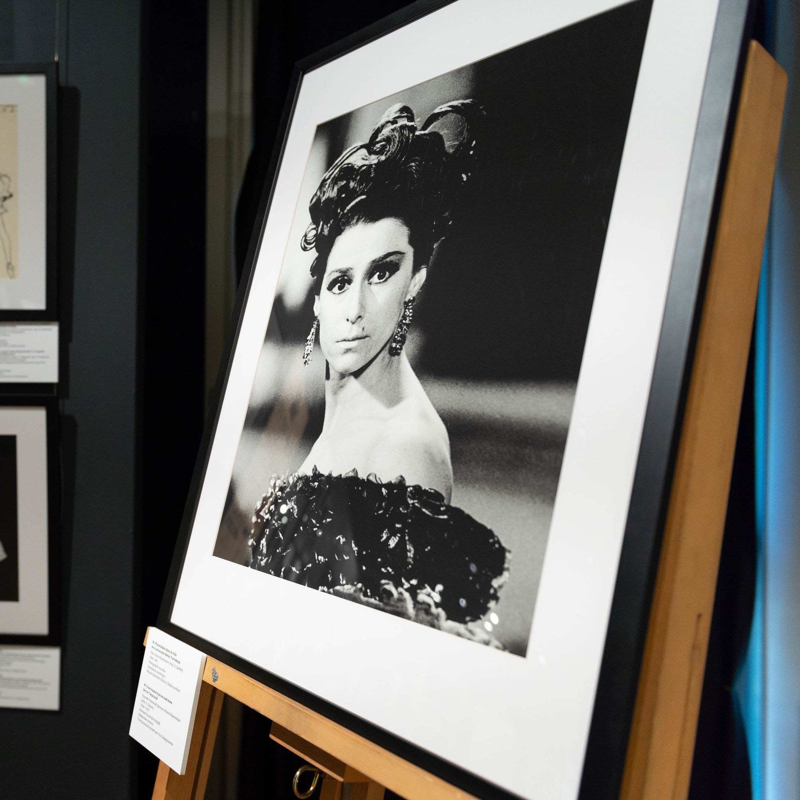{ width="260" }

[Исходное изображение](https://www.bakhrushinmuseum.ru/wp-content/uploads/2025/01/leb_5347-kvadrat.jpg).

**Р-С-02.** Коллективная выставка художников ТСХ «Московиты» «Магия ручной работы» г. Зарайск 6+

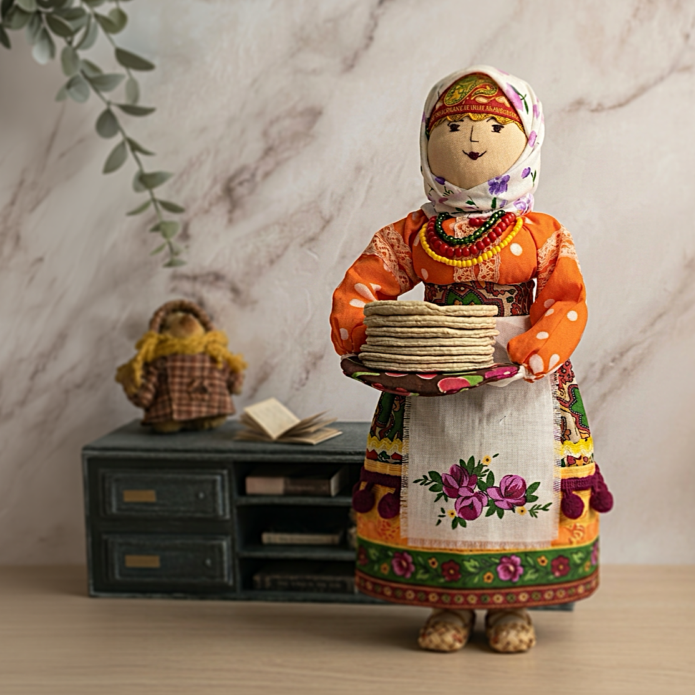{ width="260" }

[Исходное изображение](https://www.bakhrushinmuseum.ru/wp-content/uploads/2026/02/vystavka-magiya-ruchnoj-raboty.-zarajsk-kv.png).

**Р-С-03.** Сборная экскурсия «Творческий путь актера Щепкина» и выставка «Пров Садовский. Мастер серьезного комизма» 6+

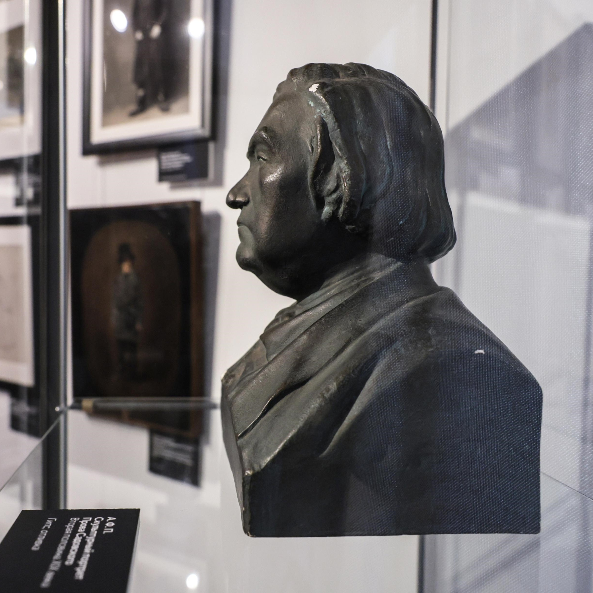{ width="260" }

[Исходное изображение](https://www.bakhrushinmuseum.ru/wp-content/uploads/2026/08/prov-sadovskijj-kv.jpg).

**Р-С-04.** Спектакль «Эй, кто-нибудь» 12+

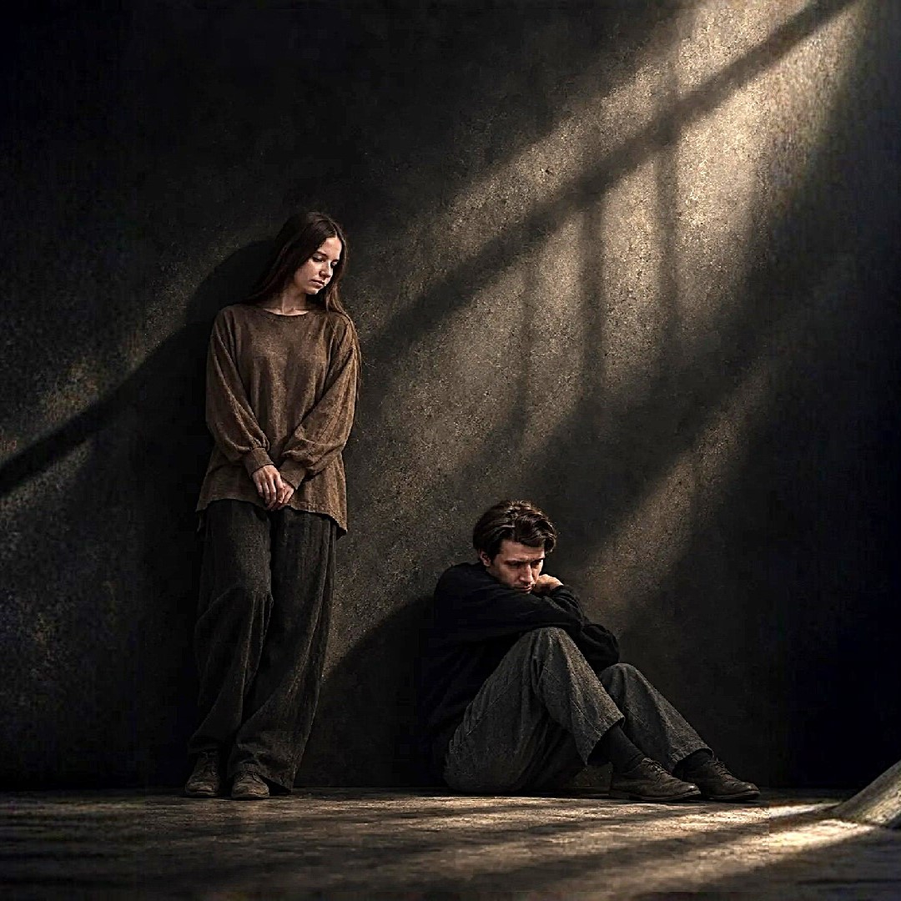{ width="260" }

[Исходное изображение](https://www.bakhrushinmuseum.ru/wp-content/uploads/2026/09/ej-kto-nibud-kv.jpg).

**Р-С-05.** Спектакль «Цветы запоздалые» 12+

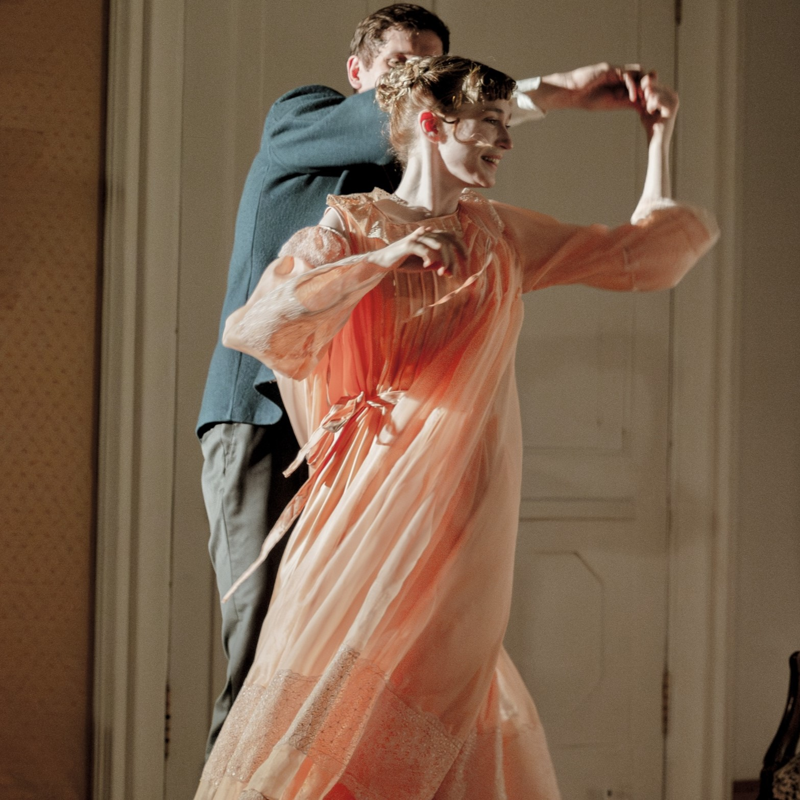{ width="260" }

[Исходное изображение](https://www.bakhrushinmuseum.ru/wp-content/uploads/2025/07/czvety-osnovnoe-foto-kvadrat.jpeg).

**Р-С-06.** Спектакль «В поисках любви» 16+

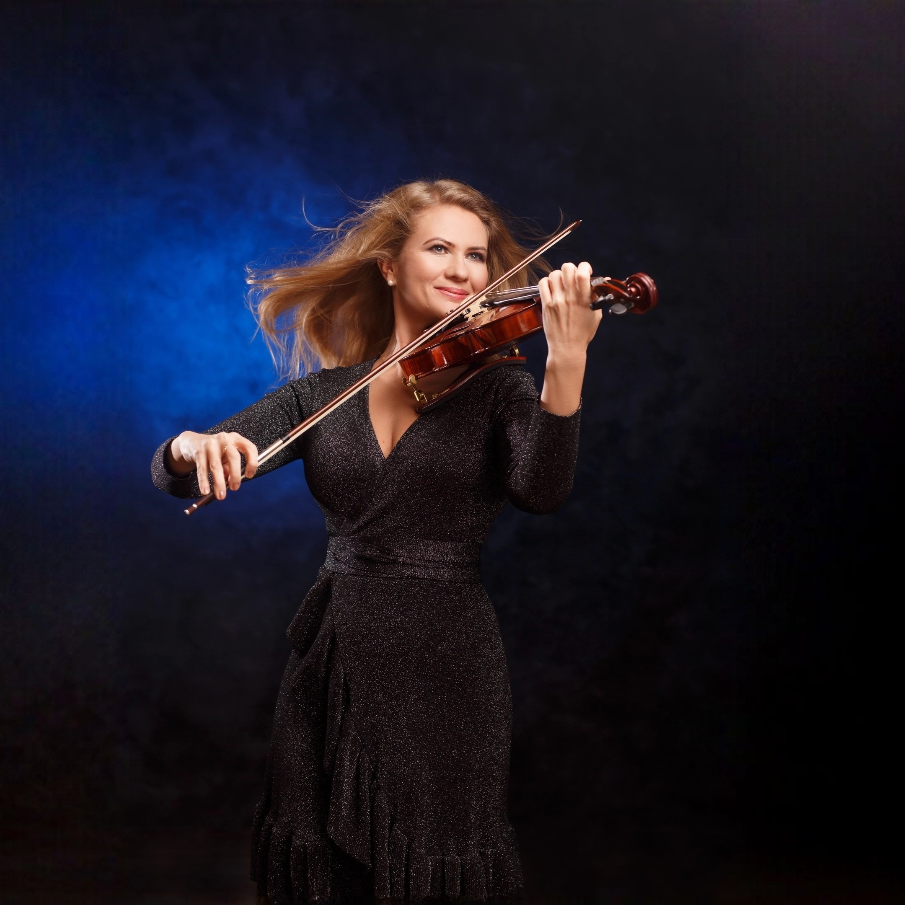{ width="260" }

[Исходное изображение](https://www.bakhrushinmuseum.ru/wp-content/uploads/2026/05/v-poiskah-lyubvi-kv.jpg).

**Р-С-07.** Спектакль «… про Левитана написать никогда не поздно» 16+

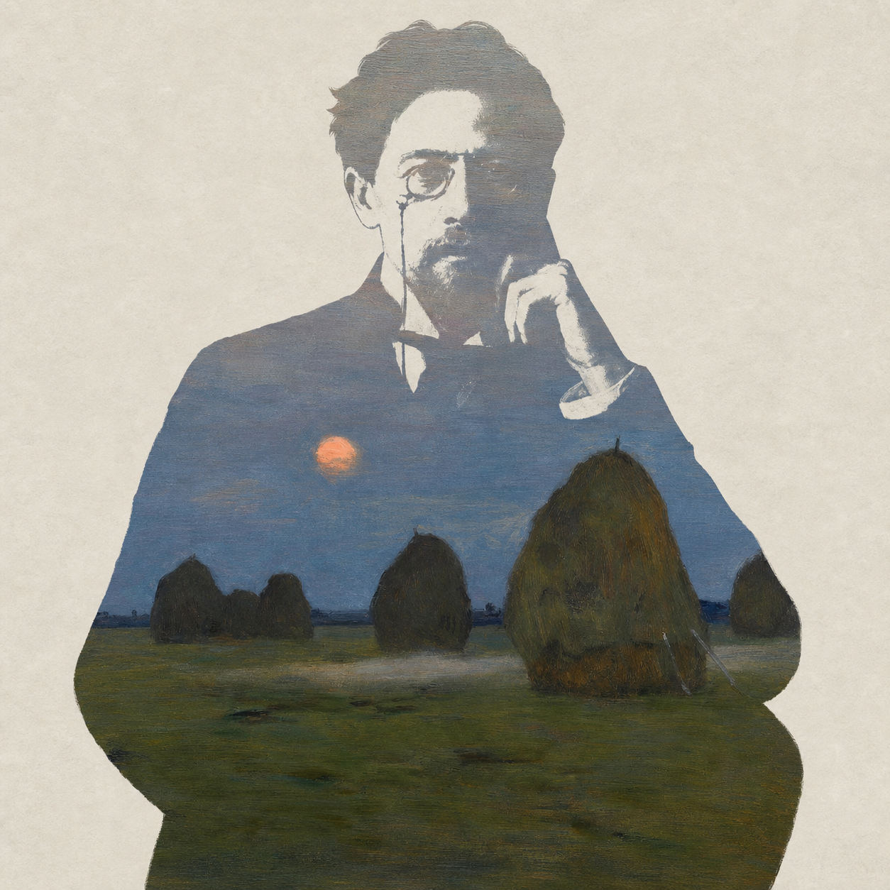{ width="260" }

[Исходное изображение](https://www.bakhrushinmuseum.ru/wp-content/uploads/2026/09/chehov-siluet-2.png).

Даты с годом и типы взяты из [афиши](https://www.bakhrushinmuseum.ru/timetable/), площадки и возраст сверены со страницами событий. В карточке на главной оставляем дату, площадку, изображение, тип, возраст и название; цены и покупку не переносим.

Важные ограничения:

- Р-С-01: на странице события опубликовано предупреждение — **с 20 октября не работает лифт, подъём по лестнице на 6-й этаж**. Не показывать безусловный бейдж доступности. Дата окончания ремонта не указана.
- Р-С-03: период **экскурсии** заканчивается 6 ноября. В новости об отдельной выставке Садовского указано 15 ноября; эти сроки относятся к разным записям и не заменяют друг друга.
- Р-С-04–07 — все четыре записи с типом «Спектакль» в полученной [месячной афише октября](https://www.bakhrushinmuseum.ru/timetable/?action=eventfilter&is_main_page=0&is_lang_ru=1&eventsType=0&eventsPlace=0&eventsDate=month&eventsLayout=grid). При повторной проверке 15.10.2026 страница загрузилась за 28 секунд: в выдаче 25 событий, из них четыре спектакля. Даты с годом, время и тип взяты непосредственно из этой выдачи; названия, возраст, время и площадка сверены с прямыми страницами трёх добавленных событий. Р-С-04 был сверён с прямой страницей ранее; его присутствие и сеанс повторно подтверждены в месячной выдаче. Изображения всех четырёх спектаклей сохранены локально. Это полнота полученной выдачи на дату проверки, не архив всех постановок музея.
- Существующие изображения подходят для подбора содержания. Возможность вырезать из них образы для коллажа и качество широкого кадра ещё нужно проверить; мобильные варианты не получены.

## Г-04. Коллекции: текст и предметы

Целевой переход для рабочего макета — [«Коллекция»](https://www.bakhrushinmuseum.ru/collections/). Страница содержит отделы фондов, а отдельный [онлайн-каталог](https://collectiononline.bakhrushinmuseum.ru/) указан в навигации музея. Не смешиваем эти два назначения.

**Предлагаемый текст анонса, редакционная адаптация:** «Эскизы декораций и костюмов, театральные портреты, афиши, программы и мемориальные предметы — познакомьтесь с коллекцией Бахрушинского музея». Основание — перечень фондов на странице коллекции и описание [отдела декорационно-изобразительных материалов](https://www.bakhrushinmuseum.ru/collection/otdel-dekoratsionno-izobrazitelnyih-materialov/). Это наш краткий текст, не цитата музея. Кнопка по ТЗ: «Узнать больше».

Для предметной композиции можно использовать следующие реальные работы из публикации отдела:

| Автор | Предмет / постановка | Данные публикации |
| --- | --- | --- |
| К.А. Коровин | Эскиз декорации к «Демону» А.Г. Рубинштейна | Первый акт, первая картина; Мариинский театр, 1903; оформление совместно с А.Я. Головиным |
| А.Я. Головин | Голубой Пьеро, эскиз мужского костюма к «Маскараду» | Александринский театр, Петроград, 1917 |
| Ф.Ф. Федоровский | Боярыни берендейки, эскиз костюмов к «Снегурочке» | Московская опера С.И. Зимина; премьера 18 октября 1910 года |

Подписи подтверждены страницей отдела. Ссылки её галереи ведут также на технический домен `bakhrushinmuseum.ru.mastertest.ru`; пригодные оригиналы изображений для этих трёх предметов пока не получены. Не присваивать им случайные картинки из других выставок. Инвентарные номера и условия атрибуции нужно запросить; предметы здесь — материалы декоративной композиции, не новые интерактивные карточки главной.

## Г-05. Здания и филиалы {#real-places}

[Источник названий, адресов и иллюстраций — «Филиалы и здания»](https://www.bakhrushinmuseum.ru/branches/). Для примера карточки основного объекта выбран Главный дом, для раскрытого списка филиалов — Щепкин, Плисецкая и Зарайск. Это не подтверждает состав будущего музейно-театрального квартала.

| ID | Объект и целевая страница | Адрес для карточки | Ограничение |
| --- | --- | --- | --- |
| Р-О-01 | [Главный дом](https://www.bakhrushinmuseum.ru/branch/gctm/) | Москва, ул. Бахрушина, д. 31/12, стр. 1 | На сайте размещено сообщение о закрытии на реставрацию с 21.03.2022; не писать «Открыто» |
| Р-О-02 | [Дом-музей М.С. Щепкина](https://www.bakhrushinmuseum.ru/branch/dom-muzey-m-s-shhepkina/) | Москва, ул. Щепкина, д. 47, стр. 2 | Бейджи удобств не подтверждены |
| Р-О-03 | [Музей-квартира М.М. Плисецкой](https://www.bakhrushinmuseum.ru/branch/dmp/) | Москва, ул. Тверская, д. 25/9, кв. 31, 2 подъезд, вход со стороны Мамоновского переулка | См. предупреждение о лифте у Р-С-01 |
| Р-О-04 | [Бахрушинский театральный музей. Зарайск](https://www.bakhrushinmuseum.ru/branch/teatralnyiy-muzey-v-zarayske/) | Зарайск, ул. Красноармейская, д. 51 | Не относить к московскому кварталу |

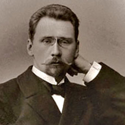{ width="200" }
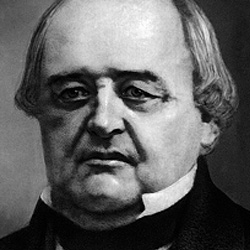{ width="200" }

Изображение Зарайска в списке — **портрет**, а не фотография здания: [сохранённый файл](assets/references/place-zaraysk.png). Для карточки объекта нужен другой, подтверждённый снимок. Доступность, парковку, Wi-Fi, кафе и другие удобства по этим материалам не устанавливаем. Наличие таких бейджей в ТЗ не позволяет придумать их значения.

### Пространства музейно-театрального квартала {#quarter-internet}

!!! info "Информация из интернета · проверено 15 октября 2026 года"
    Подборка составлена по публичным публикациям музея и проектировщика. Это сведения для наполнения макета, не утверждённый Заказчиком реестр объектов. В источниках описаны планы и концепции; открытие всех пространств, точные адреса входов, часы работы и доступность не подтверждены.

В [публикации музея от 17.05.2025](https://www.bakhrushinmuseum.ru/2025/05/17/fondy-bahrushinskogo-muzeya-pereezzhayut-v-novoe-vysokotehnologicheskoe-fondohranilishhe/) перечислены шесть пространств квартала. Подборка дополнена адресами зданий, описаниями и изображениями. Короткие описания ниже — наша редакционная адаптация источников, не дословные музейные аннотации.

| ID | Пространство | Адрес здания для макета | Основание |
| --- | --- | --- | --- |
| Р-К-01 | Музей истоков русского театра | Москва, ул. Бахрушина, д. 29 | Назначение именно дома №29 указано в [The Art Newspaper Russia, 25.01.2024](https://www.theartnewspaper.ru/posts/20240125-gcky/) |
| Р-К-02 | Дом-музей Бахрушина | Москва, ул. Бахрушина, д. 31/12, стр. 1 | [Страница Главного дома](https://www.bakhrushinmuseum.ru/branch/gctm/); та же запись здания, что Р-О-01 |
| Р-К-03 | Музей детского и кукольного театров | Москва, ул. Бахрушина, д. 27 | Назначение дома №27 указано в [The Art Newspaper Russia, 25.01.2024](https://www.theartnewspaper.ru/posts/20240125-gcky/) |
| Р-К-04 | Детский центр | Москва, ул. Бахрушина, д. 31/12, стр. 2 — рабочее сопоставление | Музей помещает центр в исторический флигель; адрес флигеля указан в документах усадьбы. Прямое подтверждение пары «центр — строение 2» не найдено |
| Р-К-05 | Театральная лаборатория / Каретный сарай | Москва, ул. Бахрушина, д. 31/12, стр. 3 | Назначение — [Бюро А4](https://a4arch.ru/interer-karetnogo-saraya-teatralnogo-muzeya-im-aa-bahrushina); адрес здания — [акт экспертизы на mos.ru](https://www.mos.ru/upload/documents/files/3715/GIKE_Bahryshinas3%28Karetniisarai%29.pdf) |
| Р-К-06 | Центр театральной истории | Москва, ул. Татарская, д. 20 | Адрес указан в [программе конференции музея на Timepad](https://teatralnyy-muzey-bakhrush.timepad.ru/event/3669096/) и [программе стажировки 2024 года](https://www.bakhrushinmuseum.ru/wp-content/uploads/2024/11/programma-stazhirovki_2024-.pdf) |

Адрес здания не равен инструкции для входа: конкретные двери, пропускной режим и доступный маршрут уточняются отдельно. Для Р-К-04 адрес остаётся выводом из двух источников, а не подтверждённым фактом о центре.

#### Р-К-01. Музей истоков русского театра

**Текст для карточки:** «История рождения русского театра — в историческом особняке на улице Бахрушина».

**Основание описания:** [сообщение о концепции квартала, Интерфакс, 22.11.2023](https://www.interfax.ru/culture/932724). В публикации речь о планируемой экспозиции; дату открытия из старого анонса не переносим.

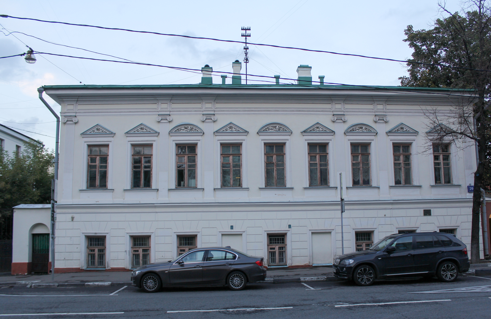{ width="420" }

**Иллюстрация:** фасад здания по нужному адресу, снимок **2015 года, до нынешней реставрации**. Это изображение здания, а не действующей экспозиции. Автор Stolbovsky, [страница файла](https://commons.wikimedia.org/wiki/File:Bakhrushina_street,_29.jpg), [CC BY-SA 4.0](https://creativecommons.org/licenses/by-sa/4.0/), сохранено без изменений. Для финального макета предпочтителен новый снимок после реставрации.

**Переход:** самостоятельная страница пространства не найдена; пока собран источник для будущего текста страницы. **Статус:** подтверждена проектная функция здания; текущее открытие не установлено.

#### Р-К-02. Дом-музей Бахрушина

**Текст для карточки:** «Неоготический особняк основателя музея и история его театрального собрания».

{ width="250" }

**Адрес и переход «Узнать больше»:** [Главный дом — ул. Бахрушина, д. 31/12, стр. 1](https://www.bakhrushinmuseum.ru/branch/gctm/). История основателя и здания описана на этой странице. Изображение уже взято из списка зданий музея; доступное превью — 250 × 250, для крупной карточки нужен оригинал. Автор и условия использования в карточке источника не указаны.

**Статус:** на сайте размещено уведомление о реставрации; не ставим отметку «Открыто». Рабочий заголовок пространства из перечня квартала не означает, что действующая страница уже переименована музеем.

#### Р-К-03. Музей детского и кукольного театров

**Текст для карточки:** «История детского театра и искусства театральной куклы в историческом доме на Бахрушина».

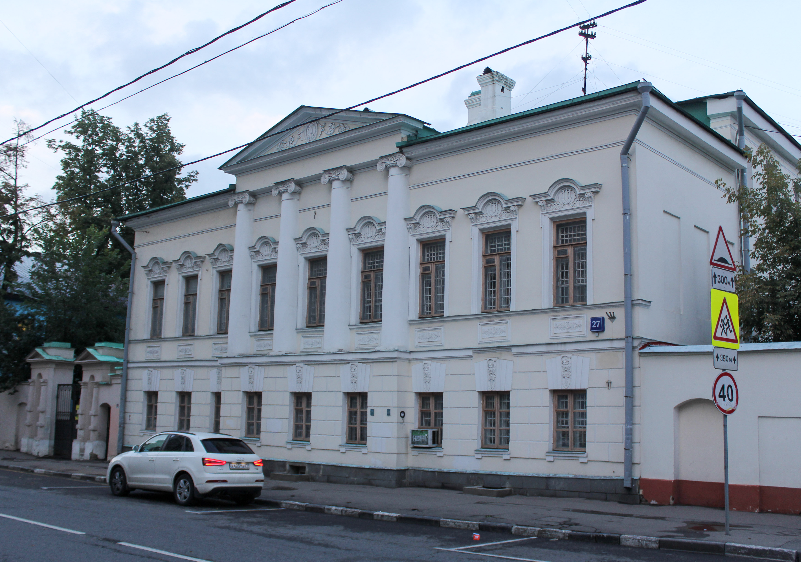{ width="420" }

**Иллюстрация:** здание на ул. Бахрушина, 27; **снимок 2015 года, до нынешней реставрации**. Автор Stolbovsky, [страница файла](https://commons.wikimedia.org/wiki/File:Bakhrushina_street,_27_1.jpg), [CC BY-SA 4.0](https://creativecommons.org/licenses/by-sa/4.0/), сохранено без изменений. Не выдаём за фотографию новой экспозиции.

**Переход:** самостоятельная публичная страница пространства не найдена. [Публикация о распределении зданий](https://www.theartnewspaper.ru/posts/20240125-gcky/) подтверждает проектное назначение; нынешний статус посещения требует проверки.

#### Р-К-04. Детский центр

**Текст для карточки:** «Знакомство с театральными профессиями через игру, мастер-классы и подготовку собственного спектакля».

**Подтверждённое содержание:** музей описывает программу «Что такое театр? Мир театральных профессий» для детей **4–9 лет** и размещение московского центра в историческом флигеле XIX века. Источник — [публикация музея об «Интермузее 2025», 30.05.2025](https://www.bakhrushinmuseum.ru/2025/05/30/bahrushinskij-teatralnyj-muzej-na-intermuzee-2025-innovaczii-v-obrazovanii-nasledie-v-dejstvii-teatr-kak-put-k-kulture/). Возраст относится к программе, не ко всем посетителям здания.

**Адрес:** ул. Бахрушина, д. 31/12, стр. 2 — рабочее сопоставление флигеля по [документам усадьбы](https://base.garant.ru/71346126/de40175ab12d04d68f792b5b742a18fc/). Документ 2016 года утратил силу; здесь он используется только как исторический источник подписей к фотографиям и адреса. Назначение центра по этому адресу нужно подтвердить.

**Изображение:** по той же ссылке есть фотографии №4 и №5 с прямой подписью строения 2. Сохранён также [кандидат — фрагмент фасада флигеля](assets/references/quarter-wing.jpg), автор Andrey Filippov, 29.07.2018, [CC BY 2.0](https://creativecommons.org/licenses/by/2.0/). [Источник снимка на Commons](https://commons.wikimedia.org/wiki/File:Усадьба_Бахрушина_А._А._(государственный_центральный_музей_театрального_искусства),_флигель_(43066143514).jpg) описывает «флигель по Зацепскому Валу», но не указывает номер строения. Поэтому кандидат пока не назначен изображением Детского центра; пригодный точный снимок остаётся открытым полем.

**Переход для рабочего макета:** «Узнать больше» → публикация музея о программе; это временный публичный материал, не окончательная внутренняя страница центра. **Статус:** работа центра по регулярному расписанию не подтверждена.

#### Р-К-05. Театральная лаборатория / Каретный сарай

**Текст для карточки:** «Экспериментальное театральное пространство для постановок, лекций и мастер-классов».

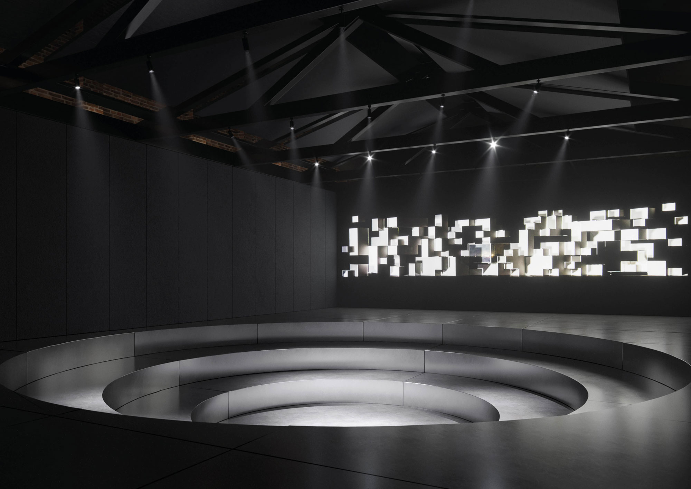{ width="420" }

**Иллюстрация — проект, не фотография реализованного интерьера:** опубликована [Бюро А4 в концепции 2021 года](https://a4arch.ru/interer-karetnogo-saraya-teatralnogo-muzeya-im-aa-bahrushina). [Исходный файл](https://cdn-st2.vigbo.com/u53873/66414/blog/6393000/6072949/section/0bd7571cebc8eb9d28700f2dc219e600.jpg), 2000 × 1414; сохранён без изменений. Открытая лицензия не указана; использование в итоговых материалах требует подтверждения. Описание карточки передаёт проектное назначение, а не обещание действующей программы.

**Адрес здания:** ул. Бахрушина, д. 31/12, стр. 3. **Переход «Узнать больше»:** [страница Каретного сарая на сайте музея](https://www.bakhrushinmuseum.ru/karetnyiy-saray/). Она содержит историю здания и сведения о прежнем выставочном зале, поэтому не подтверждает реализацию всей новой концепции лаборатории.

#### Р-К-06. Центр театральной истории

**Текст для карточки:** «Выставочное и исследовательское пространство Бахрушинского музея на Татарской улице».

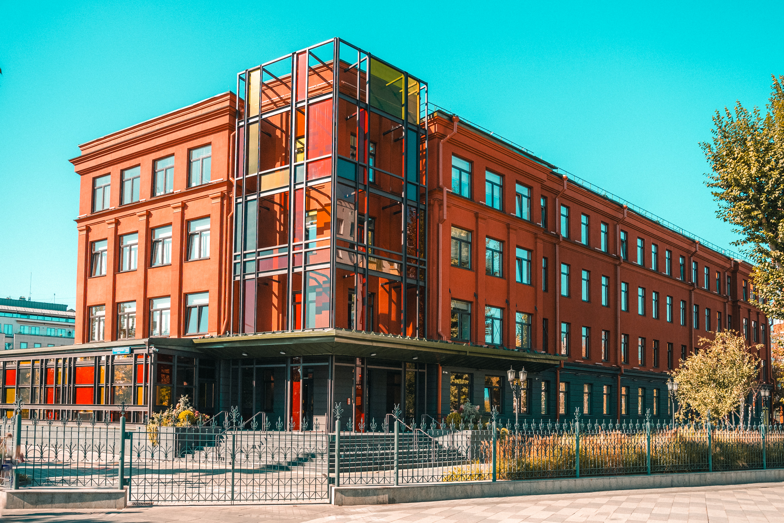{ width="420" }

**Адрес:** Москва, ул. Татарская, д. 20. Организатор указал его в [анонсе «Бахрушинских чтений — 2025»](https://teatralnyy-muzey-bakhrush.timepad.ru/event/3669096/). Для той конференции действовали пропускная система и требование паспорта; не переносим это автоматически на все будущие посещения.

**Иллюстрация:** фотография Alxklg1 от 30.09.2025, вид с Садового кольца; [страница файла](https://commons.wikimedia.org/wiki/File:Bahrushin-museum-center-teatralnoi-istorii-fall-day-view-from-sadovoe-koltso.jpg), [CC0 1.0](https://creativecommons.org/publicdomain/zero/1.0/), 3070 × 2047, сохранена без изменений.

**Переход для рабочего макета:** «Узнать больше» → [публикация музея о новом фондохранилище](https://www.bakhrushinmuseum.ru/2025/05/17/fondy-bahrushinskogo-muzeya-pereezzhayut-v-novoe-vysokotehnologicheskoe-fondohranilishhe/). Самостоятельная страница пространства не найдена; для будущего сайта она нужна отдельно.

**Статус:** в Центре уже проводились мероприятия, но это не подтверждает свободный ежедневный вход. [Сообщение музея от 24.09.2026](https://www.bakhrushinmuseum.ru/2026/09/24/fondy-bahrushinskogo-teatralnogo-mu/) ограничивает доступ к фондам до завершения переезда в 2027 году. Ограничение относится к фондам и указанным в новости категориям посетителей, а не автоматически ко всем мероприятиям здания.

#### Что ещё найдено и что осталось уточнить

В [интервью директора музея от 26.12.2025](https://www.interfax.ru/interview/1065194) отдельно упомянут **Визит-центр** и уже проведённые мероприятия в галерее Центра театральной истории. Визит-центр — дополнительный кандидат для навигации по кварталу; в основной набор из шести пространств его пока не включаем без утверждённого состава.

Для рабочего макета собраны названия, описания, адреса пяти зданий, рабочее сопоставление адреса Детского центра, фотографии трёх зданий и проектная иллюстрация лаборатории. Фотография Главного дома уже была в подборке. Остались конкретные поля: точный снимок и подтверждение адреса Детского центра, новые фотографии домов №27 и №29 после реставрации, окончательные внутренние URL, режимы работы, входы и бейджи доступности. Это уточнения отдельных карточек, а не отсутствие сведений о квартале в целом. Филиалы Р-О-02–04 остаются отдельным раскрываемым списком.

### Что означает «бейдж доступности / удобства» {#place-badges}

Это короткая текстовая подпись с иконкой у конкретного объекта. Она помогает понять условия посещения. [П. 9.1.3](../../technical-specification/09-01.md#перечень-разрабатываемых-разделов-и-функций) требует бейджи, но не определяет их словарь. Следующие варианты — **наше предложение**, а не установленные свойства зданий:

| Группа | Примеры подписей | Какие сведения нужны |
| --- | --- | --- |
| Доступность | «Вход без ступеней», «Лифт», «Доступный туалет» | Подтверждение для конкретного входа и маршрута посещения; один лифт не доказывает доступность всего здания |
| Удобства | «Гардероб», «Кафе», «Магазин» | Наличие и доступность сервиса посетителям конкретного объекта |

**Найденный пример — информация из интернета:** [страница Каретного сарая на сайте музея](https://www.bakhrushinmuseum.ru/karetnyiy-saray/) сообщает об оснащении выставочного зала для посетителей с нарушениями опорно-двигательного аппарата. Для рабочего макета возможна подпись «Оборудован для посетителей с нарушениями ОДА», но источник не описывает конкретный маршрут и не подтверждает текущие условия после реконструкции. Более узкие подписи «Пандус» или «Доступный туалет» из этой формулировки не следуют.

Предупреждения «Лифт не работает с 20 октября» или «Закрыто на реставрацию» показываем отдельно как ограничения посещения. Они не заменяют бейджи удобств. Неизвестное значение свойства не означает «Нет»; до подтверждения не ставим положительный или отрицательный бейдж.

## Г-06. Новости и подписка {#real-news}

Для макета достаточно трёх свежих записей из [ленты новостей](https://www.bakhrushinmuseum.ru/news/). Дата ниже — дата публикации, не дата события.

| ID | Заголовок / полный текст | Дата | Изображение из карточки главной |
| --- | --- | --- | --- |
| Р-Н-01 | [Бахрушинский музей представил выставку «Эффект Оперы Зимина» к 150-летию основателя Частной оперы](https://www.bakhrushinmuseum.ru/2026/10/08/bahrushinskij-muzej-predstavil-vystavku-effekt-opery-zimina-k-150-letiyu-osnovatelya-chastnoj-opery/) | 08.10.2026 | [Оригинал](https://www.bakhrushinmuseum.ru/wp-content/uploads/2026/10/img_5071.jpg) |
| Р-Н-02 | [Бахрушинский музей принимает участников 14 сезона Олимпиады «Музеи. Парки. Усадьбы»](https://www.bakhrushinmuseum.ru/2026/10/02/bahrushinskij-muzej-prinimaet-uchastnikov-14-sezona-olimpiady-muzei-parki-usadby/) | 02.10.2026 | [Оригинал](https://www.bakhrushinmuseum.ru/wp-content/uploads/2026/10/novost_usadba_1350h1350.jpg) |
| Р-Н-03 | [Фонды Бахрушинского театрального музея переезжают в новое высокотехнологичное фондохранилище](https://www.bakhrushinmuseum.ru/2026/09/24/fondy-bahrushinskogo-teatralnogo-mu/) | 24.09.2026 | [Оригинал](https://www.bakhrushinmuseum.ru/wp-content/uploads/2025/05/unnamed-file-4.jpg) |

Подписка уже имеет публичный [адрес](https://www.bakhrushinmuseum.ru/subscribe/) и подпись «Подписаться на рассылку». В полученном HTML формы виден текст «Загрузка…»; состав полей и согласий, подтверждение адреса и ответы сервиса не установлены. Для макета используем проектные состояния из Г-06; не выдаём их за извлечённый процесс музея. Подписка при исследовании не отправлялась.

## Г-07. Реальный материал для промо

**Тема:** участие в 14 сезоне Олимпиады «Музеи. Парки. Усадьбы». [Публикация музея от 02.10.2026](https://www.bakhrushinmuseum.ru/2026/10/02/bahrushinskij-muzej-prinimaet-uchastnikov-14-sezona-olimpiady-muzei-parki-usadby/), [готовый баннер из слайдера главной](https://www.bakhrushinmuseum.ru/wp-content/uploads/2026/10/slajder_usadba_841h400.jpg).

Предлагаемые тексты для макета (редакционная адаптация):

- Заголовок: «Музеи. Парки. Усадьбы».
- Описание: «Выполняйте задания олимпиады в филиалах Бахрушинского музея. 14 сезон — до 31 марта 2027 года».
- Кнопка: «Как участвовать» → публикация музея.

В источнике перечислены Мастерская Боровского, Дом-музей Щепкина и музей в Зарайске; нужна регистрация на сайте олимпиады. Для Дома Щепкина есть оговорка о закрытии с 10 ноября по 10 января для новогоднего мероприятия. Полные условия остаются на странице материала. Здесь промо использует ту же публикацию, что Р-Н-02, — отдельное событие или второй набор фактов не придумываем.

## Г-08. Товары для витрины {#real-products}

Названия, цены, изображения и категории прочитаны в [каталоге магазина](https://shop.bakhrushinmuseum.ru/), в том числе в атрибутах товарных карточек HTML. Цена — снимок на дату просмотра; наличие и варианты размеров для макета не обещаем. Кнопки добавления в корзину при исследовании не использовались.

| ID | Товар / переход | Категория на сайте | Цена | Изображение |
| --- | --- | --- | --- | --- |
| Р-Т-01 | [Футболка «Иван Билибин. Девушка в пестром сарафане»](https://shop.bakhrushinmuseum.ru/product/sample-product/%d1%84%d1%83%d1%82%d0%b1%d0%be%d0%bb%d0%ba%d0%b0-%d0%b8%d0%b2%d0%b0%d0%bd-%d0%b1%d0%b8%d0%bb%d0%b8%d0%b1%d0%b8%d0%bd-%d0%b4%d0%b5%d0%b2%d1%83%d1%88%d0%ba%d0%b0-%d0%b2-%d0%bf%d0%b5%d1%81%d1%82%d1%80/) | Одежда | 2 999 ₽ | [Оригинал](https://shop.bakhrushinmuseum.ru/wp-content/uploads/2026/06/%D1%8400-00000103_3330-300x300.jpg) |
| Р-Т-02 | [Брелок-лента «Иван Билибин. Воины», черный](https://shop.bakhrushinmuseum.ru/product/sample-product/%d0%b1%d1%80%d0%b5%d0%bb%d0%be%d0%ba-%d0%bb%d0%b5%d0%bd%d1%82%d0%b0-%d0%b8%d0%b2%d0%b0%d0%bd-%d0%b1%d0%b8%d0%bb%d0%b8%d0%b1%d0%b8%d0%bd-%d0%b2%d0%be%d0%b8%d0%bd%d1%8b-%d1%87%d0%b5%d1%80%d0%bd/) | Аксессуары | 399 ₽ | [Оригинал](https://shop.bakhrushinmuseum.ru/wp-content/uploads/2026/07/DSC_3356-300x300.jpg) |
| Р-Т-03 | [Сувенирная банкнота «К 100-летию М.М. Плисецкой»](https://shop.bakhrushinmuseum.ru/product/sample-product/%d1%81%d1%83%d0%b2%d0%b5%d0%bd%d0%b8%d1%80%d0%bd%d0%b0%d1%8f-%d0%b1%d0%b0%d0%bd%d0%ba%d0%bd%d0%be%d1%82%d0%b0-%d0%ba-100-%d0%bb%d0%b5%d1%82%d0%b8%d1%8e-%d0%bc-%d0%bc-%d0%bf%d0%bb%d0%b8%d1%81%d0%b5/) | Сувениры | 2 600 ₽ | [Оригинал](https://shop.bakhrushinmuseum.ru/wp-content/uploads/2025/12/129A3095-Photoroom-1-300x300.png) |

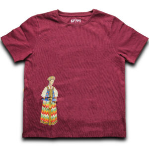{ width="200" }
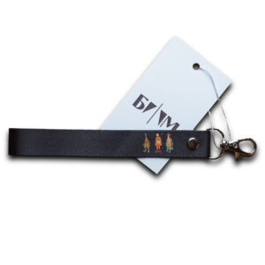{ width="200" }
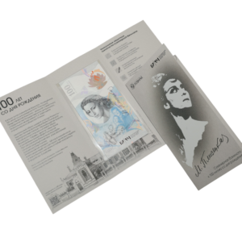{ width="200" }

Реальные адреса вкладок: [Одежда](https://shop.bakhrushinmuseum.ru/product-category/odezhda/), [Аксессуары](https://shop.bakhrushinmuseum.ru/product-category/aksessuary/), [Сувениры](https://shop.bakhrushinmuseum.ru/product-category/suveniry/); «Все» → главная магазина. В магазине есть и другие категории, но набор вкладок будущей главной сохраняем по ТЗ. Сохранённые товарные превью имеют размер 300 × 300; для крупного показа нужны оригиналы.

## Г-09. Контакты и официальные ссылки

Значения опубликованы в шапке, контактном блоке и подвале [русской главной](https://www.bakhrushinmuseum.ru/):

| Поле | Подтверждённое значение / адрес |
| --- | --- |
| Название организации | Государственный центральный театральный музей имени А. А. Бахрушина |
| Адрес | 115054, Москва, ул. Бахрушина, д. 31/12, стр. 1; метро «Павелецкая» |
| Справки и заказ экскурсий | +7 (499) 484-77-77 |
| Телефон для регионов | 8 800 777-74-84 |
| Режим Главного дома | На сайте — закрытие на реставрацию с 21 марта 2022 года; единые часы для всех филиалов не установлены |
| Социальные каналы | [ВКонтакте](https://vk.com/bahrushinmuseum), [MAX](https://max.ru/bahrushinmuseum), [Дзен](https://dzen.ru/bahrushinmuseum) |
| Официальные переходы | [Минкультуры России](https://culture.gov.ru/), [Официальные документы](https://www.bakhrushinmuseum.ru/oficialnye_dokumenty/), [Годовые отчёты](https://www.bakhrushinmuseum.ru/godovyie-otchyotyi/), [Профилактика коррупции](https://www.bakhrushinmuseum.ru/profilaktika-korruptsii/) |
| Правовые переходы | [Политика обработки ПДн](https://www.bakhrushinmuseum.ru/politika-obrabotki-personalnyh-dannyh/), [Правила приобретения и возврата билетов](https://www.bakhrushinmuseum.ru/polzovatelskoe-soglashenie/) |

Это подтверждение наличия ссылок в навигации, не аудит актуальности документов или внешних каналов. Контактный email, адрес карты сайта и будущие версии согласий в этой выборке не подтверждены. Адрес перехода и изображение Культура.РФ дополнительно получены из подвала сайта 16.10.2026 и сохранены в `navigation.json`. Не заменять email музея адресом автора текущего сайта из копирайта.

## Готовность содержания

Для компоновки подготовлены [JSON с расширенной подборкой](#json-data): 10 событий, 16 товаров, 12 предметов коллекции, 10 объектов, три новости и промо олимпиады. Изображения предметов и фотография здания в Зарайске получены; у товаров сохранены самые крупные варианты из `srcset` каталога, от 300 × 300 до 768 × 768. Для полного макета остаются: утверждение состава квартала, подтверждение адреса и точного изображения Детского центра, актуализация снимков домов №27/29 и внутренних URL, подтверждённые бейджи удобств, крупные оригиналы там, где каталожного размера недостаточно, контакты и недостающие сервисные URL. Незаполненные поля не означают отсутствие услуги или материала у музея.

Изображения сохранены без редактирования для подготовки макета; ссылка на исходный файл дана рядом с записью. Для фотографий Главного дома и Щепкина — [оригинал Главного дома](https://www.bakhrushinmuseum.ru/wp-content/uploads/2016/03/bachroushin.jpg), [оригинал Дома Щепкина](https://www.bakhrushinmuseum.ru/wp-content/uploads/2016/03/schepkin.jpg); [исходная иллюстрация Зарайска](https://www.bakhrushinmuseum.ru/wp-content/uploads/2016/08/kp-293626.-zh-177.-portret.-neizvestnyj-hudozhnik.-bahrushin-a.-a.-1890-e-gg.-kopiya_2.png). Публичная публикация не заменяет подтверждение прав и атрибуции для итоговых материалов.

[Подготовка экранов](screens.md) · [Дизайн код](references.md) · [Макеты](mockups.md)
