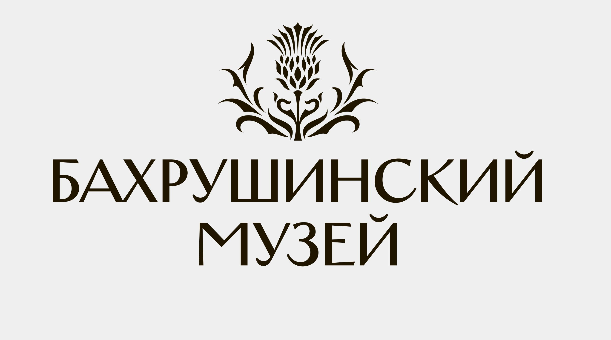
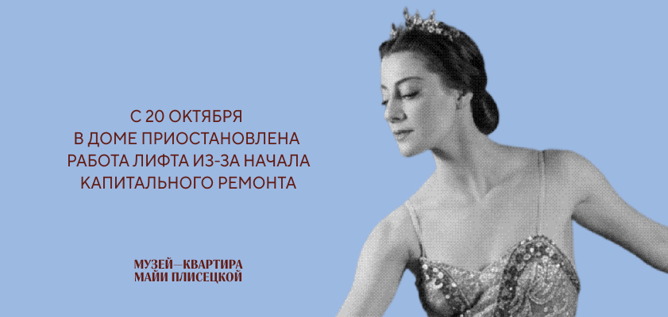
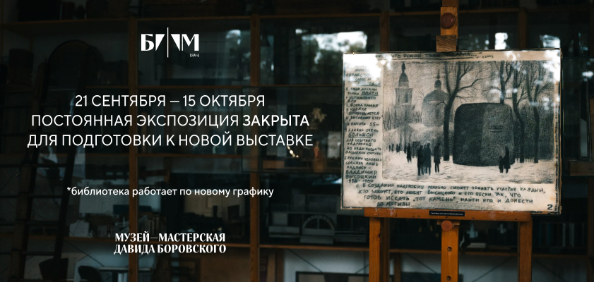

# Дизайн код

Подготовительный сбор для предложения №5. Дата просмотра: **15 октября 2026 года**. Источники — публичная русская главная музея, её HTML, таблица стилей и опубликованные изображения. Это наблюдения о действующем сайте; соответствие брендбуку и ранее утверждённому макету пока не проверено.

## Что удалось установить

На [русской главной музея](https://www.bakhrushinmuseum.ru/) одновременно используются разные визуальные решения: растительная эмблема в шапке, знак «Б/М 1894» на одном из баннеров, фотографии экспозиций и архивные портреты. Нельзя считать один из этих вариантов единственным утверждённым стилем без исходных материалов Заказчика.

### Логотипы {#logos}

{ width="420" }

В шапке — растительная эмблема и двухстрочная надпись «Бахрушинский музей». [Оригинал JPG](https://www.bakhrushinmuseum.ru/wp-content/uploads/2020/04/bm_logo_full.jpg), в HTML указан размер показа 200 × 105; сам файл — 2657 × 1481. Дата в пути файла не подтверждает дату утверждения знака. Цвет фона встроен в растровый файл.

На баннере мастерской Боровского ниже виден другой знак: белая композиция «Б/М» с вертикальной чертой и датой 1894. Это подтверждает наличие другого варианта в публичных материалах, но не его статус в брендбуке.

**Версия без фона для макетов:** [SVG с изменяемым цветом](assets/references/logo-transparent.svg) · [прозрачный PNG, 2176 × 1112](assets/references/logo-transparent.png).

Подготовлено 15 октября 2026 года по просьбе пользователя: одноцветная векторизация контуров публичного JPG, без встроенного фона, с обрезкой лишних внешних полей. Эмблема и надпись переведены в кривые; шрифты для отображения не нужны. Это рабочая производная от растра, а не официальный векторный исходник: возможны небольшие отклонения контуров.

В SVG все контуры используют `fill="currentColor"`. В редакторе можно перекрасить весь знак одной заливкой; при вставке SVG прямо в HTML цвет задаётся CSS-свойством `color`. При подключении через `` цвет родительского элемента внутрь SVG не передаётся: для такой вставки нужно заменить `currentColor` в файле на нужный HEX. PNG экспортирован из SVG чёрным цветом с прозрачностью.

**Для макета:** запросить официальные векторные исходники, основной и компактный варианты, правила фона, минимального размера и охранного поля. Рабочая векторизация не подтверждает соответствие брендбуку; надпись не набиралась заново.

### Цвета интерфейса

Значения прочитаны из [основной таблицы стилей](https://www.bakhrushinmuseum.ru/wp-content/themes/gctm/static/app/css/build.css) и встроенных стилей русской главной. Это цвета текущей реализации, а не установленная палитра бренда.

| Цвет | RGB | Где найден | Как использовать при подготовке |
| --- | --- | --- | --- |
|  `#343E79` | 52, 62, 121 | Встроенный стиль `.button-min`: кнопки магазина и покупки билета | Кандидат на основной акцент, требует сверки с брендбуком |
|  `#3D3D3D` | 61, 61, 61 | Основной текст `body` в CSS | Референс тёмного текста |
|  `#FFFFFF` | 255, 255, 255 | Фон `body`, текст кнопок | Референс светлой основы |
|  `#EFEFEF` | 239, 239, 239 | Фон элементов Hero | Референс вспомогательной поверхности |
|  `#C0C0C0` | 192, 192, 192 | Контакты шапки и часть служебных элементов в CSS | Не переносить автоматически в мелкий текст: нужна проверка контраста |

Во встроенных стилях также есть  `#722F37` для `.sub_btn`; присутствие правила само по себе не доказывает использование цвета в видимом блоке главной. Цвета социальных сетей и государственных виджетов не включены в палитру музея.

### Шрифты

| Источник | Объявленные семейства | Что подтверждено |
| --- | --- | --- |
| Основной CSS | `pf_dintext_proregular`, `pf_dintext_probold` | Назначены основному тексту и жирному начертанию |
| Основной CSS | `intro_regular` | Назначен заголовкам, навигации и ряду служебных элементов |
| Встроенный стиль главной | `Inter`, резервный `sans-serif` | Назначен кнопкам `.button-min`; загрузка Inter и фактический рендеринг этим шрифтом не подтверждены |

CSS содержит объявления `@font-face` для Intro и PF DinText Pro. Это не подтверждение лицензии на использование в новых материалах. Подключения шрифтов плагинов и сторонних виджетов не считаем указанием фирменной типографики. Шрифт надписи в растровом логотипе по этому исследованию не определён.

## Изображения и афиши

### Архивный портрет в информационном баннере

[Оригинал, 841 × 400](https://www.bakhrushinmuseum.ru/wp-content/uploads/2026/10/slajder_lift_841h400.jpg). Чёрно-белый портрет на голубом фоне, текстовое сообщение слева, подпись музея-квартиры. Это служебное объявление о лифте, а не афиша события: для будущей главной полезен композиционный приём, содержание переносить не следует.

### Фотография экспозиции и компактный знак

[Оригинал, 841 × 400](https://www.bakhrushinmuseum.ru/wp-content/uploads/2026/09/slajder_borovskij_2_841h400.jpg). Фотография музейного пространства, белый знак «Б/М 1894», сообщение о закрытии экспозиции. Показанный срок 21 сентября — 15 октября относится к объявлению на изображении; его нельзя использовать как дату нового события.

Оба изображения сохранены локально без редактирования для исследования. Публичная доступность не подтверждает права на включение в итоговую заявку или новый сайт: исходники, атрибуцию и условия использования нужно уточнить по материалам Заказчика.

## Материалы для наполнения

Реальные события, коллекции, объекты, новости, промо, товары и контакты собраны на отдельной странице [«Наполнение главной страницы»](content.md).

## Что запросить у Заказчика

Основание: [п. 3.4 «Исходные материалы Заказчика»](../../technical-specification/03.md#исходные-материалы-заказчика) перечисляет брендбук, правила фирменного стиля и согласованные дизайн-материалы; [п. 9.1.1](../../technical-specification/09-01.md#дизайн-макеты-основного-сайта) ссылается на ранее утверждённый макет главной.

Текст запроса для отправки организатору закупки:

> Просим предоставить брендбук и правила использования фирменного стиля, указанные в п. 3.4 ТЗ, а также ранее утверждённый макет главной страницы, указанный в п. 9.1.1 ТЗ, для подготовки предложения по п. 2.1.5 порядка оценки. Просим уточнить актуальные версии материалов и применимость вариантов логотипа, представленных на действующем сайте: растительной эмблемы с надписью «Бахрушинский музей» и знака «Б/М 1894». Желательно предоставить редактируемые исходники макета, векторные логотипы, коды фирменных цветов, сведения о шрифтах и условиях их использования.

Запрос подготовлен, но не отправлен. Статус проверки О-5-02 и Т-5-01 остаётся открытым: нужны исходные данные. Эта подборка не является иллюстрированной презентацией концепции и не закрывает обязательный комплект заявки.

[Критерий и оценка](criterion.md) · [Подготовка экранов](screens.md) · [Макеты](mockups.md)
