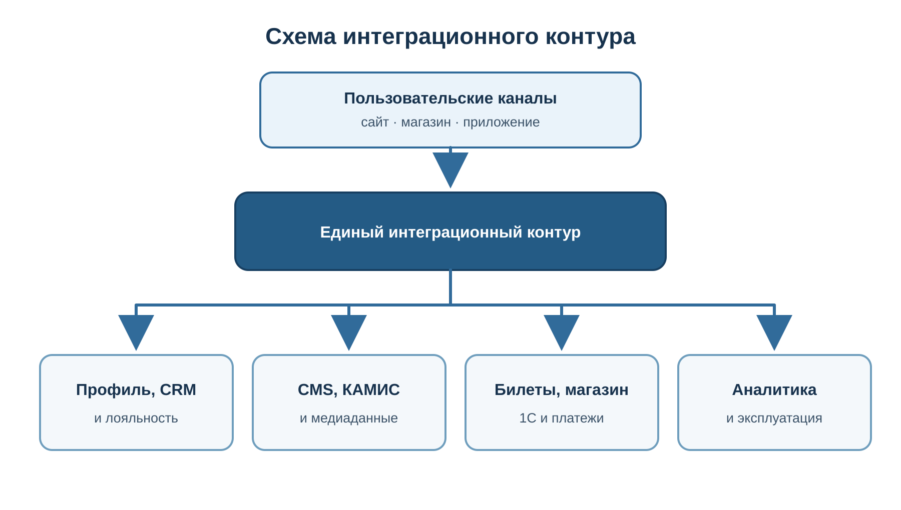

# Техническое задание

<!-- source-content:start -->

Приложение № ___ 
к Контракту № ___ 
от «___» __________ 20__ г.

<strong>ТЕХНИЧЕСКОЕ ЗАДАНИЕ</strong>

<strong>на выполнение работ по созданию, развитию и вводу в
эксплуатацию 
цифровой экосистемы Федерального государственного бюджетного учреждения
культуры 
«Государственный центральный театральный музей имени А. А.
Бахрушина»</strong>

Москва, 2026

## 1. Общие положения {#общие-положения}

### 1.1. Наименование объекта закупки {#наименование-объекта-закупки}

Выполнение работ по созданию, развитию и вводу в эксплуатацию
цифровой экосистемы Федерального государственного бюджетного учреждения
культуры «Государственный центральный театральный музей имени А. А.
Бахрушина» (далее соответственно — Работы, Музей, Заказчик,
Экосистема).

### 1.2. Заказчик и Подрядчик {#заказчик-и-подрядчик}

Заказчиком является Федеральное государственное бюджетное учреждение
культуры «Государственный центральный театральный музей имени А. А.
Бахрушина». Подрядчик определяется по результатам закупки, проводимой в
соответствии с Федеральным законом от 5 апреля 2013 г. № 44-ФЗ «О
контрактной системе в сфере закупок товаров, работ, услуг для
обеспечения государственных и муниципальных нужд».

### 1.3. Предмет и результат Работ {#предмет-и-результат-работ}

Предметом Работ является создание целостной цифровой экосистемы
Музея, объединяющей публичные цифровые продукты, пользовательские
сервисы, интернет-магазин, мобильное приложение, билетные сценарии,
единый личный кабинет, программу лояльности, игровые и мультимедийные
механики, клиентские коммуникации, аналитику, интеграции и
эксплуатационный контур.

Результатом Работ является не процесс разработки и не совокупность
разрозненных программных модулей, а введенная в эксплуатацию,
документированная, безопасная, наблюдаемая и пригодная к дальнейшему
развитию Экосистема, в которой реализованы предусмотренные настоящим
техническим заданием (далее – ТЗ) сквозные пользовательские,
административные и эксплуатационные сценарии.

Закрытие задач, предоставление отчетов о трудозатратах или
демонстрация отдельных экранов не являются самостоятельным
подтверждением выполнения Работ. Результат принимается по требованиям
ТЗ, комплекту передаваемых результатов и приемочным сценариям.

Заказчик является единственным лицом, уполномоченным утверждать
дизайн, набор технологий и оценивать соответствие требованиям, и его
замечания обязательны к исполнению в рамках ТЗ.

### 1.4. Место и сроки выполнения Работ {#место-и-сроки-выполнения-работ}

Место выполнения Работ: по месту нахождения Подрядчика, на объектах и
в информационной инфраструктуре Заказчика, а также дистанционно с
использованием согласованных защищенных каналов доступа.

Работы выполняются в четыре самостоятельных оплачиваемых этапа:

<ol type="1">
<li>
Этап 1 — Декабрьский запуск
</li>
<li>
Этап 2 — Майский запуск
</li>
<li>
Этап 3 — Запуск Экосистемы
</li>
<li>
Этап 4 — Стабилизация экосистемы
</li>
</ol>

Сроки и принимаемые результаты этапов определяются пунктом 17.2.1
настоящего ТЗ. Периоды выполнения комплексов работ и контрольные точки
устанавливаются пунктами 17.2.2 и 17.3. Каждый этап завершается
отдельной приёмкой в соответствии с разделом 18.

Стоимость и порядок оплаты этапов устанавливаются Контрактом.

### 1.5. Разграничение детализирующих документов {#разграничение-детализирующих-документов}

Настоящее ТЗ определяет обязательный состав, объем, характеристики и
результаты Работ. Подрядчик разрабатывает частные технические задания,
спецификации, схемы, протоколы и иные детализирующие документы только в
пределах настоящего ТЗ. Такие документы не могут исключать обязательные
требования, уменьшать или увеличивать объем закупки, изменять состав
Экосистемы, переносить обязательный функционал за пределы Контракта либо
ухудшать установленные показатели.

### 1.6. Общие требования к измеримости {#общие-требования-к-измеримости}

<table style="width:64%;">
<colgroup>
<col style="width: 15%"/>
<col style="width: 26%"/>
<col style="width: 22%"/>
</colgroup>
<thead>
<tr>
<th><strong>Тип требования</strong></th>
<th><strong>Способ описания</strong></th>
<th><strong>Подтверждение</strong></th>
</tr>
</thead>
<tbody>
<tr>
<td>Функциональное</td>
<td>Уникальный идентификатор, роль, канал, предусловия и входные данные,
действия пользователя и системы, основной результат, конечное состояние
данных, исключения и отрицательные ветки, интеграции, аналитические
события и применимые требования доступности</td>
<td>Паспорт сквозного сценария, протокол испытаний, снимки интерфейса,
журналы и трассировка, идентификаторы операций и объектов, сведения из
интегрируемых систем</td>
</tr>
<tr>
<td>Техническое</td>
<td>Архитектурный контур, интерфейс, формат данных, среда</td>
<td>Техническая документация, протокол испытаний, анализ
конфигурации</td>
</tr>
<tr>
<td>Качественное</td>
<td>Показатель качества, допустимый уровень дефектности</td>
<td>Отчет тестирования, классификация дефектов</td>
</tr>
<tr>
<td>Эксплуатационное</td>
<td>Доступность, мониторинг, резервное копирование, RTO/RPO</td>
<td>Данные мониторинга, протокол восстановления</td>
</tr>
<tr>
<td>Правовое</td>
<td>Передача прав, исходников, учетных записей и лицензий</td>
<td>Акты, реестры, документы о правах и доступах</td>
</tr>
</tbody>
</table>

Все функциональные требования должны быть связаны с одним или
несколькими сквозными сценариями и приёмочными проверками. Формулировки
«корректно», «удобно», «успешно», «интуитивно понятно» и аналогичные
оценочные формулировки применяются только совместно с однозначно
проверяемым критерием.

Для применимых пользовательских интерфейсов проверяются состояния
загрузки, отсутствия данных, частичного результата, ошибки,
недоступности внешней системы, успешного завершения, истечения срока
действия и недостаточности прав или разрешений.

### 1.7. Термины и сокращения {#термины-и-сокращения}

<table style="width:64%;">
<colgroup>
<col style="width: 18%"/>
<col style="width: 43%"/>
<col style="width: 2%"/>
</colgroup>
<thead>
<tr>
<th><strong>Термин</strong></th>
<th colspan="2"><strong>Определение</strong></th>
</tr>
</thead>
<tbody>
<tr>
<td>Экосистема</td>
<td colspan="2">Совокупность взаимосвязанных цифровых продуктов,
сервисов, данных, интеграций и средств эксплуатации сайтов Музея, на
условиях п.3.</td>
</tr>
<tr>
<td>Единый пользовательский контур</td>
<td colspan="2">Общий механизм идентификации, авторизации, профиля,
согласий и настроек пользователя.</td>
</tr>
<tr>
<td>Техническое задание (ТЗ)</td>
<td colspan="2">Настоящее Техническое задание, приложенное к
Контракту</td>
</tr>
<tr>
<td>Частное техническое задание (ЧТЗ)</td>
<td colspan="2">Документ, детализирующий требования настоящего
Технического задания применительно к отдельной системе, подсистеме,
компоненту, интеграции или виду работ.</td>
</tr>
<tr>
<td>Личный кабинет (ЛК)</td>
<td colspan="2">Интерфейс самообслуживания пользователя для доступа к
билетам, заказам, бонусам, обращениям и настройкам.</td>
</tr>
<tr>
<td>Система управления содержанием (CMS)</td>
<td colspan="2">Средство создания, редактирования, согласования и
публикации материалов Экосистемы.</td>
</tr>
<tr>
<td>Программный интерфейс (API)</td>
<td colspan="2">Документированный способ автоматизированного
взаимодействия информационных систем.</td>
</tr>
<tr>
<td>Единый вход</td>
<td colspan="2">Авторизация пользователя в нескольких продуктах без
повторного ввода учетных данных в пределах общего сеанса.</td>
</tr>
<tr>
<td>Цифровая копия</td>
<td colspan="2">Файл или набор файлов, воспроизводящих внешний вид,
звук, движение либо иные свойства музейного материала.</td>
</tr>
<tr>
<td>Источник достоверных данных</td>
<td colspan="2">Система или ответственное подразделение, данные которого
признаются первичными для конкретной сущности.</td>
</tr>
<tr>
<td>Тестовая среда</td>
<td colspan="2">Изолированная среда для функционального, интеграционного
и регрессионного тестирования разрабатываемых изменений с использованием
тестовых или обезличенных данных.</td>
</tr>
<tr>
<td>Предпромышленная среда</td>
<td colspan="2">Среда проверки версии перед промышленным выпуском,
максимально близкая к промышленной конфигурации.</td>
</tr>
<tr>
<td>Промышленная среда</td>
<td colspan="2">Среда, в которой Система эксплуатируется реальными
пользователями и обрабатывает реальные данные.</td>
</tr>
<tr>
<td>Наблюдаемость</td>
<td colspan="2">Метрики, журналы, трассировка, панели и оповещения,
позволяющие оценивать и диагностировать состояние системы.</td>
</tr>
<tr>
<td>Перечень программных компонентов (SBOM)</td>
<td colspan="2">Реестр сторонних библиотек, программных компонентов,
версий и лицензий, включенных в поставку.</td>
</tr>
<tr>
<td>Критический сценарий</td>
<td colspan="2">Пользовательский, административный или эксплуатационный
сценарий, нарушение которого делает невозможным предоставление ключевой
услуги или безопасную эксплуатацию.</td>
</tr>
<tr>
<td>Внешняя зависимость</td>
<td colspan="2">Система, услуга, данные, доступ или решение, не
находящиеся под непосредственным управлением Подрядчика по
Контракту.</td>
</tr>
<tr>
<td>Программа и методика испытаний (ПМИ)</td>
<td colspan="2">Документ, разрабатываемый Подрядчиком на основании
настоящего ТЗ и матрицы приёмки и утверждаемый Заказчиком до проведения
испытаний. ПМИ определяет состав, порядок и условия проверок,
используемые тестовые данные, ожидаемые результаты, критерии прохождения
испытаний и необходимые доказательства соответствия Экосистемы
требованиям ТЗ.</td>
</tr>
<tr>
<td>Паспорт сквозного сценария</td>
<td colspan="2">Включённое в ПМИ структурированное описание приёмочной
проверки отдельного сквозного сценария, содержащее условия проведения,
роли и каналы, тестовые данные, последовательность действий, ожидаемые
результаты, отрицательные ветки, перечень доказательств и критерий
«пройдено / не пройдено».</td>
</tr>
<tr>
<td>Обязательный сценарий</td>
<td colspan="2">Сценарий, который должен быть успешно пройден для
итоговой приёмки независимо от присвоенной ему критичности</td>
</tr>
<tr>
<td>Составной сценарий</td>
<td colspan="2">Сценарий, включающий несколько веток, каналов или
операций. Критичность его отдельных веток может различаться и
фиксируется в паспорте сценария</td>
</tr>
<tr>
<td>Инцидент</td>
<td>Незапланированное событие, приведшее либо способное привести к
нарушению доступности, безопасности, целостности данных или выполнения
установленного сценария Экосистемы.</td>
<td></td>
</tr>
<tr>
<td>Дефект</td>
<td>Несоответствие программного кода, конфигурации, интеграции,
интерфейса или документации требованиям ТЗ либо утверждённой
документации.</td>
<td></td>
</tr>
<tr>
<td>Время реакции</td>
<td>Период от автоматического обнаружения или регистрации инцидента до
подтверждения его получения ответственным специалистом, назначения
исполнителя и начала диагностики.</td>
<td></td>
</tr>
<tr>
<td>Обходное решение</td>
<td>Временная мера, позволяющая восстановить выполнение затронутого
сценария до окончательного устранения причины. Наличие обходного решения
не означает окончательного устранения дефекта.</td>
<td></td>
</tr>
<tr>
<td>Восстановление работоспособности</td>
<td>Восстановление выполнения установленных контрольных пользовательских
и интеграционных сценариев, подтверждённое мониторингом и
проверкой.</td>
<td></td>
</tr>
<tr>
<td>Целевое время восстановления (RTO)</td>
<td>Максимально допустимое время от автоматического обнаружения или
регистрации инцидента — в зависимости от того, что произошло раньше, —
до восстановления работоспособности затронутого сервиса или контрольного
сценария по установленному в ТЗ критерию.</td>
<td></td>
</tr>
<tr>
<td>Требования к уровню обслуживания (SLA)</td>
<td>Установленная настоящим ТЗ совокупность измеримых требований к
доступности сервисов, срокам уведомления, реакции, восстановления
работоспособности, предоставления обходного решения и окончательного
исправления, а также к режиму поддержки, эскалации, контролю и
отчётности.</td>
<td></td>
</tr>
<tr>
<td>Окончательное исправление</td>
<td>Устранение первопричины дефекта с выпуском проверенной версии и
подтверждением отсутствия повторного проявления.</td>
<td></td>
</tr>
<tr>
<td>Целевая точка восстановления данных (RPO)</td>
<td>Максимально допустимый период, за который могут быть утрачены данные
вследствие инцидента, отсчитываемый назад от момента автоматического
обнаружения или регистрации инцидента до последней доступной
согласованной точки восстановления. RPO не является периодичностью
резервного копирования: применяемая схема резервирования должна
обеспечивать установленное значение RPO.</td>
<td></td>
</tr>
</tbody>
</table>

## 2. Правовые и стратегические основания {#правовые-и-стратегические-основания}

### 2.1. Нормативные правовые акты и документы стратегического планирования {#нормативные-правовые-акты-и-документы-стратегического-планирования}

При выполнении Работ должны учитываться применимые требования
законодательства Российской Федерации и документы стратегического
планирования, включая нормативные документы, указанные в Приложении № 5,
в том числе, но не ограничиваясь:

<ul>
<li>
Конституция Российской Федерации, включая право каждого на
участие в культурной жизни, пользование учреждениями культуры и доступ к
культурным ценностям, а также обязанность заботиться о сохранении
исторического и культурного наследия;
</li>
<li>
Закон Российской Федерации от 9 октября 1992 г. № 3612-1 «Основы
законодательства Российской Федерации о культуре»;
</li>
<li>
Федеральный закон от 26 мая 1996 г. № 54-ФЗ «О Музейном фонде
Российской Федерации и музеях в Российской Федерации»;
</li>
<li>
Федеральный закон от 27 июля 2006 г. № 152-ФЗ «О персональных
данных»;
</li>
<li>
Федеральный закон от 27 июля 2006 г. № 149-ФЗ «Об информации,
информационных технологиях и о защите информации»;
</li>
<li>
Федеральный закон от 5 апреля 2013 г. № 44-ФЗ «О контрактной
системе в сфере закупок товаров, работ, услуг для обеспечения
государственных и муниципальных нужд»;
</li>
<li>
Указ Президента Российской Федерации от 24 декабря 2014 г. № 808
«Об утверждении Основ государственной культурной политики» с
последующими изменениями;
</li>
<li>
Указ Президента Российской Федерации от 9 ноября 2022 г. № 809
«Об утверждении Основ государственной политики по сохранению и
укреплению традиционных российских духовно-нравственных
ценностей»;
</li>
<li>
Указ Президента Российской Федерации от 7 мая 2024 г. № 309 «О
национальных целях развития Российской Федерации на период до 2030 года
и на перспективу до 2036 года»;
</li>
<li>
Стратегия государственной культурной политики на период до 2030
года, утвержденная распоряжением Правительства Российской Федерации от
11 сентября 2024 г. № 2501-р;
</li>
<li>
иные применимые нормативные правовые акты, национальные стандарты
и локальные акты Заказчика.
</li>
</ul>

### 2.2. Связь Экосистемы с установленными законом функциями Музея {#связь-экосистемы-с-установленными-законом-функциями-музея}

В соответствии с Федеральным законом от 26 мая 1996 г. № 54-ФЗ «О
Музейном фонде Российской Федерации и музеях в Российской Федерации»
музей является некоммерческим учреждением культуры, созданным для
хранения, изучения и публичного представления музейных предметов и
музейных коллекций. Экосистема является цифровым средством выполнения и
развития указанных функций, а также поддержки научно-исследовательской,
культурно-просветительской, образовательной и выставочной деятельности
Музея.

Экосистема должна обеспечивать:

<ul>
<li>
свободный и равный доступ к театральному наследию независимо от
места проживания, возраста, уровня подготовки, физических возможностей и
используемого устройства;
</li>
<li>
публичное представление музейных предметов, музейных коллекций,
выставок, истории театра и деятельности Музея в цифровой среде;
</li>
<li>
представление коллекции не только как совокупности отдельных
музейных предметов, но и как целостной истории театра, раскрывающей
взаимосвязи между людьми, спектаклями, театрами, эпохами,
художественными направлениями и историческими обстоятельствами;
</li>
<li>
сохранение и представление материального и нематериального
театрального наследия, включая изображения музейных предметов, аудио- и
видеозаписи, голоса, исполнительские традиции, режиссёрские и
сценографические практики, устные истории, воспоминания, сведения о
пластике, интонации и иных особенностях театрального искусства;
</li>
<li>
отражение развития театрального искусства от его исторических
истоков до современности, включая взаимосвязь театральных школ,
направлений, поколений и культур народов России;
</li>
<li>
доступ пользователей к достоверной научной, просветительской и
справочной информации;
</li>
<li>
создание, систематизацию, описание, публикацию и контролируемое
использование цифровых копий, метаданных и связанных
материалов;
</li>
<li>
документирование происхождения цифровых материалов, источников
сведений, истории изменений, правовых оснований использования и
ответственных за подготовку и публикацию;
</li>
<li>
поддержку различных образовательных и исследовательских маршрутов
для детей, школьников, студентов, взрослых пользователей, исследователей
и профессионального театрального сообщества;
</li>
<li>
возможность самостоятельного изучения коллекций, поиска смысловых
и исторических связей, формирования пользовательских подборок и
возвращения к ранее выбранным материалам;
</li>
<li>
использование мультимедийных, интерактивных и иммерсивных
способов представления материалов, включая цифровые истории, виртуальные
маршруты, аудиовизуальные материалы, игровые и иные форматы в объёме,
установленном функциональными требованиями настоящего ТЗ;
</li>
<li>
однозначное разграничение документально подтверждённых сведений,
научной интерпретации, художественной реконструкции, гипотезы и
автоматически сформированных материалов;
</li>
<li>
разграничение доступа, резервное копирование, защиту и
сохранность цифровых данных;
</li>
<li>
представление музейного квартала и филиалов Музея как открытого
культурного пространства, объединяющего наследие, современный театр,
образование, исследование и общественный диалог;
</li>
<li>
расширение аудитории Музея и формирование устойчивой связи
пользователя с культурным наследием;
</li>
<li>
развитие цифрового взаимодействия как самостоятельной формы
доступа к наследию и одновременно как средства формирования интереса к
очному посещению Музея и знакомству с подлинными музейными
предметами.
</li>
</ul>

Цифровое представление музейного предмета не должно подменять его
научное описание или создавать у пользователя ложное представление о
свойствах, атрибуции, происхождении либо степени подлинности предмета.
Художественные реконструкции и гипотетические материалы должны иметь
явное обозначение и сопровождаться указанием источников, на которых они
основаны.

### 2.3. Сохранение и укрепление традиционных российских духовно-нравственных ценностей {#сохранение-и-укрепление-традиционных-российских-духовно-нравственных-ценностей}

Экосистема должна содействовать реализации государственной политики
по сохранению и укреплению традиционных российских духовно-нравственных
ценностей, установленной Указом Президента Российской Федерации от 9
ноября 2022 г. № 809, посредством предоставления посетителям Музея и
пользователям его цифровых сервисов доступной, достоверной и
содержательной информации о театральном наследии России, создания
условий для его изучения и осмысления, а также формирования интереса к
культуре, истории российского театра и очному посещению Музея. Для
предметной области театрального музея приоритетное значение имеют
историческая память и преемственность поколений, единство народов
России, высокие нравственные идеалы, гуманизм, служение Отечеству,
созидательный труд, приоритет духовного над материальным, взаимопомощь и
взаимоуважение, достоинство человека и крепкая семья.

Связь с указанными ценностями должна обеспечиваться не декларативным
размещением лозунгов, а содержанием, пользовательскими сценариями и
функциональными возможностями Экосистемы, в том числе посредством:

<ul>
<li>
достоверного и содержательного представления истории российского
театра как части исторической памяти и единого культурного пространства
страны;
</li>
<li>
сохранения цифровой памяти о деятелях театра, спектаклях,
театральных школах, творческих профессиях, музейных предметах,
коллекциях и связанных с ними человеческих судьбах;
</li>
<li>
представления вклада различных народов, регионов, театральных
традиций и поколений в развитие российского театрального
искусства;
</li>
<li>
раскрытия театрального наследия не как застывшего собрания
предметов, а как живого культурного процесса, связывающего прошлое,
настоящее и будущее;
</li>
<li>
создания семейных, детских, молодёжных и межпоколенческих
маршрутов и образовательных материалов;
</li>
<li>
обеспечения доступа к культурному наследию для жителей регионов,
маломобильных пользователей и лиц, не имеющих возможности посетить Музей
очно;
</li>
<li>
использования понятных способов представления материалов для
пользователей разного возраста и уровня подготовки без необоснованного
упрощения или искажения научного содержания;
</li>
<li>
рассказа о музейных предметах через связанные с ними события,
судьбы, нравственный выбор, творческий и созидательный труд
людей;
</li>
<li>
поддержки самостоятельного изучения, осмысления и обсуждения
театрального наследия;
</li>
<li>
представления современного театрального сообщества и раскрытия
преемственности между историческим наследием и современными творческими
практиками;
</li>
<li>
формирования интереса к подлинным музейным предметам, очному
посещению Музея, театру и самостоятельному изучению отечественной
культуры.
</li>
</ul>

Контентные, поисковые и рекомендательные механизмы Экосистемы не
должны искажать исторические сведения, подменять научно обоснованное
музейное описание рекламными формулировками, скрывать происхождение
информации либо создавать ложную атрибуцию музейных предметов.

### 2.4. Роль цифровой трансформации {#роль-цифровой-трансформации}

Создание Экосистемы рассматривается как организационное и
технологическое развитие деятельности Музея, а не только как замена
сайта. Организационное развитие предполагает выстраивание единых
процессов создания и публикации контента, взаимодействия с посетителями,
управления данными и цифровыми сервисами, а также закрепление ролей и
ответственности подразделений Музея в рамках этих процессов. Экосистема
должна объединить цифровые точки взаимодействия с посетителем,
обеспечить измеримость результатов, сокращение ручных операций,
доступность культурного наследия, сохранность цифровых материалов, а
также возможность её последующего сопровождения, модификации и развития
Заказчиком самостоятельно либо с привлечением иных лиц без обязательного
участия первоначального Подрядчика.

## 3. Исходное состояние и объект автоматизации {#исходное-состояние-и-объект-автоматизации}

### 3.1. Объект автоматизации {#объект-автоматизации}

Объектом автоматизации являются процессы цифрового взаимодействия
Музея с посетителями, исследователями, участниками образовательных и
просветительских программ, волонтерами, партнерами и сотрудниками, а
также процессы управления контентом, билетными сценариями, программой
лояльности, обращениями, аналитикой и эксплуатацией цифровых
сервисов.

### 3.2. Исходные цифровые продукты и системы {#исходные-цифровые-продукты-и-системы}

На дату начала Работ Заказчик использует или развивает отдельные
цифровые продукты и системы, состав и состояние которых подлежат
обследованию:

<table style="width:64%;">
<colgroup>
<col style="width: 15%"/>
<col style="width: 22%"/>
<col style="width: 26%"/>
</colgroup>
<thead>
<tr>
<th><strong>Компонент</strong></th>
<th><strong>Исходное состояние</strong></th>
<th><strong>Требуемое действие</strong></th>
</tr>
</thead>
<tbody>
<tr>
<td>Основной сайт</td>
<td>Утвержденные материалы по новому дизайну</td>
<td>Создание нового решения, миграция и ввод в эксплуатацию</td>
</tr>
<tr>
<td>Сайт Фонда</td>
<td>Действующий сайт, ориентировочным объёмом около 20 страниц</td>
<td>Перенос под управление общей CMS на платформе 1С-Битрикс с
сохранением действующего дизайна, содержания и пользовательского
поведения, без редизайна</td>
</tr>
<tr>
<td>Интернет-магазин</td>
<td>Реализован на платформе 1С-Битрикс</td>
<td>Обследование, редизайн, доработка и интеграция</td>
</tr>
<tr>
<td>Мобильное приложение</td>
<td>Существующее кроссплатформенное приложение на Flutter и связанная
серверная часть; состояние подтверждается аудитом</td>
<td>Аудит, редизайн, доработка и интеграция; сохранение либо
контролируемая замена серверной части по результатам аудита</td>
</tr>
<tr>
<td>Электронный каталог</td>
<td>Существующее решение на платформе КАМИС «Коллекция онлайн»</td>
<td>Является самостоятельным компонентом экосистемы и интегрируется с
остальными сервисами</td>
</tr>
<tr>
<td>Билетная система</td>
<td>Внешний билетный контур</td>
<td>Интеграция без изменения внутренней логики, если иное не
предусмотрено</td>
</tr>
<tr>
<td>Корпоративный портал</td>
<td>Существующая корпоративная инфраструктура</td>
<td>Интеграция обезличенных технических инцидентов, их номеров и
статусов</td>
</tr>
<tr>
<td>CRM</td>
<td>Существующая клиентская инфраструктура</td>
<td>Интеграция обращений, чата, клиентского профиля, согласованных
событий и доступных пользователю статусов</td>
</tr>
<tr>
<td>1С</td>
<td>Учетные системы Музея</td>
<td>Интеграция в согласованном составе, включая магазин</td>
</tr>
<tr>
<td>Аналитика</td>
<td>Отдельные счетчики и отчеты</td>
<td>Создание единой модели событий и управленческих отчетов</td>
</tr>
<tr>
<td>Программа лояльности</td>
<td>Целевой сервис отсутствует либо фрагментарен</td>
<td>Создание единого сервиса для всех продуктов</td>
</tr>
</tbody>
</table>

Целевой программной основой публичных веб-компонентов,
интернет-магазина и клиентского CRM-контура Экосистемы являются
совместимые программные продукты семейства «1С-Битрикс» и
«1С-Битрикс24». Выбор указанной программной основы обусловлен
необходимостью совместимости с существующей цифровой инфраструктурой
Заказчика, действующим интернет-магазином, накопленными данными и
используемыми интеграциями.

Конкретный состав программных продуктов, редакций и лицензий,
количество экземпляров, распределение компонентов между ними, а также
необходимость приобретения, продления или изменения действующих лицензий
определяются Подрядчиком по результатам обследования.

В рамках обследования Подрядчик обязан:

<ul>
<li>
провести инвентаризацию имеющихся у Заказчика лицензий,
экземпляров программных продуктов, установленных модулей и условий их
использования;
</li>
<li>
сопоставить возможности имеющихся лицензий с функциональными,
интеграционными, нагрузочными, эксплуатационными требованиями и
требованиями информационной безопасности настоящего ТЗ;
</li>
<li>
определить целевую лицензионную и архитектурную схему;
</li>
<li>
представить перечень используемых, приобретаемых и продлеваемых
лицензий с указанием редакций, количества, срока действия, владельца,
назначения и компонентов Экосистемы, для которых они
необходимы;
</li>
<li>
обосновать необходимость использования нескольких экземпляров
программных продуктов либо размещения нескольких компонентов в одном
экземпляре;
</li>
<li>
определить последствия прекращения обновлений или действия каждой
лицензии для работоспособности, безопасности и возможности сопровождения
Экосистемы.
</li>
</ul>

Результаты обследования фиксируются в архитектурном решении и
лицензионной схеме и подлежат утверждению Заказчиком до начала
соответствующей разработки.

Выбранная лицензионная и архитектурная схема должна обеспечивать
выполнение полного объёма требований настоящего ТЗ, необходимую
производительность, информационную безопасность, возможность обновления,
резервного копирования, независимого сопровождения и дальнейшего
развития Экосистемы.

Определение конкретных редакций и количества лицензий по результатам
обследования не является основанием для сокращения предусмотренного
настоящим ТЗ функционального объёма Работ, ухудшения характеристик
Экосистемы или возникновения необоснованной технологической зависимости
компонентов друг от друга.

Учётная запись посетителя Экосистемы, клиентская запись CRM и
корпоративная учётная запись сотрудника являются различными сущностями
независимо от того, реализованы ли соответствующие функции в одном или
нескольких программных продуктах либо экземплярах. Совместное размещение
компонентов не должно приводить к использованию корпоративной учётной
записи сотрудника или клиентской записи CRM для непосредственной
авторизации посетителя.

Стоимость приобретения и продления лицензий, необходимых для
разработки, испытаний, ввода Экосистемы в эксплуатацию и её работы в
течение установленного Контрактом периода, включается в цену Контракта,
за исключением лицензий, прямо указанных в ТЗ или приложениях к
Контракту как предоставляемые Заказчиком. Уточнение лицензионной схемы
по результатам обследования само по себе не является основанием для
увеличения цены Контракта.

### 3.3. Обследование {#обследование}

При необходимости взаимодействия с уже используемыми системами
Заказчика допускается указание конкретных систем, сервисов и программных
интерфейсов. Такое указание применяется исключительно для обеспечения
совместимости с действующими цифровыми продуктами, учетными записями,
доменами, корпоративным порталом, билетным контуром, интернет-магазином,
мобильным приложением, средствами аналитики, почтовыми отправителями и
инфраструктурой Заказчика.

Участник закупки вправе предложить эквивалентное решение для
согласования с Заказчиком, если оно обеспечивает все требования
настоящего ТЗ, включая совместимость, миграцию данных, информационную
безопасность, приемку, гарантию и отсутствие дополнительных расходов
Заказчика на замену действующих систем, если иное прямо не предусмотрено
контрактом.

В начале Работ Подрядчик обязан обследовать существующие продукты,
исходные коды, инфраструктуру, учетные записи, интеграции, модели
данных, документы, лицензии, контрактные ограничения и технический долг.
Результаты оформляются отчетом об обследовании и не могут использоваться
для исключения заранее установленного объема Работ.

Если при обследовании выявлена объективная невозможность безопасной
доработки отдельного компонента, Подрядчик обязан предоставить
доказательства, варианты решения, оценку влияния и рекомендуемую
архитектуру. Решение о способе реализации принимает Заказчик в пределах
ТЗ и Контракта.

### 3.4. Исходные материалы Заказчика {#исходные-материалы-заказчика}

<ul>
<li>
карта сайта и перечень цифровых сервисов;
</li>
<li>
утвержденные либо ранее согласованные дизайн-материалы;
</li>
<li>
брендбук и правила использования фирменного стиля;
</li>
<li>
концепция системы лояльности и игровых механик;
</li>
<li>
результаты аудита мобильного приложения и тестового стенда
интернет-магазина;
</li>
<li>
доступная документация билетной системы, CRM, корпоративного
портала, 1С и иных интеграций;
</li>
<li>
исходный контент, имеющиеся переводы, изображения и сведения о
правах на материалы;
</li>
<li>
локальные нормативные акты и требования к обработке персональных
данных;
</li>
<li>
доступы и учетные записи в объеме, необходимом для
Работ.
</li>
</ul>

## 4. Назначение, цели и ожидаемые результаты {#назначение-цели-и-ожидаемые-результаты}

### 4.1. Назначение Экосистемы {#назначение-экосистемы}

Экосистема предназначена для создания единого цифрового пространства
Музея, обеспечивающего доступ к театральному наследию, планирование и
сопровождение посещения, получение услуг, приобретение билетов и
товаров, участие в образовательных и игровых сценариях, взаимодействие с
Музеем и продолжение культурного опыта после очного посещения.

### 4.2. Цели создания Экосистемы {#цели-создания-экосистемы}

<ul>
<li>
обеспечение доступного и достоверного публичного представления
музейных предметов, коллекций и истории театра;
</li>
<li>
формирование единого пользовательского опыта во всех цифровых
продуктах Музея;
</li>
<li>
создание единого личного кабинета и идентификатора
пользователя;
</li>
<li>
объединение билетных, торговых, коммуникационных сценариев и
сценария лояльности;
</li>
<li>
развитие семейной, детской, образовательной и межпоколенческой
аудитории;
</li>
<li>
повышение доступности Музея для пользователей с особыми
потребностями;
</li>
<li>
повышение доступности Музея для пользователей из
регионов
</li>
<li>
формирование единой системы аналитики и управленческой
отчетности;
</li>
<li>
повышение управляемости цифровых продуктов и сокращение ручного
переноса данных;
</li>
<li>
обеспечение безопасности, наблюдаемости, резервного копирования и
восстановления;
</li>
<li>
устранение критической зависимости от конкретного подрядчика или
закрытого технологического решения.
</li>
</ul>

### 4.3. Ожидаемые результаты {#ожидаемые-результаты}

<table style="width:64%;">
<colgroup>
<col style="width: 15%"/>
<col style="width: 48%"/>
</colgroup>
<thead>
<tr>
<th><strong>Область</strong></th>
<th><strong>Ожидаемый результат</strong></th>
</tr>
</thead>
<tbody>
<tr>
<td>Культурная миссия</td>
<td>Коллекции и знания Музея представлены в цифровой среде достоверно,
доступно и содержательно.</td>
</tr>
<tr>
<td>Пользовательский опыт</td>
<td>Пользователь проходит сквозные сценарии без повторной регистрации,
потери контекста и несогласованных интерфейсов.</td>
</tr>
<tr>
<td>Посещение и сервисы</td>
<td>Доступны сведения о филиалах, доступности, событиях, билетах,
маршрутах и правилах посещения. Билеты, магазин и лояльность работают
как связанные части Экосистемы.</td>
</tr>
<tr>
<td>Коммуникации</td>
<td>Обращения и сервисные сообщения фиксируются и обрабатываются в
согласованном клиентском контуре.</td>
</tr>
<tr>
<td>Управление</td>
<td>Сотрудники управляют контентом, правилами, пользователями и отчетами
в пределах ролей.</td>
</tr>
<tr>
<td>Аналитика</td>
<td>События пользователя и технические показатели доступны в
согласованной системе отчетности.</td>
</tr>
<tr>
<td>Эксплуатация</td>
<td>Экосистема имеет среды, мониторинг, журналы, резервные копии,
регламенты релизов и восстановления.</td>
</tr>
<tr>
<td>Передача</td>
<td>Исходники, права, учетные записи, документация и знания переданы
Заказчику.</td>
</tr>
</tbody>
</table>

### 4.4. Показатели достижения целей {#показатели-достижения-целей}

Целевые значения установлены в разделе 14 настоящего ТЗ и не могут
быть заменены показателями объема трудозатрат. В состав показателей
должны входить как минимум:

<ul>
<li>
успешность прохождения обязательных пользовательских
сценариев;
</li>
<li>
доступность критических сервисов;
</li>
<li>
время загрузки и отклика;
</li>
<li>
доля ошибок интеграций;
</li>
<li>
доля успешных авторизаций и переходов к покупке;
</li>
<li>
полнота передачи данных о билетах, заказах и операциях
лояльности;
</li>
<li>
соответствие требованиям доступности;
</li>
<li>
результаты восстановления из резервной копии;
</li>
<li>
отсутствие блокирующих и критических дефектов;
</li>
<li>
полнота переданных исходных материалов и документации.
</li>
</ul>

## 5. Принципы создания Экосистемы {#принципы-создания-экосистемы}

<table style="width:64%;">
<colgroup>
<col style="width: 15%"/>
<col style="width: 48%"/>
</colgroup>
<thead>
<tr>
<th><strong>Принцип</strong></th>
<th><strong>Содержание</strong></th>
</tr>
</thead>
<tbody>
<tr>
<td>Целостность</td>
<td>Все продукты проектируются как части единой Экосистемы, а не как
независимые сайты и приложения.</td>
</tr>
<tr>
<td>Единая идентичность</td>
<td>Пользователь имеет единый профиль, согласия и идентификатор во всех
поддерживаемых каналах.</td>
</tr>
<tr>
<td>Достоверность</td>
<td>Музейные и исторические сведения публикуются из определенных
источников и проходят содержательное утверждение.</td>
</tr>
<tr>
<td>Доступность</td>
<td>Критические сценарии доступны на разных устройствах и для
пользователей с особыми потребностями. Разработка ведется по принципу
«сначала мобильные».</td>
</tr>
<tr>
<td>Безопасность по проекту</td>
<td>Меры защиты учитываются на стадиях анализа, проектирования,
разработки, тестирования и эксплуатации.</td>
</tr>
<tr>
<td>Владение Заказчика</td>
<td>Домены, репозитории, облачные проекты, аналитические ресурсы и
учетные записи создаются на стороне Заказчика или передаются ему.</td>
</tr>
<tr>
<td>Открытые интерфейсы</td>
<td>Интеграции документируются и версионируются; данные могут быть
выгружены в согласованных форматах.</td>
</tr>
<tr>
<td>Наблюдаемость</td>
<td>Состояние сервисов и интеграций измеряется, а сбои диагностируются
по метрикам и журналам.</td>
</tr>
<tr>
<td>Контроль по результатам</td>
<td>Четыре этапа предусматривают самостоятельные результаты, их приемку
и оплату. Контрольные точки, установленные в рамках каждого этапа,
предназначены для подтверждения хода выполнения Работ. Завершение каждой
контрольной точки оформляется работающим промежуточным результатом,
комплектом актуальной документации и результатами проверки по
установленным сценариям. На третьем этапе осуществляется проверка
совместного функционирования всех компонентов Экосистемы</td>
</tr>
<tr>
<td>Сопровождаемость</td>
<td>Другая квалифицированная организация/подрядчик должна иметь
возможность развернуть и развивать систему по переданным
материалам.</td>
</tr>
</tbody>
</table>

## 6. Состав и границы Экосистемы {#состав-и-границы-экосистемы}

<table style="width:64%;">
<colgroup>
<col style="width: 19%"/>
<col style="width: 44%"/>
</colgroup>
<thead>
<tr>
<th><strong>Компонент</strong></th>
<th><strong>Назначение</strong></th>
</tr>
</thead>
<tbody>
<tr>
<td>Основной сайт</td>
<td>Публичное представление Музея, событий, филиалов, услуг и
материалов.</td>
</tr>
<tr>
<td>CMS</td>
<td>Управление страницами, событиями, коллекциями, переводами,
метаданными и публикациями.</td>
</tr>
<tr>
<td>Единый пользовательский контур</td>
<td>Регистрация, авторизация, идентификатор, профиль, согласия,
настройки и единый вход.</td>
</tr>
<tr>
<td>Личный кабинет</td>
<td>Билеты, заказы, бонусы, избранное, подписки, обращения, достижения и
цифровые материалы.</td>
</tr>
<tr>
<td>Билетный контур</td>
<td>Переход к покупке, получение сведений о билете, QR, статусы и
события для CRM и лояльности.</td>
</tr>
<tr>
<td>Интернет-магазин</td>
<td>Каталог, поиск, карточка товара, корзина, заказ, оплата, доставка,
личный кабинет и интеграция с 1С.</td>
</tr>
<tr>
<td>Мобильное приложение</td>
<td>Мобильный доступ к контенту, билетам, лояльности, маршрутам, аудио,
игровым и AR-сценариям.</td>
</tr>
<tr>
<td>Электронный каталог</td>
<td>Самостоятельный компонент цифровой экосистемы и интегрируется с
остальными сервисами посредством согласованных механизмов обмена
данными.</td>
</tr>
<tr>
<td>Программа лояльности</td>
<td>Единый баланс, правила, уровни, достижения, награды, промокоды и
защита от злоупотреблений.</td>
</tr>
<tr>
<td>Игровые механики</td>
<td>Задания, маршруты, коллекционирование, достижения и межканальные
события.</td>
</tr>
<tr>
<td>AR и аудиогиды</td>
<td>Дополненная реальность, мультимедийные материалы и музейные
маршруты.</td>
</tr>
<tr>
<td>CRM и обращения</td>
<td>Единый клиентский профиль, обращения, история взаимодействий и
коммуникации.</td>
</tr>
<tr>
<td>Аналитика</td>
<td>Продуктовые, коммуникационные, коммерческие и технические события и
отчеты.</td>
</tr>
<tr>
<td>Эксплуатационный контур</td>
<td>Среды, автоматизация сборки, мониторинг, журналы, резервирование и
управление инцидентами.</td>
</tr>
<tr>
<td>Сайт Фонда</td>
<td>Публичное представление деятельности Фонда с сохранением
действующего дизайна и пользовательского поведения; управление
содержанием через общую CMS.</td>
</tr>
</tbody>
</table>

### 6.1. Границы ответственности {#границы-ответственности}

Для каждого компонента в архитектурной документации определяется
владелец, источник достоверных данных, перечень функций, программные
интерфейсы, персональные данные, внешние зависимости, порядок
эксплуатации и ответственность сторон.

Подрядчик отвечает за разработанные им интеграционные компоненты,
корректную обработку недоступности внешней системы, журналирование,
пользовательские сообщения и совместное тестирование.

### 6.2. Единый пользовательский контур {#единый-пользовательский-контур}

Единый пользовательский контур обеспечивает идентификацию,
аутентификацию, подтверждение контактов, управление профилем,
согласиями, настройками и единым экосистемным идентификатором
посетителя.

Учётная запись посетителя и клиентская запись CRM являются различными
связанными сущностями. Клиентская запись CRM используется для учёта
взаимодействий, обращений и предусмотренных событий и связывается с
учётной записью посетителя по экосистемному идентификатору. Клиент CRM,
контакт CRM или пользователь корпоративного портала не должен
использоваться в качестве учётной записи для авторизации посетителя.

Корпоративные учётные записи сотрудников Музея должны быть отделены
от пользовательских учётных записей посетителей.

Единая модель пользователей и данных не означает обязательного
хранения всех сведений в одной физической базе данных. Допускается
использование нескольких экземпляров программных продуктов при наличии
единой модели идентификаторов, документированных программных
интерфейсов, правил синхронизации и определённых источников достоверных
данных.

Основной сайт, интернет-магазин и мобильное приложение не должны
создавать несвязанные учётные записи посетителя и отдельные балансы
программы лояльности. Повторная авторизация допускается только при
документированном ограничении внешней системы и должна быть согласована
Заказчиком в архитектурном решении.

### 6.3. Функциональная матрица объема Работ {#функциональная-матрица-объема-работ}

Обязательный объем Работ определяется настоящим Техническим заданием
и функциональной матрицей Экосистемы, приведенной в Приложении № 6 к
настоящему ТЗ. Для каждой функции в функциональной матрице
указываются:

<ul>
<li>
уникальный идентификатор;
</li>
<li>
компонент Экосистемы;
</li>
<li>
пользовательская, административная или эксплуатационная
роль;
</li>
<li>
состав обязательной реализации к моменту ввода Экосистемы в
промышленную эксплуатацию;
</li>
<li>
настраиваемые параметры и предусмотренные способы дальнейшего
расширения;
</li>
<li>
требования к архитектурной готовности;
</li>
<li>
контрольная точка календарного плана;
</li>
<li>
зависимости и ограничения;
</li>
<li>
результат Работ;
</li>
<li>
критерий приемки.
</li>
</ul>

Функциональная матрица, приведённая в Приложении № 6, устанавливает
минимальный обязательный объём Работ.

В рамках этапа обследования и проектирования Подрядчик обязан
дополнить и уточнить функциональную матрицу для каждой функции,
указанной в Приложении № 6, указав роли пользователей и каналы
реализации, контрольную точку и подтверждаемый результат, зависимости и
ограничения, а также идентификаторы связанных сквозных сценариев в
случае несоответствия после обследования.

Дополненная функциональная матрица согласовывается с Заказчиком. Её
уточнение не может приводить к исключению обязательных функций,
уменьшению установленного объёма, ухудшению критериев приёмки, переносу
функций за пределы Контракта или изменению условий Контракта без их
оформления в установленном порядке.

Частные технические задания, спецификации и архитектурные документы
могут детализировать требования функциональной матрицы, но не могут:

<ul>
<li>
исключать обязательные функции;
</li>
<li>
переносить обязательные функции за пределы Контракта;
</li>
<li>
заменять реализацию функции демонстрационным прототипом;
</li>
<li>
уменьшать установленный объем наполнения, интеграций или
сценариев;
</li>
<li>
исключать обязательную функцию из итогового результата либо
переносить ее за пределы Контракта без письменного изменения
Контракта;
</li>
</ul>

В случае изменения Контракта ввиду изменения технологических
особенностей цифрового продукта, такие изменения не могут влечь
изменения цены Контракта. Цена контракта не подлежит изменению в сторону
увеличения;

Если дальнейшее расширение функции влияет на идентификацию
пользователей, модель данных, согласия, события, программные интерфейсы
или архитектуру, в составе Работ должна быть обеспечена соответствующая
архитектурная готовность.

## 7. Пользователи, роли и права доступа {#пользователи-роли-и-права-доступа}

<table style="width:64%;">
<colgroup>
<col style="width: 19%"/>
<col style="width: 44%"/>
</colgroup>
<thead>
<tr>
<th><strong>Роль</strong></th>
<th><strong>Основные полномочия</strong></th>
</tr>
</thead>
<tbody>
<tr>
<td>Неавторизованный пользователь</td>
<td>Просмотр публичной информации, поиск, планирование визита, переход к
покупке.</td>
</tr>
<tr>
<td>Зарегистрированный пользователь</td>
<td>Профиль, согласия, избранное, билеты, заказы, обращения и
лояльность.</td>
</tr>
<tr>
<td>Родитель или иной совершеннолетний пользователь, управляющий
связанным детским профилем</td>
<td>Семейные сценарии, детские программы и связанные профили в
предусмотренном объеме.</td>
</tr>
<tr>
<td>Исследователь</td>
<td>Доступ к опубликованным научным данным и специальным материалам в
пределах правил Музея.</td>
</tr>
<tr>
<td>Контент-редактор</td>
<td>Создание и редактирование контента без права публикации, если роли
разделены.</td>
</tr>
<tr>
<td>Публикующий редактор</td>
<td>Проверка и публикация контента, управление версиями.</td>
</tr>
<tr>
<td>Оператор обращений</td>
<td>Просмотр и обработка обращений в клиентском контуре.</td>
</tr>
<tr>
<td>Маркетолог/аналитик</td>
<td>Настройка согласованных кампаний, сегментов и отчетов без
избыточного доступа к данным.</td>
</tr>
<tr>
<td>Администратор продукта</td>
<td>Настройка справочников, ролей, правил и интеграций в пределах
полномочий.</td>
</tr>
<tr>
<td>Технический администратор</td>
<td>Эксплуатация, диагностика, релизы и восстановление.</td>
</tr>
<tr>
<td>Специалист по безопасности</td>
<td>Контроль журналов, прав, уязвимостей и событий безопасности.</td>
</tr>
</tbody>
</table>

### 7.1. Требования к модели доступа {#требования-к-модели-доступа}

<ul>
<li>
принцип минимально необходимых полномочий;
</li>
<li>
разделение функций редактирования и публикации для критичного
контента;
</li>
<li>
отдельные административные учетные записи;
</li>
<li>
многофакторная аутентификация для привилегированных
ролей;
</li>
<li>
регистрация входов, изменений прав, публикаций, выгрузок и
критичных операций;
</li>
<li>
периодическая проверка актуальности прав;
</li>
<li>
оперативное прекращение доступа уволенных сотрудников и
завершивших работу подрядчиков.
</li>
</ul>

### 7.2. Матрица ролей и прав доступа {#матрица-ролей-и-прав-доступа}

Подрядчик обязан разработать, согласовать с Заказчиком и реализовать
матрицу ролей и прав доступа для всех административных и внутренних
компонентов Экосистемы.

Минимальный состав ролей и полномочий устанавливается Приложением № 7
к настоящему ТЗ. Матрица уточняется по результатам обследования без
исключения предусмотренных ролей, ограничений и требований к аудиту.

Для каждой роли должны быть определены права на:

<ul>
<li>
просмотр;
</li>
<li>
создание;
</li>
<li>
изменение;
</li>
<li>
согласование;
</li>
<li>
публикацию;
</li>
<li>
архивирование;
</li>
<li>
удаление;
</li>
<li>
экспорт;
</li>
<li>
изменение справочников и настроек;
</li>
<li>
просмотр журналов;
</li>
<li>
управление пользователями и правами.
</li>
</ul>

Совмещение ролей допускается только при отсутствии недопустимого
конфликта полномочий. Операции публикации критичного контента, изменения
правил лояльности, ручной корректировки бонусов, экспорта персональных
данных и назначения административных прав должны журналироваться.

## 8. Обязательные сквозные сценарии {#обязательные-сквозные-сценарии}

Обязательные сквозные сценарии охватывают пользовательские,
административные, интеграционные и эксплуатационные процессы Экосистемы.
Все указанные сценарии подлежат реализации и приёмочным испытаниям.

Обозначения критичности:

<ul>
<li>
К — критический сценарий;
</li>
<li>
О — обязательный некритический сценарий;
</li>
<li>
К/О — составной сценарий, критичность отдельных веток которого
устанавливается настоящим ТЗ и паспортом сценария.
</li>
</ul>

Отсутствие статуса «К» не означает возможности исключения сценария из
состава Работ или приёмки.

<table style="width:64%;">
<colgroup>
<col style="width: 5%"/>
<col style="width: 8%"/>
<col style="width: 16%"/>
<col style="width: 33%"/>
</colgroup>
<thead>
<tr>
<th><strong>Код</strong></th>
<th style="text-align: right;"><strong>Критичность</strong></th>
<th><strong>Роли и каналы</strong></th>
<th><strong>Сценарий и проверяемый результат</strong></th>
</tr>
</thead>
<tbody>
<tr>
<td>С-01</td>
<td style="text-align: right;">К</td>
<td>Посетитель; сайт, приложение</td>
<td>Пользователь находит филиал, часы работы, правила посещения,
сведения о доступности, событие и маршрут. Отображаются актуальные
данные из определённых источников.</td>
</tr>
<tr>
<td>С-02</td>
<td style="text-align: right;">О</td>
<td>Посетитель; сайт, приложение</td>
<td>Пользователь выполняет поиск, применяет календарь, фильтры и
сортировку, сбрасывает условия и открывает найденный объект. Обработаны
пустая выдача и ошибка поиска.</td>
</tr>
<tr>
<td>С-03</td>
<td style="text-align: right;">К</td>
<td>Посетитель; сайт, приложение, билетная система</td>
<td>Пользователь переходит к покупке с сохранением контекста события.
Результат оплаты и выпуска билета определяется однозначно, повторная
операция не создаёт дубль. Обрабатываются отказ, тайм-аут,
неопределённый статус, отмена и возврат при наличии соответствующего
API.</td>
</tr>
<tr>
<td>С-04</td>
<td style="text-align: right;">К</td>
<td>Пользователь; ЛК, приложение</td>
<td>Активный QR-билет доступен пользователю, в том числе в
предусмотренном офлайн-режиме. Статусы активного, использованного,
отменённого и возвращённого билета отображаются без доступа к чужим
данным.</td>
</tr>
<tr>
<td>С-05</td>
<td style="text-align: right;">К</td>
<td>Пользователь; сайт, ЛК, магазин, приложение</td>
<td>Проверяется полный цикл доступа: регистрация, подтверждение
контакта, вход, повторный и истёкший код, восстановление доступа,
изменение подтверждённого контакта, завершение сеанса и защита от
перебора.</td>
</tr>
<tr>
<td>С-06</td>
<td style="text-align: right;">К</td>
<td>Пользователь; ЛК, приложение</td>
<td>Пользователь просматривает и изменяет профиль, управляет согласиями
и коммуникационными предпочтениями, получает доступ к истории согласий,
отзывает согласие и направляет применимые запросы субъекта персональных
данных. Изменения распространяются на связанные системы.</td>
</tr>
<tr>
<td>С-07</td>
<td style="text-align: right;">О</td>
<td>Пользователь; ЛК, приложение</td>
<td>Отображаются связанные с единым профилем билеты, заказы, бонусы,
обращения, избранное и цифровые материалы. Проверяются полнота,
актуальность, пустые состояния и отсутствие чужих данных.</td>
</tr>
<tr>
<td>С-08</td>
<td style="text-align: right;">К</td>
<td>Покупатель; магазин, ЛК, 1С, платёжный и кассовый контуры</td>
<td>Проверяется жизненный цикл заказа: корзина, цена и остаток,
доставка, оплата, подтверждение, чек, статус, повтор заказа, отмена и
возврат. Повторный запрос не создаёт повторную оплату или заказ.</td>
</tr>
<tr>
<td>С-09</td>
<td style="text-align: right;">О</td>
<td>Участник программы лояльности; сайт, магазин, ЛК, приложение</td>
<td>Начисление, списание, отмена и иная операция отражаются один раз в
едином балансе и истории. Проверяются повтор события, срок действия,
возврат покупки и синхронизация каналов.</td>
</tr>
<tr>
<td>С-10</td>
<td style="text-align: right;">О</td>
<td>Пользователь; приложение, ЛК</td>
<td>Пользователь получает задание, выполняет условие, видит прогресс и
получает достижение или награду. Повторное событие не создаёт повторное
прохождение или начисление.</td>
</tr>
<tr>
<td>С-11</td>
<td style="text-align: right;">О</td>
<td>Пользователь; приложение</td>
<td>Пользователь запускает маршрут или AR-сценарий, предоставляет либо
отклоняет разрешения, получает связанный контент и доступную
альтернативу. Обрабатываются слабая сеть и неподдерживаемое
устройство.</td>
</tr>
<tr>
<td>С-12</td>
<td style="text-align: right;">О</td>
<td>Пользователь; приложение, сайт</td>
<td>Пользователь находит и воспроизводит аудиоматериал, управляет
воспроизведением и возобновляет его с сохранённой позиции. Проверяются
потеря сети и доступная текстовая альтернатива.</td>
</tr>
<tr>
<td>С-13</td>
<td style="text-align: right;">О</td>
<td>Пользователь и оператор обращений; сайт, ЛК, приложение, CRM</td>
<td>Обращение создаётся один раз, получает номер, направляется
ответственному, обрабатывается оператором, меняет статус и отображается
пользователю. Проверяются ответ, уточнение, закрытие, повторное открытие
и недоступность CRM.</td>
</tr>
<tr>
<td>С-14</td>
<td style="text-align: right;">К/О</td>
<td>Пользователь и администратор; email, SMS, push, ЛК</td>
<td>Проверяются формирование, отправка и результат доставки сервисных и
маркетинговых уведомлений, языковой шаблон, ссылка на нужный объект,
повторная доставка, защита от дублей и управление предпочтениями.
Обязательные сервисные сообщения являются критической веткой.</td>
</tr>
<tr>
<td>С-15</td>
<td style="text-align: right;">К</td>
<td>Автор, переводчик, публикующий редактор; CMS</td>
<td>Проверяется создание, валидация, предварительный просмотр, перевод,
публикация, отложенная публикация, снятие с публикации и восстановление
версии. Права, сроки использования материалов и действия сотрудников
журналируются.</td>
</tr>
<tr>
<td>С-16</td>
<td style="text-align: right;">К</td>
<td>Технический администратор</td>
<td>Искусственно вызванный отказ критического сценария обнаруживается
мониторингом, получает идентификатор, отображается на панели и вызывает
оповещение и эскалацию.</td>
</tr>
<tr>
<td>С-17</td>
<td style="text-align: right;">К</td>
<td>Технический администратор</td>
<td>Версия собирается из репозитория, проходит тестовую и
предпромышленную среды, выпускается в промышленную среду, проходит
smoke-тест и может быть откачена вместе с совместимыми изменениями
данных.</td>
</tr>
<tr>
<td>С-18</td>
<td style="text-align: right;">К</td>
<td>Технический администратор</td>
<td>Данные и сервис восстанавливаются из фактической резервной копии.
Подтверждаются целостность, RPO, RTO и работоспособность контрольных
сценариев.</td>
</tr>
<tr>
<td>С-19</td>
<td style="text-align: right;">К</td>
<td>Покупатель без учётной записи; билетный контур, магазин, CRM,
ЛК</td>
<td>После покупки создаётся либо находится технический профиль, покупка
привязывается без дубля и остаётся действительной без активации ЛК.
После подтверждения контакта пользователь получает доступ к своим
покупкам без автоматического маркетингового согласия.</td>
</tr>
<tr>
<td>С-20</td>
<td style="text-align: right;">К</td>
<td>Пользователь; сайт, ЛК, магазин, приложение</td>
<td>Пользователь переходит между продуктами без создания новой учётной
записи и без необоснованной повторной авторизации. Сохраняются единый
идентификатор, язык, целевой объект и предусмотренное состояние
операции.</td>
</tr>
<tr>
<td>С-21</td>
<td style="text-align: right;">К/О</td>
<td>Пользователь; мобильный сайт, приложение</td>
<td>Проверяются первый запуск, отказ от push, камеры и геолокации,
слабая и отсутствующая сеть, возврат из фонового режима, офлайн-доступ к
QR и заранее загруженным материалам, а также неподдерживаемое
устройство. Критичность наследуется от проверяемого сценария.</td>
</tr>
<tr>
<td>С-22</td>
<td style="text-align: right;">О</td>
<td>Переводчик, редактор; CMS, сайт, приложение</td>
<td>Перевод создаётся отдельно от оригинала, проходит проверку и
публикацию. Проверяются статус перевода, неполный перевод, правила
замещения, адреса, метаданные и отсутствие изменения оригинала
переводчиком.</td>
</tr>
<tr>
<td>С-23</td>
<td style="text-align: right;">К/О</td>
<td>Менеджер и администратор лояльности</td>
<td>Проверяются настройка и публикация правила, даты и ограничения,
резервирование, выдача и отмена награды, а также ручная корректировка с
обязательным основанием. Денежные и балансовые операции являются
критическими ветками.</td>
</tr>
<tr>
<td>С-24</td>
<td style="text-align: right;">О</td>
<td>Аналитик, маркетолог</td>
<td>По задокументированным источникам воспроизводимо формируется отчёт
или разрешённый сегмент. Проверяются формула, период, фильтры, возвраты,
отмены, дубли, права доступа и экспорт.</td>
</tr>
<tr>
<td>С-25</td>
<td style="text-align: right;">К</td>
<td>Администратор доступа, специалист по безопасности, аудитор</td>
<td>Проверяются создание и прекращение доступа, назначение роли, MFA,
запрет повышения собственных полномочий, отзыв доступа Подрядчика и
защищённый просмотр журналов.</td>
</tr>
<tr>
<td>С-26</td>
<td style="text-align: right;">О</td>
<td>Посетитель и редактор; сайт Фонда, CMS</td>
<td>Сохраняются структура, материалы, навигация, визуальная
идентичность, действующие сценарии и адреса сайта Фонда. Редактор
изменяет и публикует содержимое через общую CMS без изменения кода.</td>
</tr>
<tr>
<td>С-27</td>
<td style="text-align: right;">О</td>
<td>Пользователь электронного каталога; сайт, электронный каталог</td>
<td>Пользователь находит и открывает опубликованный музейный объект,
видит источник, актуальность и разрешённую цифровую копию. Проверяются
устойчивый идентификатор, ограничения прав и недоступность внешнего
источника.</td>
</tr>
</tbody>
</table>

Для каждого сценария Подрядчик разрабатывает паспорт в составе
программы и методики испытаний. Паспорт не может исключать
предусмотренные настоящим ТЗ роли, каналы, отрицательные ветки,
интеграции, состояния интерфейса и доказательства.

Один сценарий может состоять из нескольких тестовых случаев. Сценарий
считается пройденным только после успешного выполнения всех применимых
обязательных тестовых случаев во всех предусмотренных каналах. Статусы
«не проверено», «не удалось воспроизвести», «не готова внешняя система»
и «будет проверено после запуска» не означают успешного прохождения.

Минимальный состав приёмочных проверок и доказательств по каждому
сквозному сценарию устанавливается Приложением № 1 к настоящему ТЗ.

## 9. Функциональные требования {#функциональные-требования}

Функциональные требования настоящего ТЗ реализуются поэтапно в
соответствии с разделом 17 и функциональной матрицей Приложения № 6.

Этап 1 включает русскоязычный основной сайт Музея: главную страницу,
афишу и страницы событий, новости, страницы всех филиалов, необходимые
справочные сведения, билетный контур на базе действующего решения,
систему управления содержанием и применимые официальные и юридические
страницы по пункту 9.1.4. Обеспечиваются редизайн действующего
интернет-магазина, общие визуальные элементы и навигационные переходы
между сайтом и магазином, сохранение действующих торговых сценариев и
сервисных уведомлений.

На этапе 1 сохраняются действующие авторизация и личный кабинет
интернет-магазина. Отдельная новая система учётных записей основного
сайта не создаётся. Поиск по основному сайту и английские версии
пользовательских интерфейсов вводятся на этапе 2. Действующий поиск
интернет-магазина сохраняется.

На этапе 2 вводятся полный основной сайт, сайт Фонда, витрина
коллекции, единая авторизация SSO, единый личный кабинет, клиентский
CRM-контур, программа лояльности, предусмотренные интеграции и
опубликованные мобильные приложения. Обеспечиваются русская и английская
локализации пользовательских интерфейсов продуктов, вводимых в составе
этапа.

На этапе 1 выполняются сбор базовых аналитических событий
опубликованных продуктов и сохранение существующих торговых событий. На
этапе 2 обеспечивается их включение в единый аналитический контур.

Этапность определяет срок исполнения требований и не уменьшает полный
обязательный объём ТЗ. В публичном интерфейсе не допускаются
неработающие разделы, элементы поиска и переключения языка либо ссылки
на ещё не введённые функции. Последующее развитие осуществляется с
сохранением работоспособности опубликованных продуктов.

### 9.1. Основной сайт {#основной-сайт}

<ul>
<li>
главная страница с доступом к ключевым сервисам, событиям,
филиалам, коллекциям, новостям и магазину;
</li>
<li>
разделы «О музее», «Новости», «Филиалы и музейно-театральный
квартал», «Выставки и события», «Коллекции», «Посетителям»,
«Бахрушинский детям», «Поддержать музей», «Контакты»;
</li>
<li>
афиша с календарем, фильтрами по месту, типу, аудитории,
доступности и иным согласованным признакам;
</li>
<li>
карточка события с описанием, датой, местом, возрастной
маркировкой, описанием доступности, маршрутом, формой покупки
билета;
</li>
<li>
поиск по типам контента, поддерживающий как минимум морфологию
русского языка, опечатки и релевантную выдачу либо эквивалентный
согласованный уровень;
</li>
<li>
карты, маршруты, сведения о доступности и сервисах
филиалов;
</li>
<li>
формы обращений, подписок, волонтерства и партнерских
инициатив;
</li>
<li>
сквозные русская и английская версии пользовательских
интерфейсов; архитектура должна обеспечивать добавление последующих
языков без переработки бизнес-логики и программных компонентов;
</li>
<li>
технические страницы, карта сайта, юридические страницы и
юридически значимые интерфейсные тексты, подготовленные, согласованные и
размещённые в соответствии с пунктом 15.7 настоящего ТЗ;
</li>
<li>
корректная индексация поисковыми системами, структурированные
данные, метаданные и управление перенаправлениями.
</li>
</ul>

### 9.1.1 Дизайн-макеты основного сайта {#дизайн-макеты-основного-сайта}

В рамках работ разрабатываются дизайн-макеты всех страниц публичного
сайта по согласованной карте сайта, главная — на основе ранее
утвержденного макета. Макеты выполняются в единой дизайн-концепции
экосистемы и согласовываются с Заказчиком до начала верстки.

В процессе разработки дизайн-макетов Заказчик имеет право вносить
обоснованные замечания, корректировки и предложения по улучшению
визуального и пользовательского опыта в рамках утвержденной карты сайта
и структуры экосистемы. Все правки согласовываются сторонами. Подрядчик
обязан учитывать замечания Заказчика, если они не выходят за пределы
функционального объема, определенного настоящим ТЗ, и не требуют
изменения архитектуры или расширения состава страниц/экранов.

### 9.1.1.1 Состав страниц для создания дизайн-макетов в рамках этапа подготовки {#состав-страниц-для-создания-дизайн-макетов-в-рамках-этапа-подготовки}

<ul>
<li>
Главная
</li>
<li>
О музее (включая блок истории)
</li>
<li>
Филиалы и музейно-театральный квартал: музейно-театральный
квартал (обзор); страница филиала; страница здания
</li>
<li>
Выставки и события: афиша (+ календарь); страница мероприятия;
онлайн-выставки
</li>
<li>
Коллекции: список коллекций; страница коллекции
</li>
<li>
Посетителям: билеты и льготы; карты лояльности; «Добродень»;
доступный музей
</li>
<li>
Бахрушинский детям: детский центр; мастер-классы;
экскурсии
</li>
<li>
Пресс-центр: новости и СМИ; страница новости
</li>
<li>
Поддержать музей: стать волонтёром; попечительский совет;
корпоративные программы; фонд развития; сотрудничество
</li>
<li>
Личный кабинет: авторизация/регистрация; профиль пользователя;
история покупок; подписки; избранные мероприятия (требования к Единому
личному кабинету указаны в п. 9.4 настоящего ТЗ)
</li>
<li>
Контакты
</li>
<li>
Результаты поиска
</li>
</ul>

Дополнительно в составе дизайна: дизайн-система / набор
пользовательских интерфейсов (токены, мастер-компоненты, состояния);
адаптивные версии (версия для компьютеров, планшетов, мобильных
устройств); макеты русской и английской локализации интерфейсных
состояний.

Формат результата: редактируемые исходные макеты и экспорт в PDF;
бумажные копии предоставляются по запросу Заказчика. Приведенный состав
страниц относится к обязательному объему Работ.

Требования <strong>к качеству дизайн-макетов</strong>
(дизайн-система, токены, макеты и расположение, состояния, адаптивность
макетов) — единые для сайта, магазина и приложения.

### 9.1.2 Верстка и программирование основного сайта {#верстка-и-программирование-основного-сайта}

В рамках Работ выполняется вёрстка и программная реализация
утверждённых дизайн-макетов на CMS: используется утверждённый дизайн
главной страницы, а также макеты, разработанные в рамках этапа создания
дизайн-макетов этапа.

В пункте 9.1.3 детализированы функциональные требования к разделам с
нетривиальной логикой (фильтры, календарь, слайдеры, интеграции) и к
сквозным сервисам. Остальные страницы — «О музее», «Посетителям» (билеты
и льготы, карты лояльности, «Добродень», доступный музей), «Бахрушинский
детям», «Поддержать музей», «Контакты», «Пресс-центр / СМИ»,
онлайн-выставки, служебные — реализуются как тексто-графические страницы
на основе шаблона и набора виджетов из дизайн-системы.

### 9.1.3 Перечень разрабатываемых разделов и функций {#перечень-разрабатываемых-разделов-и-функций}

<ol type="1">
<li>
<strong>Шапка</strong> (глобальная, на всех страницах): верхняя
строка экосистемы — ссылки «<strong>Магазин</strong>», «Театральная
энциклопедия», «Медиа»; поиск, личный кабинет, переключатель языка
(RU/EN); основная навигация — меню, «Афиша», логотип, «Купить
билет».
</li>
<li>
<strong>Главная страница</strong> (на основе утверждённого макета
и согласованной структуры; блоки в порядке размещения):
</li>
</ol>
<ul>
<li>
Hero — полноэкранный динамический коллаж событий: несколько
образов, каждый привязан к событию/выставке; образы и заголовок
сменяются; клик по образу — переход на страницу соответствующего события
(обычный переход, не одностраничное приложение — для корректной
SEO-индексации). Управление контентом через CMS.
</li>
<li>
Афиша — заголовок, вкладки (Все / Выставки / Экскурсии /
Спектакли), ограниченный список карточек, «Смотреть все» → страница
афиши. Карточка: дата, площадка/филиал, изображение, тип события и
возрастная маркировка, название. На главной без цен и кнопки «Купить»
(покупка — на странице события).
</li>
<li>
Коллекции — текст-анонс фондов и кнопка «Узнать больше» →
внутренняя страница «Коллекция»; декоративное оформление (параллакс).
Интерактивный просмотр экспонатов — на внутренней странице, не на
главной.
</li>
<li>
Музейно-театральный квартал — карточка объекта (адрес, бейджи
доступности/удобств, фото, «Узнать больше»), слайдер объектов с ручной
пагинацией, переключатель «Филиалы» (раскрывает список). Без
автоматической прокрутки.
</li>
<li>
Новости — ограниченный список карточек (изображение, заголовок,
дата), подписка на рассылку, «Смотреть все» → раздел новостей.
</li>
<li>
Промо-блок — редактируемый через CMS слайдер промо-материалов
(изображение, заголовок, описание, кнопка).
</li>
<li>
Интернет-магазин — витрина с вкладками по категориям (Все /
Одежда / Аксессуары/ Сувениры), карточка (изображение, категория,
название, цена), «Смотреть все» → интернет-магазин.
</li>
</ul>
<ol start="3" type="1">
<li>
<strong>Раздел «Афиша»</strong> — страница со списком
мероприятий; календарь с выбором даты; фильтры по филиалу/зданию и по
типу события (выставки, экскурсии, спектакли); сортировка по дате и
участию в «Пушкинской карте»; индивидуальная страница мероприятия
(иллюстрация, название, описание, возрастная маркировка, кнопка «Купить
билет», карта с маршрутом); интеграция с билетной системой (существующий
виджет).
</li>
<li>
<strong>Раздел «Коллекции»</strong> — внутренняя страница (на неё
ведёт блок коллекции с главной): <strong>выборочная</strong> часть
коллекции музея, описание, карточки экспонатов (фото, название, краткое
описание), при клике — карточка с подробным описанием.
</li>
<li>
<strong>Раздел «Музейно-театральный квартал и филиалы»</strong> —
страница с фотографиями зданий музейно-театрального квартала и списком
филиалов; при клике на объект —индивидуальная страница (баннер, краткое
описание, события/экскурсии/экспонаты, адрес, карта с
маршрутом).
</li>
<li>
<strong>Раздел «Новости»</strong> — страница со списком новостей
(фильтр по дате/популярности), подписка на рассылку; карточка новости
(заголовок, дата, иллюстрация, краткое описание), при клике — полный
текст.
</li>
<li>
<strong>Поиск по сайту</strong> — поисковая строка в шапке (поиск
по основному сайту); фильтрация результатов по типам контента.
</li>
<li>
Подвал — навигация, часы работы, контакты, адрес, подписка на
новости, социальные сети/мессенджеры, логотипы (Минкультуры РФ,
Культура.РФ), правовые ссылки.
</li>
</ol>

### 9.1.4. Размещение обязательных правовых, технических и официальных страниц {#размещение-обязательных-правовых-технических-и-официальных-страниц}

В составе Экосистемы должны быть реализованы следующие страницы,
доступные не более чем в один клик из подвала (футера) на всех страницах
основного сайта, интернет-магазина, а также из раздела «Настройки» или
«О приложении» в мобильном приложении, уточненные списки ссылок для
каждого сервиса и продукта уточняются в ЧТЗ:

<ul>
<li>
карта сайта;
</li>
<li>
политика обработки персональных данных;
</li>
<li>
согласия на обработку данных (включая версии согласий);
</li>
<li>
сведения об организации (реквизиты, структура,
контакты);
</li>
<li>
правовая информация (пользовательское соглашение, оферта, порядок
возврата билетов и товаров);
</li>
<li>
официальные документы Музея (устав, положения, приказы,
регулирующие деятельность);
</li>
<li>
годовые отчёты о деятельности Музея (в формате, доступном для
скачивания);
</li>
<li>
информация о противодействии коррупции (включая контакты
ответственных лиц и порядок сообщения о коррупционных
проявлениях).
</li>
</ul>

Названия пунктов меню в подвале и в приложении должны быть
единообразными и соответствовать внутренней номенклатуре Заказчика.
Ссылки на указанные страницы должны вести на актуальные версии
документов, размещённые в CMS, и не требовать для просмотра
авторизации.

### 9.2. Система управления контентом {#система-управления-контентом}

<ul>
<li>
управление типами контента, страницами, блоками, меню, формами,
событиями, коллекциями и справочниками;
</li>
<li>
черновики, предварительный просмотр, отложенная публикация,
версии и восстановление предыдущей версии;
</li>
<li>
раздельные роли автора, редактора и публикующего
сотрудника;
</li>
<li>
управление языковыми версиями, переводами интерфейсов и контента,
контроль полноты и статуса перевода;
</li>
<li>
управление SEO-метаданными, адресами страниц и
перенаправлениями;
</li>
<li>
валидация обязательных полей, форматов изображений и прав на
материалы;
</li>
<li>
журнал действий и публикаций;
</li>
<li>
массовый импорт и экспорт в документированном формате;
</li>
<li>
редактирование без необходимости изменения программного кода для
типовых операций.
</li>
</ul>

### 9.3. Регистрация, авторизация и профиль {#регистрация-авторизация-и-профиль}

<ul>
<li>
регистрация и вход по телефону и/или электронной почте с
подтверждением;
</li>
<li>
настройка обязательности заполнения полей после
регистрации;
</li>
<li>
зависимость заполнения профиля и доступные действия;
</li>
<li>
поддержка входа без постоянного пароля; допустимы одноразовый
код, ссылка или иной безопасный механизм;
</li>
<li>
единый идентификатор пользователя и единый сеанс для
согласованных продуктов;
</li>
<li>
подтверждение и изменение контактов;
</li>
<li>
защита от перебора, злоупотреблений и автоматизированной
регистрации;
</li>
<li>
восстановление доступа;
</li>
<li>
профиль: ФИО, контакты, дата рождения при наличии правового
основания, предпочтения, доступность и иные согласованные
сведения;
</li>
<li>
история согласий с версией текста, датой, временем, источником и
способом подтверждения;
</li>
<li>
управление подписками и каналами уведомлений;
</li>
<li>
удаление или блокирование учетной записи в предусмотренном
правовыми документами порядке.
</li>
<li>
покупка билета или товара не должна требовать обязательной
предварительной регистрации или активации личного кабинета, если иное не
уточнено в ЧТЗ после обследования;
</li>
<li>
при гостевой покупке создаётся либо определяется технический
идентификатор клиента и связанная клиентская запись CRM, но не
активированная учётная запись посетителя;для получения доступа к личному
кабинету пользователь подтверждает адрес электронной почты или номер
телефона и самостоятельно активирует учетную запись;
</li>
<li>
если связанная клиентская запись уже существует, покупка
привязывается к ней без создания дубля;
</li>
<li>
пароль в открытом виде не создается и не направляется
пользователю; покупка, билет, заказ, и кассовый чек сохраняют
действительность независимо от активации личного кабинета;
</li>
<li>
после активации к профилю привязываются относящиеся к нему
покупки, билеты, заказы и начисления программы лояльности;
</li>
<li>
автоматическое создание технического профиля не означает согласия
на рекламу или маркетинговые рассылки;
</li>
<li>
объединение возможных дублей выполняется только по подтвержденным
идентификаторам, с журналированием оснований, исходных записей и
результата;
</li>
<li>
система должна исключать повторное создание профиля и повторное
начисление при повторной доставке интеграционного события.
</li>
</ul>

### 9.4. Единый личный кабинет {#единый-личный-кабинет}

<ul>
<li>
активные и прошедшие билеты, QR-коды и доступные
статусы;
</li>
<li>
история заказов интернет-магазина и детальная информация о
заказе;
</li>
<li>
единый баланс, история операций, уровни, достижения и доступные
награды программы лояльности;
</li>
<li>
избранные события, товары, материалы и маршруты;
</li>
<li>
подписки, сервисные уведомления и настройки
коммуникаций;
</li>
<li>
обращения и доступные статусы их обработки;
</li>
<li>
цифровые материалы, доступные после покупки или
посещения;
</li>
<li>
создание и управление связанными детскими профилями, привязка к
ним детских билетов, маршрутов, заданий и достижений в объёме пункта
9.4.1;выгрузка пользовательских данных в применимом объеме.
</li>
</ul>

### 9.4.1. Семейные и детские профили {#семейные-и-детские-профили}

Авторизованный совершеннолетний пользователь должен иметь возможность
создавать, просматривать, изменять и удалять связанные детские профили в
пределах своего личного кабинета.

Детский профиль:

<ul>
<li>
не является самостоятельной учётной записью и не имеет
собственных средств аутентификации;
</li>
<li>
управляется создавшим его совершеннолетним
пользователем;
</li>
<li>
содержит минимально необходимый состав данных;
</li>
<li>
может использоваться для привязки детских билетов, прохождения
маршрутов, игровых достижений и иных предусмотренных ТЗ детских
сценариев;
</li>
<li>
не получает маркетинговых согласий автоматически;
</li>
<li>
не может самостоятельно совершать оплату, публиковать сведения
или изменять согласия;
</li>
<li>
не должен быть публично доступен другим пользователям.
</li>
</ul>

Создание, изменение, привязка и удаление детского профиля
журналируются. Состав данных, возрастные категории, правила удаления и
интерфейс управления уточняются в ЧТЗ и прототипах не позднее КТ-2 без
уменьшения указанного обязательного результата.

Совместное управление детским профилем несколькими взрослыми,
передача профиля между семейными группами и единый семейный баланс
программы лояльности в объём настоящего Контракта не входят.

### 9.5. Билетный контур {#билетный-контур}

<ul>
<li>
встраивание виджета или интеграция по программному интерфейсу с
сохранением контекста события;
</li>
<li>
получение сведений о результате покупки и статусах билетов в
пределах возможностей внешней системы;
</li>
<li>
сопоставление билета с единым пользователем;
</li>
<li>
отображение QR-билета и истории;
</li>
<li>
передача событий покупки, возврата и посещения в CRM, аналитику и
лояльность при наличии правового и технического основания;
</li>
<li>
идемпотентная обработка повторных уведомлений;
</li>
<li>
понятные сообщения пользователю при отказе внешней
системы;
</li>
<li>
журналирование запросов без раскрытия чувствительных
данных;
</li>
<li>
совместные интеграционные испытания.
</li>
</ul>

### 9.6. Интернет-магазин {#интернет-магазин}

Интернет-магазин является самостоятельным продуктом Экосистемы. В
состав Работ входят редизайн интернет-магазина, доработка изменяемых
Подрядчиком компонентов, интеграция с единым пользовательским контуром,
личным кабинетом, программой лояльности, CRM и аналитикой, а также
сохранение работоспособности существующего торгового контура в части,
затрагиваемой Работами.

В состав Работ не входят замена, развитие и сопровождение
существующей внутренней логики учётной системы 1С, эквайринга,
контрольно-кассовой техники, оператора фискальных данных и иных
действующих компонентов торгового контура, за исключением изменений,
прямо предусмотренных настоящим ТЗ для их интеграции с Экосистемой.

Если вследствие изменений, настройки, миграции или развёртывания,
выполненных Подрядчиком, нарушена ранее существовавшая работоспособность
интернет-магазина, обмена с 1С, оплаты, возвратов, фискализации или
передачи чеков, Подрядчик обязан за свой счёт восстановить нарушенную
работоспособность и устранить причину нарушения.

До начала изменений Подрядчик совместно с Заказчиком фиксирует
исходное состояние предусмотренных ТЗ сценариев интернет-магазина,
обмена с 1С, оплаты, возвратов и фискализации. Результат оформляется
протоколом исходного состояния.

В состав обследования входит:

<ul>
<li>
главная страница магазина, каталог, категории, поиск, фильтры,
сортировка и пагинация;
</li>
<li>
карточка товара, варианты, остатки, цена, изображения,
характеристики, рекомендации и сведения о доставке;
</li>
<li>
корзина, промокоды, бонусы, выбор доставки, оплата и
подтверждение заказа;
</li>
<li>
личный кабинет магазина как часть единого личного
кабинета;
</li>
<li>
история и детали заказов, повтор заказа, избранное, адреса
доставки;
</li>
<li>
единые шапка, подвал, дизайн-система и авторизация;
</li>
<li>
начисление и списание бонусов по единым правилам;
</li>
<li>
интеграция с 1С по каталогу, ценам, остаткам, заказам, статусам и
иным согласованным данным;
</li>
<li>
обработка возвратов в пределах бизнес-процесса и действующей
учетной системы;
</li>
<li>
события аналитики и CRM;
</li>
<li>
миграция действующего каталога и контента в установленном
объеме.

Включая интеграционные требования:
</li>
<li>
единые ссылки и переходы между сайтом, личным кабинетом,
приложением при наличии и магазином;
</li>
<li>
единые элементы дизайн-системы в согласованных точках
входа;
</li>
<li>
отображение истории заказов магазина;
</li>
<li>
передача согласованных событий магазина в CRM/аналитику при
наличии API и правового основания;
</li>
<li>
участие заказов магазина в программе лояльности только при
наличии согласованного API и правил лояльности.
</li>
</ul>

На этапе 1 выполняется приведение действующего интернет-магазина к
единому визуальному стилю: общие шапка и подвал, типографика, цветовая
система и навигационные переходы между сайтом и магазином, с сохранением
действующих торговых сценариев, оплаты, фискализации и обмена с учётной
системой. Редизайн экранов по пункту 9.6.1.1 на основе карты пути
покупателя и встраивание сквозных сервисов выполняются на этапе 2.
Сохраняются существующие учётные записи и история заказов.

Требования к общему SSO, единому личному кабинету, CRM и программе
лояльности реализуются к моменту завершения этапа 2. Переход выполняется
с проверкой связывания пользовательских профилей, сохранности данных и
отсутствия дублирования операций.

К завершению этапа 2 Подрядчик обеспечивает миграцию сведений о
покупках билетов и заказах интернет-магазина, совершённых начиная с
публичного запуска этапа 1, и их связывание с единым профилем
посетителя. Пользователь получает доступ к соответствующим покупкам
после подтверждения принадлежащего ему контактного идентификатора и
безопасного сопоставления записей.

Миграция включает первоначальную загрузку, перенос изменений за
переходный период и итоговую сверку. Обеспечиваются сохранность
идентификаторов, состава покупок, сумм и статусов, отсутствие дублей,
сохранение действительности билетов и заказов и защита от доступа к
чужим данным. Состав переносимых данных и порядок сопоставления
фиксируются в ЧТЗ и плане миграции без исключения указанного
обязательного результата.

### 9.6.1 Редизайн и доработка интернет-магазина {#редизайн-и-доработка-интернет-магазина}

Интернет-магазин уже реализован на 1С-Битрикс, в рамках работ
выполняются его редизайн под единую дизайн-систему экосистемы и
встраивание сквозных сервисов (единый личный кабинет, программа
лояльности и другие). Состав работ:

<ol type="1">
<li>
<strong>Редизайн всех страниц интернет-магазина —</strong>
приведение к единой визуальной концепции экосистемы (единые шапка и
подвал, типографика, компоненты, состояния), проверка адаптивности и
доступности, основой редизайна служит карта пути покупателя (CJM),
разрабатываемая на этапе дизайна.
</li>
<li>
<strong>Интеграция с единым личным кабинетом</strong> —
авторизация через общую систему единого профиля. Сервис авторизации в
интернет-магазине не должен дублироваться.
</li>
<li>
<strong>Интеграция с программой лояльности</strong> — начисление
и списание бонусов за покупки, отображение баланса и истории в корзине и
при оформлении заказа.
</li>
<li>
<strong>Подключение интернет-магазина к сервисам
интернационализации —</strong> перевод интерфейса на английский язык,
подключение к общей системе переводов.
</li>
<li>
<strong>Обновление каталога</strong> — настройка категорий,
фильтров и сортировки под обновленный дизайн.
</li>
<li>
<strong>Интеграция с основным сайтом</strong> — единые шапка и
подвал, мега-меню каталога, сквозные переходы между сайтом и магазином
без повторной авторизации.
</li>
</ol>

Итоговый контент (тексты, фотографии товаров) предоставляет Заказчик.
Состав миграции и первичного наполнения определяется Приложением № 11 и
уточняется по результатам обследования без превышения объема
действующего каталога магазина на дату заключения Контракта.

### 9.6.1.1 Перечень экранов под редизайн в рамках этапа подготовки {#перечень-экранов-под-редизайн-в-рамках-этапа-подготовки}

<ul>
<li>
<strong>Витрина</strong>: главная магазина.
</li>
<li>
<strong>Каталог</strong>: каталог (корень); листинг категории
(фильтры в боковой панели — sidebar, на мобильных — в выдвижной панели,
сортировка, пагинация, вид «плитка/список»); карточка товара.
</li>
<li>
<strong>Покупка</strong>: корзина; оформление заказа
(многошаговое оформление — checkout: контакты, доставка, оплата,
сводка); подтверждение заказа («спасибо»).
</li>
<li>
<strong>Поиск</strong>: результаты поиска (+ пустое
состояние).
</li>
<li>
<strong>Личный кабинет магазина (на базе единого ЛК):</strong>
сводная страница (дашборд); заказы (список); заказ (детальный, повтор
заказа); избранное; профили и адреса доставки.
</li>
<li>
<strong>Промо</strong>: акции (список); акция
(детальная).
</li>
<li>
<strong>Контент</strong>: контентный шаблон (1 шаблон → 6
страниц: «Покупателям», «Доставка и оплата», «Возврат товара», «О
магазине», «Правовая информация», FAQ); контакты.
</li>
<li>
<strong>Служебные</strong>: 404 и заглушки.
</li>
<li>
<strong>Сквозные</strong> <strong>элементы:</strong> единые шапка
и подвал, мега-меню каталога, выдвижная панель фильтров, модальные окна
(быстрый просмотр, «добавлено в корзину»), превью корзины.
</li>
</ul>

### 9.7 Сайт Фонда {#сайт-фонда}

Подрядчик должен перенести действующий сайт Фонда развития
Бахрушинского музея под управление общей CMS Экосистемы с сохранением
его визуальной идентичности, информационной структуры, содержания и
действующих пользовательских сценариев.

Подрядчик должен воспроизвести существующий дизайн и пользовательское
поведение сайта средствами общей CMS выбранной при обследовании.

В рамках работ Подрядчик обязан:

<ul>
<li>
сохранить визуальную концепцию сайта Фонда, включая композицию
страниц, цветовую палитру, типографику, графические элементы, принципы
размещения изображений и характер интерактивных эффектов;
</li>
<li>
обеспечить адаптивное отображение сайта на настольных
компьютерах, планшетах и мобильных устройствах;
</li>
<li>
реализовать общую навигацию сайта Фонда, включая переходы между
главной страницей, проектами, новостями, сведениями о Фонде и контактной
информацией;
</li>
<li>
перенести все опубликованные страницы, тексты, изображения,
логотипы, документы, ссылки и иные материалы действующего сайта, кроме
материалов, исключённых Заказчиком;
</li>
<li>
сохранить существующие адреса страниц, а при невозможности —
настроить постоянные перенаправления с прежних адресов на
соответствующие новые страницы;
</li>
<li>
обеспечить размещение сайта на действующем доменном имени, если
иное не будет установлено Заказчиком;
</li>
<li>
исключить зависимость функционирования от внешних конструкторов
сайтов, не используемых в Экосистеме;
</li>
<li>
обеспечить управление содержанием сайта через общую
административную панель Экосистемы.
</li>
</ul>

### 9.8. Мобильное приложение {#мобильное-приложение}

Мобильное приложение не заменяет адаптивные версии основных
продуктов, мобильные версии продуктов должны обеспечивать критические
сценарии без функциональной деградации. Мобильное приложение является
самостоятельным кроссплатформенным продуктом Экосистемы и дорабатывается
в рамках настоящих Работ.

<ul>
<li>
главная, афиша, календарь, события, филиалы, поиск и материалы о
Музее;
</li>
<li>
единая регистрация, профиль и личный кабинет;
</li>
<li>
билеты, QR-билеты, история покупок и заказов;
</li>
<li>
программа лояльности, достижения и задания;
</li>
<li>
избранное с синхронизацией между каналами;
</li>
<li>
push-уведомления и настройки;
</li>
<li>
аудиогиды, цифровые маршруты, сканер QR-кодов и
AR-сценарии;
</li>
<li>
работа при нестабильной сети для заранее загруженных билетов и
материалов в безопасном объеме;
</li>
<li>
сбор диагностических и продуктовых событий с учетом
согласий;
</li>
<li>
передача исходного кода, инструкций сборки, ключей и конфигураций
без раскрытия секретов в документации.
</li>
</ul>

Подрядчик обязан подготовить промышленные сборки приложения,
подписать их с использованием учётных записей Заказчика и направить на
публикацию в предусмотренные Контрактом магазины приложений. Подрядчик
устраняет замечания магазинов, относящиеся к разработанному результату,
и выполняет повторную подачу до получения положительного решения. Отказ,
обусловленный дефектом приложения, нарушением правил площадки,
неправильной конфигурацией или неполнотой представленных материалов,
является несоответствием результата ТЗ.

Публикация приложений для iOS и Android и их доступность
пользователям в магазинах приложений, определённых утверждённым ЧТЗ,
являются обязательным результатом этапа 3. Срок завершения этапа
устанавливается пунктом 17.2.1 настоящего ТЗ. Передача сборок на
модерацию сама по себе не является выполнением требования о
публикации.

ЧТЗ определяет перечень магазинов приложений, территории
распространения, используемые учётные записи Заказчика и необходимые
материалы для публикации.

Полный объём готовых контентных продуктов по пункту 9.10.12
передаётся на этапе 3. Контрольные материалы не заменяют обязательный
производственный объём.

### 9.8.1 Редизайн и доработка мобильного приложения {#редизайн-и-доработка-мобильного-приложения}

Мобильное приложение уже реализовано на Flutter, в рамках работ
выполняются его редизайн под единую дизайн-систему экосистемы и
встраивание сквозных сервисов (единый личный кабинет, программа
лояльности и другие). Состав работ:

<ol type="1">
<li>
<strong>Редизайн экранов приложения</strong> под единую
дизайн-систему экосистемы. Экраны к редизайну

<ul>
<li>
Загрузочный экран (splash)
</li>
<li>
Главная
</li>
<li>
Афиша / список событий (календарь, фильтры)
</li>
<li>
Страница события
</li>
<li>
О музее
</li>
<li>
Филиалы
</li>
<li>
Сканер QR-кодов
</li>
<li>
Вход / регистрация / восстановление пароля
</li>
<li>
Личный кабинет (профиль)
</li>
<li>
Мои билеты (+ электронный билет с QR-кодом)
</li>
<li>
История покупок / заказы
</li>
<li>
Избранное (синхронизация с сайтом и магазином)
</li>
</ul>
<ul>
<li>
Программа лояльности (баланс, история операций)
</li>
<li>
Результаты поиска
</li>
<li>
Пуш-уведомления / настройки
</li>
</ul></li>
<li>
<strong>Интеграция и доработка основного функционала</strong>

<ul>
<li>
<strong>Интеграция с единым личным кабинетом Экосистемы</strong>
— сквозная авторизация, единые данные пользователя, восстановление
доступа, редактирование профиля.
</li>
<li>
<strong>Базовая программа лояльности в приложении</strong> —
баланс, история операций; интеграция с билетной системой и
магазином.
</li>
<li>
<strong>Поиск по приложению</strong>.
</li>
<li>
<strong>Интеграция с билетной системой</strong> — покупка
билетов, отображение приобретенных билетов в профиле.
</li>
<li>
<strong>Пуш-уведомления и обратная связь.</strong>
</li>
<li>
Обязательная документация (инструкции, описание кодовой базы,
сборка).
</li>
<li>
Модуль дополненной реальности (AR) и аудиогиды — реализация
обязательных пилотных маршрутов и аудиогидов в объеме, установленном
пунктом 9.10.12 настоящего ТЗ.
</li>
</ul></li>
</ol>

Подрядчик проводит аудит существующей серверной части и представляет
отчёт о её архитектуре, безопасности, производительности, документации,
правах на исходный код, возможности сборки, развёртывания, сопровождения
и интеграции с единым пользовательским контуром Экосистемы.

Если существующая серверная часть соответствует требованиям ТЗ и
может быть передана Заказчику для независимой эксплуатации и развития,
Подрядчик выполняет её доработку и интеграцию. Если выявленные
ограничения невозможно устранить доработкой без существенного
архитектурного или эксплуатационного риска, Подрядчик выполняет
контролируемую замену серверной части. Решение утверждается Заказчиком и
не может уменьшать состав функций, данных, интеграций и сценариев,
предусмотренных ТЗ. Оба варианта входят в цену Контракта.

### 9.9. Программа лояльности {#программа-лояльности}

<ul>
<li>
единый баланс для сайта, магазина и приложения;
</li>
<li>
начисление за билеты, товары и согласованные действия;
</li>
<li>
списание при оплате в разрешенных каналах, уточняемых в
ЧТЗ;
</li>
<li>
уровни участия, достижения, награды, привилегии и сроки
действия;
</li>
<li>
настраиваемые правила с датами действия, приоритетами,
ограничениями и аудитом изменений;
</li>
<li>
промокоды, сертификаты и специальные кампании в согласованном
составе;
</li>
<li>
семейные или групповые механики;
</li>
<li>
события посещения филиалов, аудиогидов, заданий и
AR-сценариев;
</li>
<li>
защита от повторного начисления, подмены событий,
автоматизированных злоупотреблений и ручных ошибок;
</li>
<li>
ручная корректировка только уполномоченной ролью с указанием
основания и журналированием;
</li>
<li>
выгрузка реестра операций и сверка с источниками;
</li>
<li>
все подтверждённые операции лояльности должны регистрироваться в
журнале операций с уникальным идентификатором, датой и временем,
основанием, источником, значением баланса до и после операции и
признаком повторной обработки;
</li>
<li>
журнал операций должен обеспечивать восстановление подтверждённых
начислений, списаний, отмен и корректировок без логической потери
операций при восстановлении Экосистемы.
</li>
<li>
конкретные механики уточняются Заказчиком и фиксируется в ЧТЗ на
этапе обследования в пределах базовой механики.
</li>
</ul>

### 9.10. Игровые механики, AR и аудиогиды {#игровые-механики-ar-и-аудиогиды}

Экосистема должна обеспечивать создание и использование игровых
механик, направленных на повышение вовлеченности посетителей,
стимулирование изучения музейных материалов, посещения объектов и
мероприятий Музея, использования цифровых сервисов и повторного
взаимодействия с Музеем.

Игровые механики должны быть связаны с личным кабинетом, мобильным
приложением, программой лояльности, профилем посетителя, музейным
контентом и иными сервисами Экосистемы.

Подрядчик разрабатывает и производит под ключ контент обязательных
пилотных игровых маршрутов, AR-маршрутов и аудиогидов. Заказчик
предоставляет доступные исходные музейные материалы, выполняет научную
проверку и согласовывает содержание.

В состав производства входят концепции, сценарии, тексты, графика,
2D- и 3D-материалы, аудиозапись, озвучивание, монтаж,
программно-техническая сборка, тестирование и подготовка к публикации в
объеме, необходимом для полноценной работы согласованных пилотов.

Подрядчик отвечает за правомерность использования привлеченных
изображений, музыки, голосов, шрифтов, моделей и иных материалов.
Исключительные права на специально созданные результаты, а также
редактируемые исходные файлы передаются Заказчику в порядке,
установленном Контрактом.

Игровые механики включают, но не ограничиваются:

<ul>
<li>
конструктор либо управляемый набор заданий, маршрутов, достижений
и наград;
</li>
<li>
привязка к филиалам, событиям, музейным предметам, экспозициям и
цифровым материалам;
</li>
<li>
условия выполнения по событию, времени, месту, коду, сканированию
или подтвержденному действию;
</li>
<li>
интеграция результатов с программой лояльности;
</li>
<li>
поддержка сценариев для детей, семей и образовательных
групп;
</li>
<li>
управление мультимедийным контентом и версиями;
</li>
<li>
режим предварительного просмотра и тестирования;
</li>
<li>
доступность альтернативного контента для пользователей, которые
не могут использовать AR или аудио;
</li>
<li>
сбор статистики прохождения без избыточного наблюдения за
пользователем;
</li>
<li>
документация интерфейсов для подключения новых игровых и
AR-модулей.
</li>
</ul>

### 9.10.1 Система игровых активностей {#система-игровых-активностей}

Экосистема должна поддерживать игровые активности различных типов,
включая:

<ul>
<li>
задания, выполняемые в цифровых сервисах и при физическом
посещении объектов Музея;
</li>
<li>
музейные квесты и маршруты;
</li>
<li>
викторины и иные формы проверки знаний;
</li>
<li>
взаимодействие с музейными предметами, экспозициями и цифровым
контентом;
</li>
<li>
сканирование QR-кодов и иных идентификаторов;
</li>
<li>
использование дополненной реальности;
</li>
<li>
посещение объектов, выставок, мероприятий и отдельных локаций
Музея;
</li>
<li>
индивидуальное и групповое прохождение заданий;
</li>
<li>
специальные, временные, сезонные и событийные игровые
активности.
</li>
</ul>

Подрядчик должен обеспечить возможность добавления новых типов
игровых активностей и их параметров без переработки базовой архитектуры
Экосистемы.

### 9.10.2 Задания и условия выполнения {#задания-и-условия-выполнения}

Для игровой активности должна обеспечиваться возможность
устанавливать:

<ul>
<li>
наименование, описание и визуальные материалы;
</li>
<li>
тип активности;
</li>
<li>
условия начала и завершения;
</li>
<li>
последовательность прохождения;
</li>
<li>
территориальные и временные ограничения;
</li>
<li>
обязательные и необязательные этапы;
</li>
<li>
целевую аудиторию и условия доступности;
</li>
<li>
количество попыток;
</li>
<li>
правила индивидуального или группового прохождения;
</li>
<li>
начисляемые баллы, достижения и иные результаты;
</li>
<li>
срок доступности;
</li>
<li>
основания отмены или аннулирования результата.
</li>
</ul>

Система должна автоматически фиксировать начало, ход и завершение
активности, если это допускается соответствующим сценарием.

### 9.10.3 Баллы и игровой прогресс {#баллы-и-игровой-прогресс}

Экосистема должна поддерживать начисление баллов или иных условных
единиц за действия посетителя.

Должна обеспечиваться возможность:

<ul>
<li>
устанавливать количество начисляемых баллов для каждого
действия;
</li>
<li>
задавать однократное или повторное начисление;
</li>
<li>
ограничивать количество начислений за установленный
период;
</li>
<li>
устанавливать срок действия баллов;
</li>
<li>
использовать разные виды баллов, если это предусмотрено
утвержденной моделью;
</li>
<li>
корректировать, отменять или восстанавливать начисления;
</li>
<li>
просматривать историю начислений и списаний;
</li>
<li>
определять правила перехода пользователя между уровнями;
</li>
<li>
информировать пользователя о текущем прогрессе и условиях
достижения следующего уровня.
</li>
</ul>

Параметры начисления, ограничения и пороговые значения должны
настраиваться уполномоченными сотрудниками Заказчика без изменения
программного кода.

### 9.10.4 Статусы, уровни и достижения {#статусы-уровни-и-достижения}

Экосистема должна поддерживать многоуровневую систему статусов и
достижений.

Должна обеспечиваться возможность:

<ul>
<li>
создавать и изменять статусы, уровни и достижения;
</li>
<li>
определять условия их получения и утраты;
</li>
<li>
задавать последовательность уровней;
</li>
<li>
устанавливать требуемое количество баллов, выполненных заданий
или иных условий;
</li>
<li>
присваивать достижения автоматически либо после подтверждения
уполномоченным сотрудником;
</li>
<li>
отображать статус, достижения и прогресс в профиле
пользователя;
</li>
<li>
использовать визуальное оформление статуса, включая значок, рамку
профиля или иной графический элемент;
</li>
<li>
уведомлять пользователя о получении достижения или изменении
статуса;
</li>
<li>
сохранять историю полученных статусов и достижений.
</li>
</ul>

### 9.10.5 Вознаграждения {#вознаграждения}

Экосистема должна поддерживать предоставление цифровых и материальных
вознаграждений за достижение установленных результатов.

Для вознаграждения должна обеспечиваться возможность задавать:

<ul>
<li>
тип и описание;
</li>
<li>
основание предоставления;
</li>
<li>
количество доступных единиц;
</li>
<li>
срок действия;
</li>
<li>
условия получения и использования;
</li>
<li>
способ выдачи или активации;
</li>
<li>
ограничения по пользователям и количеству получений;
</li>
<li>
необходимость подтверждения сотрудником;
</li>
<li>
статус предоставления;
</li>
<li>
основания отмены или замены.
</li>
</ul>

Система должна исключать повторную выдачу вознаграждения при
отсутствии соответствующего основания и вести историю его
предоставления.

### 9.10.6 Квесты и маршруты {#квесты-и-маршруты}

Экосистема должна обеспечивать создание и прохождение индивидуальных
и групповых квестов, маршрутов и иных последовательностей заданий.

Должны поддерживаться:

<ul>
<li>
последовательные и вариативные сценарии прохождения;
</li>
<li>
задания, привязанные к музейным объектам и локациям;
</li>
<li>
подтверждение выполнения посредством QR-кода, геолокации, ответа
на вопрос, взаимодействия с контентом или иным предусмотренным
способом;
</li>
<li>
сохранение промежуточного результата;
</li>
<li>
продолжение прерванного прохождения;
</li>
<li>
групповое прохождение с присоединением участников;
</li>
<li>
отображение результата участника или группы;
</li>
<li>
начисление баллов и выдача достижений;
</li>
<li>
возможность поделиться результатом с учетом настроек
конфиденциальности пользователя.
</li>
</ul>

### 9.10.7 Викторины {#викторины}

Экосистема должна обеспечивать создание тематических викторин с
различными типами вопросов, вариантами ответов, ограничением времени,
автоматической проверкой результатов и начислением баллов.

Административный интерфейс должен позволять устанавливать:

<ul>
<li>
состав и последовательность вопросов;
</li>
<li>
правила случайного выбора вопросов;
</li>
<li>
количество попыток;
</li>
<li>
время ответа;
</li>
<li>
правила подсчета результата;
</li>
<li>
условия успешного прохождения;
</li>
<li>
начисляемые баллы и достижения;
</li>
<li>
период доступности викторины.
</li>
</ul>

### 9.10.8 Дополненная реальность {#дополненная-реальность}

Игровые сценарии могут предусматривать использование дополненной
реальности для взаимодействия с музейными объектами, экспозициями,
пространствами и цифровыми персонажами.

Экосистема должна обеспечивать архитектурную возможность:

<ul>
<li>
запускать AR-сценарий из мобильного приложения;
</li>
<li>
привязывать сценарий к объекту, изображению, метке или
локации;
</li>
<li>
отображать графические, текстовые, звуковые, видео- и трехмерные
материалы;
</li>
<li>
предусматривать интерактивные точки и действия
пользователя;
</li>
<li>
фиксировать предусмотренные сценарием результаты
взаимодействия;
</li>
<li>
передавать результат в профиль, систему достижений, программу
лояльности и аналитику.
</li>
</ul>

Конкретные AR-сценарии, персонажи, композиции, способы взаимодействия
и визуальные решения определяются отдельными сценарными и проектными
материалами.

### 9.10.9 Групповые механики {#групповые-механики}

Экосистема должна поддерживать создание пользовательских групп для
совместного прохождения отдельных игровых активностей.

Должны быть предусмотрены:

<ul>
<li>
создание группы и приглашение участников;
</li>
<li>
присоединение по ссылке, коду или иному идентификатору;
</li>
<li>
назначение организатора группы;
</li>
<li>
отображение состава и результатов участников;
</li>
<li>
выход участника и прекращение существования группы;
</li>
<li>
ограничение количества участников;
</li>
<li>
защита от несанкционированного присоединения;
</li>
<li>
соблюдение требований к персональным данным и
приватности.
</li>
</ul>

### 9.10.10 Защита от злоупотреблений {#защита-от-злоупотреблений}

Экосистема должна предусматривать механизмы выявления и
предотвращения:

<ul>
<li>
повторного выполнения однократных заданий;
</li>
<li>
многократного начисления баллов за одно действие;
</li>
<li>
использования недействительных или скопированных
идентификаторов;
</li>
<li>
искусственного создания активности;
</li>
<li>
неправомерного получения вознаграждений;
</li>
<li>
изменения результатов неуполномоченными пользователями.
</li>
</ul>

Спорные начисления и результаты должны допускать проверку,
корректировку или аннулирование уполномоченным сотрудником с
обязательным журналированием операции.

### 9.10.11 Аналитика {#аналитика}

По игровым механикам должны собираться как минимум следующие
события:

<ul>
<li>
начало и завершение активности;
</li>
<li>
прохождение отдельных этапов;
</li>
<li>
успешное и неуспешное выполнение;
</li>
<li>
отказ или прекращение прохождения;
</li>
<li>
начисление и отмена баллов;
</li>
<li>
получение статуса, достижения или вознаграждения;
</li>
<li>
использование AR-механики;
</li>
<li>
создание группы и участие в ней.
</li>
</ul>

Заказчику должны быть доступны показатели востребованности механик,
конверсии начала в завершение, повторного участия, распределения
пользователей по уровням и влияния игровых активностей на посещение и
использование сервисов Музея.

### 9.10.12. Обязательный объем реализации и пилотного наполнения {#обязательный-объем-реализации-и-пилотного-наполнения}

<table style="width:63%;">
<colgroup>
<col style="width: 12%"/>
<col style="width: 27%"/>
<col style="width: 23%"/>
</colgroup>
<thead>
<tr>
<th>Объект</th>
<th>Обязательный объем</th>
<th>Критерий приемки</th>
</tr>
</thead>
<tbody>
<tr>
<td>Игровые маршруты</td>
<td>Не менее 2 полностью работающих маршрутов; каждый включает не менее
8 связанных заданий.</td>
<td>Маршрут запускается, сохраняет прогресс, корректно завершает задания
и однократно выдает предусмотренный результат.</td>
</tr>
<tr>
<td>AR-маршруты</td>
<td>Не менее 2 полностью работающих маршрутов с согласованным набором
точек и мультимедийных объектов.</td>
<td>Маршруты работают на поддерживаемых устройствах, передают результаты
в профиль и аналитику и имеют доступную альтернативу.</td>
</tr>
<tr>
<td>Аудиогиды</td>
<td>Не менее 2 полностью подготовленных и опубликованных
аудиогидов.</td>
<td>Воспроизведение, навигация, прогресс, аналитика и предусмотренные
альтернативы работают в согласованных каналах.</td>
</tr>
<tr>
<td>Производство контента</td>
<td>Концепции, сценарии, тексты, графика, 2D/3D, аудиозапись,
озвучивание, монтаж и техническая сборка выполняются Подрядчиком.</td>
<td>Передан и опубликован полный комплект согласованного контента;
научные замечания Заказчика устранены.</td>
</tr>
<tr>
<td>Администрирование</td>
<td>Все пилоты создаются и редактируются через административную систему
без доработки программного кода для типовых операций.</td>
<td>Сотрудник Заказчика изменяет контент, порядок, условия и публикацию
на приемочном примере.</td>
</tr>
<tr>
<td>Аналитика</td>
<td>Фиксируются запуск, этапы, завершение, отказ, ошибки и
предусмотренные результаты.</td>
<td>События доступны в согласованном аналитическом контуре и не
дублируются.</td>
</tr>
<tr>
<td>Языки контента</td>
<td>Перевод пилотного музейного контента Подрядчиком не требуется;
интерфейсные элементы доступны на RU/EN.</td>
<td>Отсутствие EN-контента не нарушает интерфейс и однозначно
обрабатывается системой.</td>
</tr>
<tr>
<td>Права и исходники</td>
<td>Передаются права и редактируемые исходные файлы; сторонние материалы
включаются на законном основании.</td>
<td>Передан реестр прав, лицензий и исходников, достаточный для
дальнейшего изменения пилотов.</td>
</tr>
</tbody>
</table>

Обязательные пилоты подтверждают работоспособность платформы,
административных инструментов, аналитики и сквозных пользовательских
сценариев. Массовое производство последующих маршрутов и аудиогидов в
объем Работ не входит.

Количество точек каждого AR-маршрута, состав мультимедийных объектов,
количество остановок и продолжительность каждого аудиогида определяются
утверждённым ЧТЗ. Указанные параметры согласовываются в составе
проектирования контентных продуктов к КТ-2. ЧТЗ не может уменьшать
установленные настоящим пунктом минимальное количество продуктов и
обязательный состав результатов их производства.

### 9.11. Обращения, чат и CRM {#обращения-чат-и-crm}

<ul>
<li>
формы обращений по типам тем и услуг;
</li>
<li>
чат-виджет или эквивалентный канал;
</li>
<li>
создание обращения в клиентском контуре с уникальным
номером;
</li>
<li>
подтверждение пользователю и доступный статус;
</li>
<li>
маршрутизация по ответственным подразделениям;
</li>
<li>
история коммуникаций и соблюдение сроков обработки;
</li>
<li>
передача только необходимых персональных данных;
</li>
<li>
обезличенная передача технических инцидентов в корпоративный
портал;
</li>
<li>
разделение сервисных и маркетинговых коммуникаций;
</li>
<li>
аналитика причин обращений и качества обработки.
</li>
</ul>

### 9.12. Уведомления {#уведомления}

<ul>
<li>
электронная почта, SMS и push в согласованном составе;
</li>
<li>
шаблоны, языковые версии и предварительный просмотр;
</li>
<li>
уведомления о регистрации, входе, билете, заказе, обращении,
бонусной операции и изменении важных условий;
</li>
<li>
очереди, повторная отправка и фиксация результата
доставки;
</li>
<li>
отдельное управление сервисными и маркетинговыми
согласиями;
</li>
<li>
защита от повторных и избыточных отправок;
</li>
<li>
журнал отправок и причин отказа без раскрытия секретов.
</li>
</ul>

### 9.13. Аналитика и отчетность {#аналитика-и-отчетность}

Подрядчик обязан разработать и согласовать с Заказчиком каталог
аналитических событий и паспорт показателей.

Каждое аналитическое событие должно содержать:

<ul>
<li>
уникальный код;
</li>
<li>
наименование;
</li>
<li>
описание;
</li>
<li>
условие возникновения;
</li>
<li>
источник;
</li>
<li>
обязательные параметры;
</li>
<li>
идентификатор сеанса;
</li>
<li>
экосистемный идентификатор пользователя при наличии
основания;
</li>
<li>
версию схемы;
</li>
<li>
требования к согласию;
</li>
<li>
получателей;
</li>
<li>
срок доставки;
</li>
<li>
правила исключения дублей;
</li>
<li>
контроль качества.
</li>
</ul>

Для каждого показателя должны быть определены ответственное
подразделение или должностное лицо, методика и формула расчета,
источники данных, периодичность обновления, правила фильтрации, а также
порядок учета возвратов, отмен, некорректных и дублирующихся данных.
Должен быть обеспечен следующий функционал:

<ul>
<li>
единый план событий и параметров для сайта, магазина и
приложения;
</li>
<li>
воронки: просмотр события — переход к покупке — результат;
просмотр товара — корзина — заказ; регистрация — повторное посещение;
участие в лояльности;
</li>
<li>
события поиска, фильтров, ошибок, обращений, уведомлений и
интеграций;
</li>
<li>
отчеты по посещаемости, аудитории, контенту, конверсии, продажам,
лояльности и обращениям;
</li>
<li>
технические панели и отчёты доступности, ошибок, времени ответа и
состояния интеграций;
</li>
<li>
разграничение доступа и исключение необоснованного вывода
персональных данных;
</li>
<li>
документирование формул показателей и источников данных;
</li>
<li>
экспорт отчетов в распространенные форматы.
</li>
</ul>

Разработанные паспорта событий и показателей не могут быть менее
полными, чем минимальные паспорта согласно приложению №9.

## 10. Требования к данным и миграции {#требования-к-данным-и-миграции}

### 10.1. Основные сущности {#основные-сущности}

<ul>
<li>
Пользователь и профиль
</li>
<li>
Согласие и версия согласия
</li>
<li>
Филиал, здание, помещение и маршрут
</li>
<li>
Событие, сеанс и билет
</li>
<li>
Музейный предмет, коллекция и цифровой материал
</li>
<li>
Новость, проект и публикация
</li>
<li>
Товар, категория, цена, остаток и заказ
</li>
<li>
Бонусный счет, операция, правило, достижение и награда
</li>
<li>
Обращение и коммуникация
</li>
<li>
Уведомление и статус доставки
</li>
<li>
Игровой маршрут, задание и прохождение
</li>
<li>
Метрика, событие аналитики и технический инцидент
</li>
</ul>

### 10.2. Источники достоверных данных {#источники-достоверных-данных}

Для каждой сущности определяется система — источник достоверных
данных. Дублирование редактируемых мастер-данных в нескольких системах
не допускается без утвержденного механизма синхронизации, приоритетов и
разрешения конфликтов.

Минимальное распределение авторитетных источников, потребителей
данных и правил их использования устанавливается Приложением № 2.

### 10.3. Качество данных {#качество-данных}

<ul>
<li>
уникальность идентификаторов;
</li>
<li>
валидация обязательных полей и справочников;
</li>
<li>
контроль форматов, дат и связей;
</li>
<li>
дедубликация пользователей и объектов;
</li>
<li>
история изменений критичных данных;
</li>
<li>
контроль полноты интеграционного обмена;
</li>
<li>
сверка операций лояльности, билетов и заказов;
</li>
<li>
отчеты об ошибках качества данных.
</li>
</ul>

### 10.4. Миграция {#миграция}

Миграция выполняется в составе, установленном Приложением № 11, по
утвержденному плану, включающему инвентаризацию источников, правила
преобразования, пробную миграцию, очистку, сопоставление, итоговую
загрузку, сверку, протокол полноты и процедуру отката.

Состав, объём, правила и критерии приёмки миграции определяются
Приложением № 11. Уточнение матрицы по результатам инвентаризации не
может приводить к исключению обязательных объектов миграции.

## 11. Требования к архитектуре интеграционного взаимодействия и данным {#требования-к-архитектуре-интеграционного-взаимодействия-и-данным}

### 11.1. Общая архитектура {#общая-архитектура}

Создаваемая цифровая экосистема Музея представляет собой совокупность
взаимосвязанных информационных систем, цифровых сервисов и программных
компонентов, функционирующих как единое информационное пространство.

Архитектура цифровой экосистемы должна обеспечивать возможность
последовательного развития, модернизации и масштабирования отдельных
компонентов без необходимости переработки архитектуры экосистемы в
целом.

При проектировании архитектуры подрядчик обязан обеспечить соблюдение
принципов модульности, расширяемости, технологической независимости,
повторного использования сервисов, единства данных и минимизации
связанности между компонентами. То есть должны быть выполнены следующие
пункты, но не ограничиваясь ими:

<ul>
<li>
согласованное взаимодействие всех компонентов цифровой
экосистемы;
</li>
<li>
отсутствие необоснованного дублирования функций и
данных;
</li>
<li>
возможность независимого развития и замены отдельных
компонентов;
</li>
<li>
подключение новых информационных систем и цифровых сервисов без
полной переработки существующей архитектуры;
</li>
<li>
технологическую нейтральность;
</li>
<li>
централизованное управление интеграционными
интерфейсами;
</li>
<li>
контролируемое использование, передачу и изменение
данных;
</li>
<li>
выполнение требований информационной безопасности и
законодательства Российской Федерации.
</li>
</ul>

Конкретные программные продукты, технологии и способы реализации
определяются Подрядчиком на этапе архитектурного проектирования и
подлежат согласованию с Заказчиком.

### 11.2 Основные архитектурные принципы {#основные-архитектурные-принципы}

При проектировании и реализации цифровой экосистемы Подрядчик обязан
соблюдать следующие принципы:

<ul>
<li>
<strong>Единство экосистемы.</strong> Все компоненты должны
использовать согласованные правила интеграции, идентификации, управления
данными и безопасности.
</li>
<li>
<strong>Модульность и слабая связанность.</strong> Изменение или
замена одного компонента не должны требовать полной переработки других
компонентов.
</li>
<li>
<strong>Разделение предметных областей.</strong> Для каждой
системы должны быть определены её функции, данные и границы
ответственности.
</li>
<li>
<strong>Единственный авторитетный источник.</strong> Для каждой
критичной сущности должен быть определён главный источник данных. Другие
системы могут использовать только управляемые производные
копии.
</li>
<li>
<strong>Взаимодействие через документированные
интерфейсы.</strong> Прямой доступ одной системы к внутренней базе
данных другой системы в качестве целевого способа интеграции не
допускается.
</li>
<li>
<strong>API First.</strong> Интеграционные интерфейсы должны
проектироваться, документироваться и согласовываться до их
реализации.
</li>
<li>
<strong>Обоснованный выбор способа обмена.</strong> Синхронный,
асинхронный или пакетный обмен выбирается с учётом требований
конкретного бизнес-сценария.
</li>
<li>
<strong>Версионирование и обратная совместимость.</strong>
Изменения интерфейсов и схем данных не должны нарушать работу
действующих потребителей без предусмотренного периода миграции.
</li>
<li>
<strong>Наблюдаемость.</strong> Состояние интеграций и
прохождение критичных операций должны подлежать централизованному
контролю.
</li>
<li>
<strong>Технологическая независимость.</strong> Архитектура не
должна создавать необоснованную зависимость Заказчика от конкретного
производителя или Подрядчика.
</li>
</ul>

### 11.3 Единый интеграционный контур {#единый-интеграционный-контур}

В цифровой экосистеме должен быть реализован единый управляемый
интеграционный контур, обеспечивающий взаимодействие внутренних и
внешних информационных систем.

Интеграционный контур должен обеспечивать в применимой части:

<ul>
<li>
публикацию и вызов API;
</li>
<li>
синхронный и асинхронный обмен;
</li>
<li>
публикацию и доставку событий;
</li>
<li>
маршрутизацию;
</li>
<li>
преобразование и проверку форматов данных;
</li>
<li>
аутентификацию и авторизацию систем;
</li>
<li>
управление версиями;
</li>
<li>
ограничение нагрузки;
</li>
<li>
журналирование;
</li>
<li>
мониторинг;
</li>
<li>
обработку ошибок;
</li>
<li>
повторную доставку;
</li>
<li>
предотвращение повторного выполнения операций;
</li>
<li>
подключение новых поставщиков и потребителей данных.
</li>
</ul>

Под единым интеграционным контуром понимается совокупность
согласованных программных компонентов и правил. Применение одного
централизованного программного продукта не является обязательным.
Реализация интеграционного контура должна обеспечивать централизованное
управление, мониторинг и журналирование, независимо от того,
используется ли для этого один продукт или несколько компонентов.

Не допускается создание новых неконтролируемых интеграций в обход
утверждённой архитектуры.

Минимальный состав интеграционных взаимодействий устанавливается
Приложением № 8. По результатам обследования Подрядчик уточняет
доступность методов, форматы, частоту обмена, ограничения и режимы
деградации. Уточнение интеграционных контрактов не может исключать
интеграцию, прямо предусмотренную настоящим Техническим заданием.

Конкретные внешние сервисы указаны исходя из действующих договоров и
инфраструктуры Заказчика (совместимость с ранее внедрёнными системами —
п. 1 ч. 1 ст.33 Федерального закона № 44-ФЗ).

### 11.4 Требования к API и интеграционным контрактам {#требования-к-api-и-интеграционным-контрактам}

Каждый межсистемный интерфейс должен иметь документированный
интеграционный контракт.

Интеграционный контракт должен включать:

<ul>
<li>
назначение взаимодействия;
</li>
<li>
поставщика и потребителя;
</li>
<li>
владельца;
</li>
<li>
состав и семантику передаваемых данных;
</li>
<li>
формат запросов, ответов или сообщений;
</li>
<li>
правила аутентификации и разграничения доступа;
</li>
<li>
способы обработки ошибок;
</li>
<li>
требования к производительности и доступности;
</li>
<li>
правила версионирования;
</li>
<li>
порядок изменения и прекращения поддержки;
</li>
<li>
порядок тестирования.
</li>
</ul>

Спецификации API должны быть представлены в машиночитаемом и
человекочитаемом видах.

Все API должны быть зарегистрированы в едином каталоге с указанием
владельца, версии, статуса, потребителей и действующей спецификации.

Несовместимые изменения API должны реализовываться в новой версии с
обеспечением периода миграции действующих потребителей.

### 11.5 Синхронный и асинхронный обмен {#синхронный-и-асинхронный-обмен}

Синхронное взаимодействие должно применяться для операций, требующих
немедленного результата.

Для синхронных взаимодействий должны быть определены:

<ul>
<li>
предельное время ожидания;
</li>
<li>
правила повторных запросов;
</li>
<li>
режим работы при недоступности зависимой системы;
</li>
<li>
защита от каскадных отказов и перегрузки;
</li>
<li>
предотвращение повторного выполнения бизнес-операций.
</li>
</ul>

Асинхронное взаимодействие должно применяться для распространения
изменений, фоновой обработки, взаимодействия с временно недоступными
системами и иных процессов, допускающих отложенную согласованность.

Для асинхронного взаимодействия должны быть предусмотрены:

<ul>
<li>
уникальная идентификация сообщений;
</li>
<li>
версионирование схем;
</li>
<li>
контроль доставки;
</li>
<li>
повторная доставка;
</li>
<li>
изоляция необработанных сообщений;
</li>
<li>
возможность контролируемого повторного запуска;
</li>
<li>
предотвращение повторной обработки бизнес-операций;
</li>
<li>
мониторинг задержек и ошибок.
</li>
</ul>

При использовании событийной модели все события должны быть
зарегистрированы в каталоге событий с указанием их назначения,
производителя, схемы, версии и правил доставки.

### 11.6 Архитектура данных {#архитектура-данных}

Подрядчик обязан разработать концептуальную модель данных цифровой
экосистемы.

Для каждой общей или критичной сущности должны быть определены:

<ul>
<li>
наименование и единое определение;
</li>
<li>
предметная область;
</li>
<li>
авторитетный источник;
</li>
<li>
владелец данных;
</li>
<li>
уникальный идентификатор;
</li>
<li>
основные атрибуты;
</li>
<li>
потребители;
</li>
<li>
правила создания и изменения;
</li>
<li>
требования к качеству;
</li>
<li>
сроки и правила хранения.
</li>
</ul>

Единая модель данных не означает обязательного создания единой
физической базы данных.

Для межсистемного обмена общими сущностями должны использоваться
согласованные модели данных, не зависящие от внутренней структуры
конкретных информационных систем.

Каждая система должна сохранять идентификаторы авторитетного
источника. Для общих сущностей должны применяться устойчивые
экосистемные идентификаторы, не зависящие от изменяемых
бизнес-атрибутов.

### 11.7 Мастер-данные, справочники и НСИ {#мастер-данные-справочники-и-нси}

Для мастер-сущностей должны быть установлены:

<ul>
<li>
авторитетные источники;
</li>
<li>
владельцы;
</li>
<li>
правила идентификации;
</li>
<li>
правила выявления и устранения дублей;
</li>
<li>
порядок распространения изменений;
</li>
<li>
допустимые сроки рассогласования;
</li>
<li>
правила сверки данных.
</li>
</ul>

Требование к управлению мастер-данными не означает обязательного
приобретения отдельной MDM-системы.

Общие справочники и классификаторы должны иметь владельца, версию,
статус, период действия и установленный механизм распространения.

Исторические данные должны сохранять возможность корректной
интерпретации после изменения справочника.

### 11.8 Управление и качество данных {#управление-и-качество-данных}

Подрядчик обязан разработать регламент управления данными,
определяющий:

<ul>
<li>
владельцев и кураторов данных;
</li>
<li>
порядок изменения моделей и справочников;
</li>
<li>
порядок предоставления доступа;
</li>
<li>
порядок разрешения противоречий;
</li>
<li>
требования к качеству;
</li>
<li>
порядок устранения ошибок;
</li>
<li>
правила архивирования, обезличивания и удаления.
</li>
</ul>

Для критичных данных должны быть установлены измеримые показатели
качества, включая в применимой части:

<ul>
<li>
полноту;
</li>
<li>
точность;
</li>
<li>
непротиворечивость;
</li>
<li>
уникальность;
</li>
<li>
актуальность;
</li>
<li>
соответствие установленным форматам и справочникам.
</li>
</ul>

Для персональных, финансовых, музейных и аналитических данных должна
обеспечиваться прослеживаемость от источника до конечного потребителя в
объёме, необходимом для контроля, аудита и расследования инцидентов.

### 11.9 Музейные данные и электронный каталог {#музейные-данные-и-электронный-каталог}

КАМИС должен рассматриваться как авторитетный источник учётных и
научных данных о музейных предметах, если иное не будет установлено по
результатам обследования.

Действующий электронный каталог «Коллекция онлайн» должен
рассматриваться как самостоятельный публичный компонент цифровой
экосистемы.

Создание второй равноправной мастер-копии музейного каталога в
официальном сайте, мобильном приложении, CRM/CDP, BI-платформе или иных
сервисах не допускается.

Публичные и аналитические сервисы должны получать разрешённые к
использованию музейные данные через документированные интерфейсы,
выгрузки или производные индексы.

Прямое подключение публичных сервисов к производственной базе данных
КАМИС не допускается.

На этапе обследования Подрядчик обязан оценить применимость открытых
стандартов обмена и представления музейных данных и цифровых объектов.
Результаты оценки и предлагаемое решение должны быть представлены
Заказчику на согласование.

### 11.10 Журналирование, мониторинг и ошибки {#журналирование-мониторинг-и-ошибки}

Все критичные интеграционные операции должны журналироваться с
использованием идентификаторов, обеспечивающих сквозное прослеживание
взаимодействия.

Журналы не должны содержать пароли, ключи, токены доступа и
избыточные персональные данные.

Мониторинг должен обеспечивать контроль:

<ul>
<li>
доступности;
</li>
<li>
времени ответа;
</li>
<li>
ошибок;
</li>
<li>
пропускной способности;
</li>
<li>
задержек доставки;
</li>
<li>
повторных попыток;
</li>
<li>
необработанных сообщений;
</li>
<li>
актуальности синхронизации данных.
</li>
</ul>

Ошибки интеграции должны регистрироваться и обрабатываться без
молчаливой потери данных.

Для критичных ошибок должны быть предусмотрены автоматические
уведомления и порядок эскалации.

### 11.11 Безопасность интеграционного взаимодействия {#безопасность-интеграционного-взаимодействия}

Передача защищаемой информации должна осуществляться по защищённым
каналам с обеспечением аутентификации сторон и контроля целостности,
должно быть обеспечено маскирование персональных данных и секретов в
журналах.

Доступ к интерфейсам и данным должен предоставляться по принципу
минимально необходимых полномочий.

Для межсистемных взаимодействий должны применяться отдельные
идентифицируемые технические субъекты.

Изменения прав доступа, интерфейсов, схем данных, маршрутов и
критичных интеграционных настроек должны подлежать аудиту.

Конкретные требования по защите информации устанавливаются в разделе
информационной безопасности Технического задания.

### 11.12 Производительность, масштабируемость и отказоустойчивость {#производительность-масштабируемость-и-отказоустойчивость}

Интеграционная архитектура должна обеспечивать рост количества
пользователей, операций, данных, компонентов и внешних потребителей без
полной переработки существующих интеграционных контрактов.

Для критичных интеграций должны быть установлены:

<ul>
<li>
показатели производительности;
</li>
<li>
показатели доступности;
</li>
<li>
допустимая задержка данных;
</li>
<li>
RTO и RPO;
</li>
<li>
режимы деградации;
</li>
<li>
порядок восстановления.
</li>
</ul>

Конкретные значения устанавливаются в разделе нефункциональных
требований и уточняются по результатам обследования и разработки
нагрузочной модели.

### 11.13 Документирование и передача результатов {#документирование-и-передача-результатов}

Подрядчик обязан передать Заказчику:

<ul>
<li>
утверждённую архитектурную документацию;
</li>
<li>
матрицу интеграций;
</li>
<li>
каталог сервисов и API;
</li>
<li>
каталог событий при его наличии;
</li>
<li>
концептуальную модель данных;
</li>
<li>
перечень мастер-сущностей и источников;
</li>
<li>
схемы данных;
</li>
<li>
интеграционные контракты;
</li>
<li>
документацию по мониторингу и обработке ошибок;
</li>
<li>
инструкции по подключению новых систем;
</li>
<li>
документацию фактически реализованной архитектуры.
</li>
</ul>

### Требования к полноте комплекта и возможности самостоятельной эксплуатации устанавливаются разделом 19, в том числе пунктом 19.1 настоящего ТЗ.11.14 Общие критерии приёмки {#требования-к-полноте-комплекта-и-возможности-самостоятельной-эксплуатации-устанавливаются-разделом-19-в-том-числе-пунктом-19.1-настоящего-тз.11.14-общие-критерии-приёмки}

Требования настоящего раздела считаются выполненными при условии,
что:

<ul>
<li>
разработана и утверждена целевая архитектура;
</li>
<li>
все реализованные интеграции отражены в матрице
интеграций;
</li>
<li>
все интерфейсы имеют актуальные спецификации и интеграционные
контракты;
</li>
<li>
определены авторитетные источники и владельцы критичных
данных;
</li>
<li>
реализованы предусмотренные механизмы журналирования и
мониторинга;
</li>
<li>
подтверждена обработка ошибок и повторн<mark>ая</mark>
доставк<mark>а</mark> данных;
</li>
<li>
подтверждено отсутствие повторного выполнения критичных
бизнес-операций;
</li>
<li>
выполнены интеграционные, нагрузочные и отказные
испытания;
</li>
<li>
отсутствуют несогласованные прямые подключения к внутренним базам
данных;
</li>
<li>
Заказчику передан полный комплект документации.
</li>
</ul>

Детальные сценарии, показатели и методики испытаний определяются в
программе и методике испытаний на основании требований настоящего
Технического задания и утверждённой архитектуры.

### 11.15. Внешние зависимости {#внешние-зависимости}

Заказчик предоставляет имеющиеся доступы и документацию в сроки
Контракта. Подрядчик проверяет зависимость и фиксирует ограничения.
Отсутствие отдельного метода внешней системы освобождает Подрядчика
только от объективно зависимой функции и не прекращает выполнение иных
Работ. Альтернативный способ и влияние на сроки оформляются
мотивированным протоколом и утверждаются Заказчиком.

## 12. Технологические требования {#технологические-требования}

### 12.1 Общие принципы {#общие-принципы}

<ul>
<li>
разработка, испытания, подготовка выпуска и эксплуатация
осуществляются в технологических средах, предусмотренных пунктом 12.2
настоящего ТЗ; публикация в промышленную среду выполняется только после
проверки версии в тестовой и предпромышленной средах;
</li>
<li>
для каждого релиза оформляется журнал выпуска версии;
</li>
<li>
до продуктивного релиза создается точка восстановления;
</li>
<li>
для каждого продуктивного релиза должен быть определен и проверен
порядок отката;
</li>
<li>
доступ к промышленной среде ограничивается ответственными лицами
и фиксируется в журнале действий.
</li>
</ul>

### 12.2 Технологические среды {#технологические-среды}

<table style="width:64%;">
<colgroup>
<col style="width: 15%"/>
<col style="width: 21%"/>
<col style="width: 27%"/>
</colgroup>
<thead>
<tr>
<th><strong>Среда</strong></th>
<th><strong>Назначение</strong></th>
<th><strong>Требования</strong></th>
</tr>
</thead>
<tbody>
<tr>
<td>Среда разработки</td>
<td>Разработка и автоматические проверки</td>
<td>Не содержит персональных данных; доступ по ролям.</td>
</tr>
<tr>
<td>Тестовая среда</td>
<td>Функциональное и интеграционное тестирование</td>
<td>Управляемые тестовые данные; подключение тестовых внешних
контуров.</td>
</tr>
<tr>
<td>Предпромышленная среда</td>
<td>Проверка версии перед выпуском</td>
<td>Максимально близка к промышленной конфигурации.</td>
</tr>
<tr>
<td>Промышленная среда</td>
<td>Промышленная эксплуатация</td>
<td>Ограниченный доступ, мониторинг, резервирование и
журналирование.</td>
</tr>
</tbody>
</table>

### 12.2.1. Создание, владение и передача инфраструктуры {#создание-владение-и-передача-инфраструктуры}

Подрядчик обязан подобрать, создать, настроить и подготовить к
эксплуатации облачную инфраструктуру Экосистемы у российского облачного
провайдера с размещением соответствующих данных и резервных копий на
территории Российской Федерации. Выбор провайдера и архитектура
размещения согласовываются с Заказчиком.

Подрядчик создаёт и настраивает четыре изолированные среды: среду
разработки, тестовую, предпромышленную и промышленную. До публичного
запуска этапа 1 подготавливаются промышленная и тестовая среды, средства
сборки и развёртывания, мониторинг, журналирование, резервное
копирование и восстановление публикуемых продуктов в объёме, необходимом
для безопасной разработки и промышленной эксплуатации публикуемых
продуктов; на этапе 1 проверка версий перед публикацией по пункту 12.1
выполняется в тестовой среде, КТ-2 подтверждает среды в объёме этапа 1.
Среда разработки и предпромышленная среда, а также полный сетевой контур
по настоящему пункту подготавливаются к этапу 2.

Учётные записи инфраструктуры и административный доступ Заказчика
должны быть оформлены и доступны Заказчику до запуска этапа 1.

Облачная организация, проекты, биллинг, домены, DNS, TLS-сертификаты,
система управления исходным кодом и автоматизацией сборки и
развёртывания, система мониторинга, хранилище секретов, резервное
хранилище и иные эксплуатационные ресурсы с момента создания
регистрируются на юридическое лицо Заказчика. Подрядчику предоставляются
делегированные права доступа, которые могут быть отозваны Заказчиком без
утраты управления ресурсами.

Подключение к внутренним системам Музея выполняется через защищённый
VPN-туннель и с применением сетевой сегментации. Необходимость
выделенного канала определяется утверждённой архитектурой и моделью
угроз.

Подрядчик обязан обеспечить подключение промышленной среды Экосистемы
к сети Интернет с пропускной способностью, соответствующей нагрузочной
модели, установленной настоящим ТЗ, но не менее 100 Мбит/с для входящего
и исходящего трафика. Сетевая инфраструктура должна обеспечивать
возможность увеличения пропускной способности без изменения прикладной
архитектуры Экосистемы и длительного прекращения её работы.

Если для взаимодействия с внешними информационными системами
требуется включение источника запросов в списки разрешённых адресов,
Подрядчик обязан обеспечить использование одного или нескольких
статических публичных IPv4-адресов, выделенных исключительно для
Экосистемы. Исходящие запросы серверных компонентов Экосистемы к таким
внешним системам должны выполняться через сетевой шлюз, прокси-сервер
или эквивалентное решение с использованием указанных адресов.

Перечень статических публичных IP-адресов, их назначение и связанные
с ними внешние информационные системы фиксируются в эксплуатационной
документации и реестре сетевых ресурсов.

Для приёма и распределения входящего трафика промышленной среды
Подрядчик обязан предусмотреть отказоустойчивый балансировщик нагрузки
прикладного уровня L7 либо эквивалентное решение, исключающее единую
точку отказа и обеспечивающее:

<ul>
<li>
маршрутизацию запросов по доменным именам и путям URL;
</li>
<li>
проверку работоспособности обслуживающих компонентов и исключение
недоступного экземпляра из обработки запросов при наличии резервного
экземпляра;
</li>
<li>
сохранение и передачу исходного IP-адреса клиента обслуживающим
компонентам посредством доверенного стандартного заголовка либо
эквивалентного механизма;
</li>
<li>
ограничение частоты запросов и числа соединений в соответствии с
установленными правилами;
</li>
<li>
регистрацию запросов с указанием даты и времени с часовым поясом,
исходного IP-адреса, запрошенного ресурса, результата обработки и
идентификатора запроса;
</li>
<li>
применение правил защиты веб-приложений от атак прикладного
уровня.
</li>
</ul>

Защита от сетевых атак должна включать средства противодействия
DDoS-атакам на сетевом и транспортном уровнях, а также средства защиты
веб-приложений, ограничения частоты запросов и блокирования аномальной
активности на прикладном уровне.

Административные интерфейсы Экосистемы не должны быть общедоступными,
кроме случаев, прямо согласованных с Заказчиком. Доступ к ним должен
ограничиваться средствами аутентификации и сетевой фильтрации, VPN или
эквивалентным защищённым способом.

Облачная учётная запись, в которой создаются статические IP-адреса,
балансировщики, сетевые шлюзы и иные сетевые ресурсы промышленной среды,
должна быть зарегистрирована на Заказчика и находиться под его
административным контролем до публичного запуска соответствующих
компонентов. Подрядчик обязан передать Заказчику описание сетевой
архитектуры, настройки маршрутизации и фильтрации, перечень ресурсов и
инструкции по их администрированию.

Подрядчик выполняет миграцию существующих развёртываний компонентов,
входящих в состав Экосистемы, в создаваемую инфраструктуру.

До начала миграции Подрядчик обязан провести инвентаризацию
существующих развёртываний, зафиксировать их конфигурацию и исходное
состояние, подготовить резервные копии, план миграции, критерии проверки
результата, допустимый период недоступности и план возврата к исходному
состоянию.

План миграции и план возврата согласовываются с Заказчиком до начала
работ. Результат миграции подтверждается функциональными,
интеграционными и эксплуатационными проверками. Нарушения, возникшие
вследствие миграции, устраняются Подрядчиком за свой счёт

Подрядчик обязан передать Заказчику:

<ul>
<li>
схему инфраструктуры и сетевого взаимодействия;
</li>
<li>
конфигурации и инфраструктурный код;
</li>
<li>
реестр ресурсов, учётных записей и административных
ролей;
</li>
<li>
регламенты развёртывания, мониторинга, резервного копирования и
восстановления;
</li>
<li>
порядок изменения мощностей и тарифов;
</li>
<li>
сведения о размещении и обработке персональных данных;
</li>
<li>
расчёт регулярных расходов по каждому сервису.
</li>
</ul>

Стоимость инфраструктуры для разработки, испытаний и непрерывной
промышленной эксплуатации с декабрьского запуска до окончания этапа 4
включается в цену соответствующих этапов Контракта без повторного учёта
одних расходов. После завершения этапа 4 регулярные платежи
осуществляются Заказчиком в порядке, установленном Контрактом.

### 12.3 Репозиторий и контроль версий {#репозиторий-и-контроль-версий}

<ul>
<li>
исходный код и инфраструктурные конфигурации хранятся в
репозиториях Заказчика либо в репозитории с полным административным
контролем Заказчика;
</li>
<li>
история изменений и авторство сохраняются;
</li>
<li>
изменения проходят проверку кода;
</li>
<li>
релизные версии маркируются тегами;
</li>
<li>
запрещается передача только архивов без истории и процесса
сборки;
</li>
<li>
в репозиторий не помещаются пароли, ключи и иные
секреты.
</li>
</ul>

### 12.4 Автоматизация сборки и выпуска {#автоматизация-сборки-и-выпуска}

<ul>
<li>
автоматизированная сборка воспроизводима на инфраструктуре
Заказчика;
</li>
<li>
проверки качества, тесты и анализ зависимостей выполняются для
релизной сборки;
</li>
<li>
артефакты имеют версию и контрольную сумму;
</li>
<li>
развертывание в тестовые среды автоматизировано;
</li>
<li>
выпуск в промышленную среду требует утвержденной процедуры и
полномочий;
</li>
<li>
автоматизация сборки, тестирования и развертывания (CI/CD)
является обязательной для всех сред, кроме промышленной, где требуется
подтвержденный ручной запуск;
</li>
<li>
миграции баз данных версионируются и имеют процедуру отката или
компенсации.
</li>
</ul>

### 12.5 Технологическая независимость {#технологическая-независимость}

Использование конкретных продуктов допускается при объективной
необходимости совместимости с действующей инфраструктурой. В остальных
случаях требования описываются через характеристики результата.
Подрядчик обязан раскрыть перечень компонентов, лицензий, ограничений и
затрат, необходимых для дальнейшей эксплуатации.

## 13. Дизайн-система, интерфейсы и доступность {#дизайн-система-интерфейсы-и-доступность}

### 13.1 Требования к эргономике и технической эстетике {#требования-к-эргономике-и-технической-эстетике}

В качестве нормативно-технической документации при эргономическом
проектировании компонентов интерфейса Системы должны использоваться
государственные стандарты (в том числе стандарты серии ССЭТО и ГОСТ Р
ИСО 9241-110-2016. Национальный стандарт Российской Федерации.
«Эргономика взаимодействия человек-система. Часть 110. Принципы
организации диалога»). Экранные формы должны проектироваться с учетом
требований унификации:

<ul>
<li>
все экранные формы пользовательского интерфейса должны быть
выполнены в едином графическом дизайне, с одинаковым расположением
основных элементов управления и навигации;
</li>
<li>
для обозначения одних и тех же операций должны использоваться
одинаковые графические значки, кнопки и другие управляющие
(навигационные) элементы; − должны быть унифицированы термины,
используемые для описания идентичных понятий, операций и действий
пользователя;
</li>
<li>
реакция Системы на действия пользователей (наведение указателя
«мыши», переключение фокуса, нажатие кнопки) должна быть типовой для
каждого действия над одними и теми же графическими элементами,
независимо от их расположения на экране.
</li>
</ul>

Пользовательские интерфейсы должны быть интуитивно понятными для
представителей соответствующих целевых групп и обеспечивать выполнение
критических пользовательских сценариев без предварительного обучения,
обращения к внешним инструкциям и обязательной помощи специалиста.
Структура навигации, наименования разделов, элементы управления,
подсказки, обратная связь и сообщения об ошибках должны быть
последовательными, однозначными и соответствовать ожидаемой логике
действий пользователя.

Понятность и удобство использования проверяются в рамках
пользовательского приемочного тестирования по критическим сценариям,
утвержденным Заказчиком. Основанием для доработки являются
систематические затруднения пользователей, неоднозначность навигации или
терминологии, ошибочные действия, вызванные организацией интерфейса, а
также невозможность завершить критический сценарий без помощи
модератора.

### 13.2 Единая дизайн-система {#единая-дизайн-система}

Единые для всех продуктов экосистемы — основного сайта,
интернет-магазина и мобильного приложения. Дизайн-макеты сдаются в
состоянии, пригодном для передачи в разработку без дополнительных
уточнений, детальный перечень оформляется отдельной спецификацией
требований.

<ul>
<li>
единая библиотека компонентов для сайта, личного кабинета,
магазина и приложения;
</li>
<li>
дизайн-токены цвета, типографики, размеров, отступов, радиусов и
состояний;
</li>
<li>
принцип «сначала мобильные»;
</li>
<li>
состояния normal, hover, focus, active, disabled, loading, empty
и error;
</li>
<li>
адаптивные правила для настольных, планшетных и мобильных
устройств;
</li>
<li>
документация по применению компонентов;
</li>
<li>
редактируемые исходники и права передаются Заказчику;
</li>
<li>
использование шрифтов и материалов только на законных
основаниях.
</li>
</ul>

### 13.3 Порядок согласования дизайна {#порядок-согласования-дизайна}

Макеты передаются в состоянии, пригодном для разработки: полные
экраны, адаптивные варианты, состояния, тексты, правила поведения,
компоненты и связи прототипа. Количество итераций и сроки согласования
устанавливаются планом; исправление несоответствий ТЗ не считается
дополнительной итерацией.

Заказчик имеет право требовать доработки дизайн-макетов на любом
этапе их разработки, если они не соответствуют его ожиданиям в части
визуального стиля, удобства использования или соответствия брендбуку.
Такие доработки производятся Подрядчиком в рамках согласованного объема
работ и не считаются дополнительной работой, если не выходят за пределы
утвержденной структуры и не требуют изменения технологического
стека.

### 13.4 Доступность {#доступность}

Критические пользовательские сценарии веб-интерфейсов должны
соответствовать WCAG 2.2 уровня AA в применимой части и обязательным
требованиям законодательства Российской Федерации, указанным в
Приложении № 5.

<ul>
<li>
полная клавиатурная навигация;
</li>
<li>
видимый фокус;
</li>
<li>
текстовые подписи и сообщения об ошибках;
</li>
<li>
достаточная контрастность;
</li>
<li>
масштабирование текста и отсутствие потери функций;
</li>
<li>
текстовые альтернативы значимых изображений;
</li>
<li>
поддержка программ экранного доступа в критических
сценариях;
</li>
<li>
отсутствие зависимости только от цвета, движения или
наведения;
</li>
<li>
управление анимацией и автоматическим воспроизведением;
</li>
<li>
альтернативы для аудио, видео и AR-материалов.
</li>
</ul>

Область обязательных, но не достаточных, проверок: главная страница,
навигация, афиша, карточка события, переход к покупке билета,
авторизация, личный кабинет, QR-билет, история билетов, обращения,
согласия, уведомления об ошибках, мобильная версия.

### 13.5 Требования к качеству макетов {#требования-к-качеству-макетов}

Основанием для отказа в приёмке является непригодность макетов к
передаче в разработку, а не отдельные отступления от пунктов ниже;
специальные термины Figma — мастер-компоненты, инстансы, variants,
variable modes, Auto Layout и прочие — употребляются в значении
официальной документации Figma:

<ol type="1">
<li>
<strong>Дизайн-система / UI Kit</strong> — отдельный результат
работ: переиспользуемые элементы как master-компоненты, разложенные по
категориям (токены, типографика, компоненты, паттерны); иерархия токенов
в 2–3 уровня (примитивы →семантические → слой состояний); полный каталог
компонентов со всеми вариантами (size, type) и состояниями (default /
hover / focus / active / disabled /error / loading); адаптивные токены
(брейкпоинты, контейнеры, межколоночные интервалы и внешние отступы —
переменными, а не по месту); темы и версия для слабовидящих — через
variable modes, а не отдельными перекрашенными экранами; краткий гайд по
применению ключевых компонентов и токенов.
</li>
<li>
<strong>Layout:</strong> Auto Layout на каждом фрейме и
компоненте; Frames, а не Groups; осознанный resizing (fill / hug /
fixed) на каждом элементе; единая сетка отступов (шкала 4 / 8 px);
Layout Grid на ключевых экранах.
</li>
<li>
<strong>Компоненты:</strong> повторяющиеся элементы —
компонентами, а не дублированием; variants и component properties с
осмысленными именами (type, size, state); инстансы не отсоединены от
библиотеки (без detach); имена компонентов совпадают с будущими именами
в коде.
</li>
<li>
<strong>Стили и токены:</strong> все цвета, шрифты, радиусы, тени
— через styles / variables, без локальных значений; семантические имена
(color/brand, text/secondary); ограниченный набор текстовых стилей
(кегль, line-height, letter-spacing, начертания заданы как text styles);
шрифты — только в коммерческой лицензии (Trial / Demo запрещены в
продакшене).
</li>
</ol>

5. <strong>Нейминг и структура файла:</strong> слои названы по смыслу
(HeroSection, AfishaCard,не Frame 891); страницы организованы по фичам /
флоу, черновики отделены от финала; готовые экраны помечены статусом
Figma «Ready for dev».

6. <strong>Состояния и крайние случаи:</strong> состояния
интерактивных элементов (hover / focus /active / disabled / error /
loading) как варианты компонентов; состояния экранов (пустой список,
ошибка загрузки, индикаторы загрузки — skeleton/spinner); поведение
длинного контента (truncate / перенос / скролл) задано в макете.

7. <strong>Адаптивность макетов:</strong> ключевые брейкпоинты
предоставлены макетами (минимум desktop и mobile; планшет — если
поведение не выводится однозначно); поведение блоков между брейкпоинтами
задано (отдельными фреймами либо resizing+ текстовое описание);
адаптивная типографика зафиксирована; указаны точки переключения
раскладки.

Данные требования не исключают требований, заданных в Приложении № 3
к настоящему ТЗ.

### 13.6. Интернационализация и языковые версии {#интернационализация-и-языковые-версии}

Экосистема должна быть изначально реализована как мультиязычная.
Русская и английская локализации пользовательских интерфейсов являются
обязательными и поддерживаются сквозным образом во всех входящих в
предмет Контракта пользовательских компонентах и сценариях.

<ul>
<li>
пользовательские тексты интерфейса хранятся вне программного кода
в каталогах локализации формата JSON либо в ином открытом машиночитаемом
формате;
</li>
<li>
для переводимых сообщений используются стабильные идентификаторы;
жестко заданные пользовательские тексты в программном коде не
допускаются;
</li>
<li>
обеспечиваются централизованные добавление, экспорт, импорт,
редактирование и публикация переводов;
</li>
<li>
новый язык подключается путем регистрации языковой версии и
загрузки каталога переводов без изменения бизнес-логики, структуры базы
данных и программных компонентов;
</li>
<li>
языковые версии могут независимо включаться и отключаться;
система контролирует полноту локализации интерфейсов и статус языковых
вариантов контента;
</li>
<li>
корректно локализуются даты, время, числа, валюты, формы
множественного числа, адреса и иные зависящие от языка
значения;
</li>
<li>
выбранный язык сохраняется при переходах между компонентами
Экосистемы и передается через API и интеграционные
взаимодействия;
</li>
<li>
переключение языка по возможности сохраняет текущий контекст
пользователя: страницу, событие, товар, билет, маршрут или иной
объект;
</li>
<li>
для веб-компонентов предусматриваются отдельные индексируемые URL
языковых версий, корректные атрибуты lang и hreflang, языковые карты
сайта и метаданные;
</li>
<li>
административный интерфейс может быть русскоязычным, но должен
позволять управлять русскими, английскими и последующими языковыми
вариантами интерфейсов и контента.
</li>
</ul>

Требование RU/EN распространяется на навигацию, меню, кнопки, формы,
подсказки, сообщения об ошибках, статусы, результаты поиска, элементы
личного кабинета, билеты и заказы, правила и интерфейсы программы
лояльности, сервисные уведомления, email- и push-сообщения, а также
интерфейсные элементы игровых, AR- и аудиосценариев основного сайта,
сайта Фонда, интернет-магазина и мобильного приложения.

Перевод существующего текстового, музейного и иного внутреннего
контента Подрядчиком не выполняется. Названия и описания событий,
коллекций, товаров, публикаций, маршрутов и иных материалов могут быть
представлены только на русском языке. Отсутствие английской версии
такого материала не является дефектом. При отсутствии перевода система
должна отображать русскую версию либо однозначно сообщать пользователю
об отсутствии перевода; выбор правила согласовывается с Заказчиком.

При приемке Подрядчик обязан подключить демонстрационный третий язык,
загрузить тестовый каталог интерфейсных сообщений и подтвердить сквозное
переключение языка без изменения бизнес-логики и структуры данных.
Перевод внутреннего контента для данного испытания не требуется.

## 14. Нефункциональные и эксплуатационные требования {#нефункциональные-и-эксплуатационные-требования}

### 14.1. Производительность {#производительность}

<table style="width:64%;">
<colgroup>
<col style="width: 15%"/>
<col style="width: 26%"/>
<col style="width: 22%"/>
</colgroup>
<thead>
<tr>
<th><strong>Показатель</strong></th>
<th><strong>Целевое значение</strong></th>
<th><strong>Область</strong></th>
</tr>
</thead>
<tbody>
<tr>
<td>LCP</td>
<td>не более 2,5 с на 75-м перцентиле</td>
<td>Согласованный перечень ключевых публичных страниц, отдельно для
мобильных и настольных устройств</td>
</tr>
<tr>
<td>INP</td>
<td>не более 200 мс на 75-м перцентиле</td>
<td>Согласованный перечень интерактивных страниц и основных
пользовательских сценариев</td>
</tr>
<tr>
<td>CLS</td>
<td>не более 0,1 на 75-м перцентиле</td>
<td>Согласованный перечень ключевых публичных и интерактивных
страниц</td>
</tr>
<tr>
<td>Ответ собственного API</td>
<td>не более 500 мс для типовых операций без внешних систем</td>
<td>Типовые синхронные операции чтения и записи, не зависящие от времени
ответа внешних систем</td>
</tr>
<tr>
<td>Формирование типового отчета</td>
<td>не более 30 с, если иной объем не установлен</td>
<td>Согласованные типы отчётов при установленном объёме и периоде
данных</td>
</tr>
</tbody>
</table>

Методика измерения, профиль нагрузки, устройство, сеть, объем данных,
прогрев и допустимые исключения определяются программой испытаний до
начала соответствующего теста и утверждаются Заказчиком.

Проверка проводится отдельно для мобильного и настольного профилей
при условиях, установленных программой и методикой испытаний.

В состав нагрузочных и отказных испытаний включается проверка работы
балансировщика при пиковой нагрузке и имитации отказа одного из
бэкендов. Проверяется сохранение сессий и корректность маршрутизации при
смене IP-адреса (при его изменении).

### 14.1.1. Нагрузочная модель {#нагрузочная-модель}

Достоверная статистика существующего сайта не используется как
основание для снижения требований. До начала реализации соответствующих
компонентов Подрядчик детализирует нагрузочную модель с учетом рекламных
кампаний, доступности билетов на востребованные мероприятия и
кратковременных всплесков. Значения не могут быть уменьшены без
изменения ТЗ.

Для каждой строки базовый и пиковый профили должны быть выражены в
одинаковом наборе показателей. Если используются одновременно количество
активных сессий и интенсивность операций, оба показателя указываются для
базового и пикового профилей.

Для этапа 1 количественные показатели нагрузки составляют 30
процентов соответствующих значений нагрузочной модели настоящего пункта.
Коэффициент применяется к количеству одновременно активных пользователей
и сессий, интенсивности запросов и операций, а также к расчету
инфраструктуры этапа 1; дробные значения округляются вверх. Коэффициент
не применяется к требованиям ко времени ответа, допустимой доле ошибок,
сохранности данных и продолжительности испытаний. Начиная с этапа 2
применимые сценарии проверяются на полной установленной нагрузке.

<table style="width:66%;">
<colgroup>
<col style="width: 11%"/>
<col style="width: 12%"/>
<col style="width: 12%"/>
<col style="width: 9%"/>
<col style="width: 20%"/>
</colgroup>
<thead>
<tr>
<th>Сценарий</th>
<th>Минимальная нагрузка</th>
<th>Пиковая нагрузка</th>
<th>Продолжительность</th>
<th>Критерий</th>
</tr>
</thead>
<tbody>
<tr>
<td>Просмотр публичных страниц</td>
<td>1 000 активных пользователей одновременно</td>
<td>2 000 активных пользователей одновременно</td>
<td>не менее 60 минут</td>
<td>p95 ответа серверной части не более 1 с; технические ошибки не более
0,1%; Core Web Vitals соответствуют ТЗ</td>
</tr>
<tr>
<td>Открытие билетов / продвижение</td>
<td>5 000 новых сессий за 15 минут</td>
<td>до 2 000 одновременно активных пользователей</td>
<td>не менее 30 минут</td>
<td>нет потери контекста, дублей операций и неконтролируемого отказа;
механизм ограничения нагрузки работает</td>
</tr>
<tr>
<td>Поиск и фильтрация афиши</td>
<td>100 запросов/с</td>
<td>200 запросов/с</td>
<td>не менее 30 минут</td>
<td>p95 не более 2 с; технические ошибки не более 0,1%</td>
</tr>
<tr>
<td>Личный кабинет, авторизация, билеты и лояльность</td>
<td>300 одновременных сессий</td>
<td>600 одновременных сессий</td>
<td>не менее 30 минут</td>
<td>p95 не более 2,5 с; успешность не ниже 99,9%; нет повторных
начислений</td>
</tr>
<tr>
<td>Сквозной сценарий покупки</td>
<td>200 одновременных пользовательских сценариев</td>
<td>не менее 20 запусков операций/с</td>
<td>не менее 15 минут</td>
<td>заказы, билеты и подтвержденные операции не теряются и не
дублируются</td>
</tr>
<tr>
<td>Длительная стабильная работа</td>
<td>500 одновременных пользователей</td>
<td>—</td>
<td>не менее 8 часов</td>
<td>нет роста ошибок, неконтролируемого потребления ресурсов и
деградации сверх установленных показателей</td>
</tr>
<tr>
<td>Стрессовый тест собственных компонентов</td>
<td>4 000 активных пользователей либо 400 бизнес-запросов/с</td>
<td>до выявления фактического предела</td>
<td>не менее 10 минут на предельном уровне</td>
<td>зафиксирован предел; деградация контролируема; данные не теряются и
не повреждаются</td>
</tr>
</tbody>
</table>

<ul>
<li>
статические материалы обслуживаются с применением кеширования и
CDN либо эквивалентного механизма;
</li>
<li>
для ажиотажного спроса реализуется виртуальная очередь либо иной
согласованный механизм ограничения нагрузки и контролируемой
деградации;
</li>
<li>
при превышении расчетной нагрузки не допускаются потеря данных,
повторное списание, создание дублирующих заказов, билетов или
начислений;
</li>
<li>
собственные компоненты испытываются на полной установленной
нагрузке; внешние системы — в пределах документированных лимитов их
владельцев;
</li>
<li>
если внешняя система не допускает требуемое испытание,
собственный контур проверяется с использованием эмулятора или заглушки,
воспроизводящей согласованные задержки, ошибки и ограничения;
</li>
<li>
уточнение модели допускается в сторону детализации или увеличения
нагрузки и фиксируется в программе и методике испытаний.
</li>
</ul>

### 14.2. Доступность и надежность {#доступность-и-надежность}

<ul>
<li>
круглосуточная работа публичных критических сервисов, за
исключением согласованных окон;
</li>
<li>
целевой SLA критических сервисов — не ниже 99,5 процента в месяц,
если Контрактом не установлено более высокое значение;
</li>
<li>
плановые работы проводятся в согласованные периоды с
предварительным уведомлением;
</li>
<li>
отказы некритичных внешних систем не должны приводить к полной
недоступности сайта;
</li>
<li>
применяются тайм-ауты, ограничение повторов и автоматические
защитные механизмы;
</li>
<li>
после критического инцидента оформляется анализ причин и
корректирующих мер.
</li>
</ul>

### 14.2.1. Порядок расчета доступности {#порядок-расчета-доступности}

Доступность рассчитывается ежемесячно отдельно для каждого
критического сервиса по формуле:

<math display="block" xmlns="http://www.w3.org/1998/Math/MathML"><semantics><mrow><mi>A</mi><mo>=</mo><mfrac><mrow><mi>T</mi><mo>−</mo><mi>D</mi></mrow><mi>T</mi></mfrac><mo>×</mo><mn>100</mn><mi>%</mi></mrow><annotation encoding="application/x-tex">A = \frac{T - D}{T} \times 100\%</annotation></semantics></math>

где:

<ul>
<li>
<math display="inline" xmlns="http://www.w3.org/1998/Math/MathML"><semantics><mi mathvariant="bold-italic">𝑨</mi><annotation encoding="application/x-tex">\mathbf{A}</annotation></semantics></math>
— доступность сервиса;
</li>
<li>
<math display="inline" xmlns="http://www.w3.org/1998/Math/MathML"><semantics><mi>T</mi><annotation encoding="application/x-tex">T</annotation></semantics></math>
— общее время расчетного периода за вычетом согласованных плановых
окон;
</li>
<li>
<math display="inline" xmlns="http://www.w3.org/1998/Math/MathML"><semantics><mi>D</mi><annotation encoding="application/x-tex">D</annotation></semantics></math>
— суммарная продолжительность подтвержденной недоступности.
</li>
</ul>

Недоступностью считается невозможность выполнить критический сценарий
по причине отказа компонента, находящегося в зоне ответственности
Подрядчика.

Плановые работы исключаются из расчета только при одновременном
соблюдении условий:

<ul>
<li>
Заказчик уведомлен не менее чем за 3 рабочих дня;
</li>
<li>
продолжительность окна согласована;
</li>
<li>
работы выполнены в согласованный период;
</li>
<li>
суммарное плановое время не превышает 4 часов в месяц.
</li>
</ul>

Источником расчёта является система мониторинга, создаваемая и
настраиваемая Подрядчиком в рамках настоящего Контракта и находящаяся
под административным контролем Заказчика. При расхождении данных
используются результаты совместного анализа журналов и синтетических
проверок.

### 14.3. Совместимость {#совместимость}

<ul>
<li>
актуальные поддерживаемые версии основных браузеров;
</li>
<li>
адаптивная работа на типовых размерах экранов;
</li>
<li>
поддерживаемые версии iOS и Android определяются с учетом
статистики и требований магазинов приложений;
</li>
<li>
корректная работа при медленном соединении и понятные состояния
загрузки;
</li>
<li>
отсутствие критичных функций, доступных только в одном браузере
без обоснования.
</li>
</ul>

### 14.4. Резервное копирование и восстановление {#резервное-копирование-и-восстановление}

RTO и RPO применяются к восстановлению после аварийного события и не
заменяют требования к повседневной доступности, резервированию
компонентов и автоматическому переключению при единичных отказах.
Требования к RTO/RPO настоящего пункта не применяются к 1 этапу и
уточняются в ЧТЗ.

<table style="width:66%;">
<colgroup>
<col style="width: 17%"/>
<col style="width: 25%"/>
<col style="width: 9%"/>
<col style="width: 13%"/>
</colgroup>
<thead>
<tr>
<th>Класс</th>
<th>Сервисы и данные</th>
<th>RTO</th>
<th>RPO</th>
</tr>
</thead>
<tbody>
<tr>
<td>Критические транзакционные сценарии</td>
<td>Авторизация, профиль, активные билеты, заказы, операции лояльности и
подтвержденные пользовательские действия</td>
<td>не более 2 часов</td>
<td>не более 15 минут</td>
</tr>
<tr>
<td>Публичные информационные сервисы</td>
<td>Основной сайт, сайт Фонда, афиша, поиск и публичная часть
приложения</td>
<td>не более 4 часов</td>
<td>не более 1 часа</td>
</tr>
<tr>
<td>Внутренние операционные сервисы</td>
<td>Административная система, управление контентом и операторские
интерфейсы CRM</td>
<td>не более 8 часов</td>
<td>не более 4 часов</td>
</tr>
<tr>
<td>Аналитика и фоновые процессы</td>
<td>BI, отчетность, витрины и повторно формируемые данные</td>
<td>не более 24 часов</td>
<td>не более 24 часов</td>
</tr>
</tbody>
</table>

Потеря подтвержденных операций покупки, выдачи билета, изменения
статуса заказа, начисления или списания баллов не допускается. После
восстановления Экосистема должна обеспечивать автоматическую либо
управляемую сверку с системой — источником данных, повторную обработку
событий и устранение расхождений без создания дублей.

При недоступности основного динамического контура не позднее чем
через 30 минут должна быть опубликована резервная информационная
страница либо доступна сохраненная статическая версия основных публичных
материалов с уведомлением о временном ограничении отдельных функций.

<ul>
<li>
начальным событием для исчисления срока восстановления является
автоматическое обнаружение сбоя мониторингом либо регистрация инцидента
— в зависимости от того, что произошло раньше. Учёт рабочего и
календарного времени осуществляется в соответствии с режимом поддержки,
установленным пунктом 21.2. восстановлением считается не запуск
серверов, а успешное выполнение установленных контрольных
пользовательских и интеграционных сценариев;
</li>
<li>
плановые работы исключаются из расчета только в заранее
согласованном окне;
</li>
<li>
RTO/RPO внешних систем не относятся к ответственности Подрядчика,
однако он обязан обеспечить корректную деградацию, журналирование,
ограниченные повторы, сверку и восстановление интеграционного обмена
данными;
</li>
<li>
до приемки Подрядчик выполняет полное восстановление критических
компонентов в изолированной среде с измерением фактических RTO/RPO и
оформлением протокола.
</li>
</ul>

Показатели RTO и RPO применяются к инфраструктуре, создаваемой и
настраиваемой Подрядчиком в соответствии с утверждённой архитектурой. До
передачи Экосистемы Подрядчик несёт ответственность за работоспособность
прикладных компонентов, серверов, баз данных, резервного хранилища,
инфраструктурного резервирования, мониторинга и процедур восстановления
в пределах созданной им инфраструктуры.

Если к отдельным работам привлекается согласованный с Заказчиком
инфраструктурный или DevOps-подрядчик, ответственность между участниками
распределяется в утверждённой матрице ответственности. Такое
распределение не освобождает Подрядчика от обязанности обеспечить
достижение предусмотренных ТЗ показателей и организовать совместное
восстановление Экосистемы.

Заказчик обеспечивает предоставление решений, доступов и
организационное взаимодействие в установленной за ним зоне
ответственности, но не выполняет вместо Подрядчика создание и первичную
настройку инфраструктуры.

<table style="width:62%;">
<colgroup>
<col style="width: 27%"/>
<col style="width: 19%"/>
<col style="width: 14%"/>
</colgroup>
<thead>
<tr>
<th>Тип копии</th>
<th>Периодичность</th>
<th>Срок хранения</th>
</tr>
</thead>
<tbody>
<tr>
<td>Журнал транзакций / инкрементальная копия критических БД</td>
<td>с периодичностью и по технологии, обеспечивающими RPO, установленный
пунктом 14.4 для критических транзакционных данных</td>
<td>не менее 7 суток</td>
</tr>
<tr>
<td>Полная ежедневная копия БД</td>
<td>ежедневно</td>
<td>не менее 30 суток</td>
</tr>
<tr>
<td>Недельная копия</td>
<td>еженедельно</td>
<td>не менее 12 недель</td>
</tr>
<tr>
<td>Месячная копия</td>
<td>ежемесячно</td>
<td>не менее 12 месяцев</td>
</tr>
<tr>
<td>Файлы и цифровые материалы</td>
<td>при изменениях, но не реже одного раза в сутки</td>
<td>согласно критичности и объему</td>
</tr>
<tr>
<td>Конфигурации</td>
<td>при каждом изменении и перед релизом</td>
<td>в течение срока эксплуатации соответствующей версии</td>
</tr>
</tbody>
</table>

<ul>
<li>
резервные копии шифруются при передаче и хранении;
</li>
<li>
хранятся отдельно от основной промышленной среды и защищаются от
изменения или удаления учетными записями промышленного контура;
</li>
<li>
проходят автоматический контроль успешности и
целостности;
</li>
<li>
имеют документированный срок хранения и безопасно удаляются после
его окончания;
</li>
<li>
не создают неконтролируемых копий персональных данных.
</li>
</ul>

При эксплуатации сроки восстановления исчисляются с учётом режима
поддержки по пункту 21.2. В период этапа 4 для критических инцидентов
сроки исчисляются в календарном времени; в остальные периоды и для иных
приоритетов — в установленное рабочее время поддержки, кроме
согласованных работ Подрядчика вне рабочего времени.

При контрольных испытаниях техническая способность восстановления в
пределах установленных значений RTO проверяется по непрерывно
измеряемому фактическому времени. Значения RPO, периодичность резервного
копирования, работа автоматических механизмов отказоустойчивости и
расчёт доступности сервисов не зависят от рабочего времени
специалистов.

Временное обходное решение учитывается как восстановление только при
условии, что соответствующий контрольный сценарий фактически
выполняется, данные не теряются и не повреждаются, а применённая мера не
создаёт неприемлемых рисков безопасности.

### 14.5. Наблюдаемость {#наблюдаемость}

С первого публичного запуска этапа 1 Подрядчик обеспечивает
круглосуточное функционирование автоматизированного мониторинга
эксплуатируемых компонентов. Режим участия специалистов Подрядчика и
порядок исчисления сроков реакции и восстановления определяются пунктами
14.4 и 21.2 настоящего ТЗ.

<ul>
<li>
журналы приложения, интеграций, безопасности и административных
действий;
</li>
<li>
метрики доступности, ошибок, задержек, очередей и
ресурсов;
</li>
<li>
трассировка критических запросов по идентификатору
корреляции;
</li>
<li>
синтетические проверки ключевых сценариев;
</li>
<li>
панели для технических специалистов и руководителей;
</li>
<li>
оповещения с приоритетами и матрицей эскалации;
</li>
<li>
сроки хранения журналов в соответствии с назначением и
требованиями к данным;
</li>
<li>
инструкции диагностики типовых сбоев.
</li>
</ul>

## 15. Информационная безопасность и персональные данные {#информационная-безопасность-и-персональные-данные}

### 15.1 Определение применимых требований {#определение-применимых-требований}

До утверждения окончательной архитектуры Подрядчик совместно с
Заказчиком уточняет категории данных, роли оператора, границы
информационной системы, уровень защищенности персональных данных, модель
угроз и применимые обязательные меры. Требования, относящиеся
исключительно к государственным информационным системам определенного
класса, применяются только при наличии установленного правового
основания.

### 15.2 Требования к защите информации при выполнении работ {#требования-к-защите-информации-при-выполнении-работ}

Экосистема должна обеспечивать защиту информации, персональных данных
и учетных записей от неправомерного доступа, изменения, уничтожения,
блокирования, копирования, предоставления и распространения. Подрядчик
должен реализовать разграничение прав доступа в соответствии с ролями
пользователей, защищенную передачу и хранение данных, безопасное
управление учетными данными и секретами, журналирование действий
пользователей и администраторов, выявление подозрительной активности, а
также защиту игровых механик и программы лояльности от повторного
начисления баллов, подмены результатов, использования недействительных
идентификаторов и неправомерного получения вознаграждений. Состав мер
определяется с учетом результатов, предусмотренных пунктом 15.1.

Экосистема должна соответствовать действующим в Российской Федерации
законодательным актам, в том числе представленным в Приложении № 5, и
отвечать требованиям, предъявляемым к информационным системам,
осуществляющим обработку защищаемой информации.

Автоматизированное обнаружение и регистрация событий мониторинга
осуществляются круглосуточно с первого публичного запуска этапа 1.
Реагирование специалистов Подрядчика, включая критические инциденты и
выполнение согласованных работ вне рабочего времени, осуществляется в
режиме, установленном пунктом 21.2 настоящего ТЗ.Круглосуточный режим
реагирования ответственных специалистов Подрядчика на критические
инциденты применяется в периоды, установленные пунктами 18.6 и 21.2
настоящего ТЗ.

Круглосуточное реагирование также обеспечивается в согласованные
периоды выполнения Подрядчиком плановых работ в промышленной среде,
включая развертывание релизов, миграцию данных и изменение конфигурации,
если такие работы проводятся вне рабочего времени и могут повлиять на
доступность, безопасность или целостность данных Экосистемы.

В остальные периоды выполнения Работ, а также после завершения
периода стабилизации сроки реагирования и устранения гарантийных
дефектов исчисляются в пределах рабочего времени поддержки, если иной
режим не установлен Контрактом или отдельным договором
сопровождения.

При выполнении работ Подрядчик должен обеспечить выполнение
требований действующего законодательства Российской Федерации в сфере
защиты информации, указанного в Приложении № 5, в том числе, обеспечить
безопасность персональных данных, а именно:

первичное автоматическое уведомление о критическом инциденте
направляется системой мониторинга круглосуточно не позднее 5 минут с
момента его обнаружения или регистрации по каналам и информации согласно
матрице определенной в Приложении № 12 к настоящему ТЗ.

<ul>
<li>
. Направление автоматического уведомления само по себе не
означает круглосуточного дежурства специалистов Подрядчика за пределами
периодов, прямо установленных настоящим ТЗ.
</li>
<li>
обеспечить реакцию ответственного специалиста в срок,
установленный для критического приоритета пунктом 21.2 настоящего ТЗ;
при наличии признаков инцидента информационной безопасности не позднее
20 минут с указанного момента, с учётом порядка исчисления времени,
установленного пунктом 21.2, начать первичные меры по локализации и
недопущению развития инцидента, включая в зависимости от его характера
ограничение доступа, изоляцию компонента, блокирование
скомпрометированной учётной записи и сохранение журналов и иных цифровых
свидетельств;
</li>
<li>
осуществлять восстановление работоспособности и окончательное
устранение последствий в сроки, установленные приоритетом инцидента, в
части реакции и окончательного исправления — в соответствии с пунктом
21.2, в части восстановления и допустимой потери данных — в соответствии
с пунктом 14.4 настоящего ТЗ;
</li>
<li>
обеспечивать контроль и учет действий своих работников
(работников субподрядчиков, привлекаемых к выполнению работ), имеющих
доступ к программно-техническим средствам, средствам защиты информации
Экосистемы, информации ограниченного доступа Заказчика.
</li>
</ul>

Применяемые меры обеспечения информационной безопасности должны
обеспечивать минимизацию рисков, связанных с возможным нарушением
конфиденциальности, целостности и доступности информации, содержащейся в
Экосистеме. Они включают практические правила управления безопасностью
(организационно-административные, программные), в том числе:

<ul>
<li>
управление доступом к Экосистеме, информационным ресурсам
Экосистемы и резервным копиям;
</li>
<li>
предотвращение несанкционированного доступа извне;
</li>
<li>
организация защиты данных средствами резервного копирования и
санкционированного восстановления, дублирования копий и организации их
хранения;
</li>
<li>
мониторинг и устранение уязвимостей в Экосистеме.
</li>
</ul>

Комплекс механизмов защиты информации в Экосистеме должен
обеспечивать выполнение следующих требований:

<ul>
<li>
доступ к персонализированному балансу и использованию программы
лояльности предоставляется после идентификации пользователя. Совершение
гостевой покупки и получение обязательных документов по ней не должны
зависеть от регистрации или активации личного кабинета, если иное не
уточнено в ЧТЗ после обследования.
</li>
<li>
для каждого пользователя должна иметься возможность разграничения
доступа к компонентам Экосистемы;
</li>
<li>
для каждого пользователя должна иметься возможность установить
уровень доступа, обеспечивающий только просмотр или модификацию
информации;
</li>
<li>
вход (выход) пользователей в Экосистему (из Экосистемы) должен
регистрироваться в журнале, при этом должны фиксироваться следующие
данные:
</li>
<li>
дата и время входа (выхода) пользователей в Экосистему (из
Экосистемы);
</li>
<li>
данные учетной записи, зарегистрированной при запросе
доступа;
</li>
<li>
результат попытки входа: успешная или неуспешная
(несанкционированная);
</li>
<li>
должно осуществляться ведение журнала действий
пользователей.
</li>
<li>
многофакторная аутентификация администраторов;
</li>
<li>
отдельный доступ к средам;
</li>
<li>
журналирование привилегированных действий;
</li>
<li>
регулярный пересмотр прав;
</li>
<li>
запрет общих неидентифицируемых учетных записей, кроме технически
обоснованных сервисных записей;
</li>
</ul>

Защита информации в Экосистеме должна быть реализована с учетом
требований нормативных правовых актов, указанных в Приложении № 5,
действующих на дату сдачи-приемки результатов работ по Контракту.

<ul>
<li>
учетные данные, ключи и иные секреты не размещаются в исходном
коде и журналах и хранятся в предназначенном для этого защищенном
средстве;
</li>
<li>
события безопасности, попытки входа, административные действия и
ошибки интеграций журналируются в объеме, достаточном для расследования,
без избыточного включения персональных данных;
</li>
<li>
Подрядчик контролирует доступ своих работников и субподрядчиков,
прекращает его при утрате необходимости и передает Заказчику
подтверждение отключения временных учетных записей;
</li>
<li>
при выявлении инцидента Подрядчик уведомляет Заказчика и
выполняет локализацию, устранение последствий и анализ причин в порядке
и сроки, установленные Контрактом и регламентом реагирования;
</li>
<li>
должны быть предусмотрены меры против повторного начисления
баллов, подмены результатов, повторного использования идентификаторов и
иных злоупотреблений в платежных, билетных, игровых и бонусных
сценариях.
</li>
</ul>

Информация ограниченного доступа, полученная от Заказчика для
выполнения Работ, используется только в целях исполнения Контракта и не
передается третьим лицам без законного основания и согласования с
Заказчиком.

### 15.3 Требования к обеспечению безопасности разработки исходного кода ПО системы {#требования-к-обеспечению-безопасности-разработки-исходного-кода-по-системы}

Хранение исходного кода и инфраструктурных конфигураций
осуществляется в закрытом экземпляре хранилища кода, размещённом в
согласованной российской облачной инфраструктуре и находящемся под
полным административным контролем Заказчика.

Доступ к хранилищу кода предоставляется по именным учётным записям с
многофакторной аутентификацией, разграничением ролей и журналированием
административных действий. Подключение административных и иных
привилегированных пользователей осуществляется через защищённый канал
или VPN. Публичный анонимный доступ к репозиториям запрещается.

Репозитории резервируются отдельно от основной промышленной среды.
Отказ или прекращение обслуживания основного облачного проекта не должны
приводить к одновременной утрате исходного кода, истории изменений и
инфраструктурных конфигураций.

Требования, установленные для государственных информационных систем,
применяются только в случае, если по результатам пункта 15.1 установлено
правовое основание для отнесения Экосистемы или её отдельного компонента
к государственной информационной системе. Класс защиты, уровень
защищённости и состав обязательных мер определяются по результатам
обследования и применимых нормативных требований и утверждаются
Заказчиком в составе требований к защите информации.Подрядчик обязан
создать, контролировать и сопровождать библиотеку разработки ПО для
обеспечения упорядоченной разработки и последующей поддержки ПО.
Библиотека разработки ПО может быть частью среды разработки ПО и среды
верификации. Подрядчик должен сопровождать библиотеку разработки ПО до
исполнения обязательств по Контракту в соответствии с его условиями.

При разработке исходного кода Подрядчик должен применять методы
безопасного программирования, включающие:

<ul>
<li>
ручную и автоматизированную проверку кода на предмет отсутствия
недекларированных возможностей и уязвимостей в исходном коде;
</li>
<li>
контроль версионности исходного кода;
</li>
<li>
устранение выявленных Заказчиком уязвимостей Экосистемы.
</li>
<li>
моделирование угроз для критических функций;
</li>
<li>
проверка значимых изменений;
</li>
<li>
автоматизированный статический анализ, анализ сторонних
зависимостей;
</li>
<li>
динамическое тестирование и динамическая проверка применимых
веб-интерфейсов и API;
</li>
<li>
моделирование угроз для критических функций и проверка
разграничения доступа;
</li>
<li>
устранение применимых уязвимостей, включая XSS, CSRF,
SQL-инъекции, IDOR и обход авторизации;
</li>
<li>
управление секретами вне исходного кода и журналов;
</li>
<li>
ведение перечня сторонних программных компонентов, их версий и
лицензий;
</li>
<li>
проверка релизной сборки перед выпуском и запрет включения в нее
тестовых учетных данных, секретов и отладочных интерфейсов;
</li>
<li>
документирование выявленных уязвимостей, принятых мер и
остаточного риска.
</li>
</ul>

Предотвращение появления и устранение уязвимостей ПО должно быть
достигнуто путем реализации Подрядчиком мер по разработке безопасного
ПО, представленных в ГОСТ Р 56939-2024. Национальный стандарт Российской
Федерации. «Защита информации. Разработка безопасного программного
обеспечения. Общие требования» (утвержден Приказом Росстандарта от
24.10.2024 N 1504-ст "Об утверждении национального стандарта Российской
Федерации").

Требования к размещению среды разработки, аттестации, применению
сертифицированных средств защиты и лицензируемым работам устанавливаются
только при подтвержденной применимости соответствующего правового
режима.

До начала применения исходного кода в Экосистеме Заказчиком может
проводиться выявление (поиск) уязвимостей, связанных с ошибками
исходного кода.

Для выявления (поиска) уязвимостей могут применяться средства анализа
(контроля) защищенности (сканеры безопасности), имеющие
стандартизованные (унифицированные) в соответствии с национальными
стандартами описание и перечни программно-аппаратных платформ,
уязвимостей ПО, ошибочных конфигураций, правила описания уязвимостей,
проверочные списки, процедур тестирования и языка тестирования
Экосистемы на наличие уязвимостей, оценка последствий уязвимостей,
имеющие возможность оперативного обновления БД выявляемых
уязвимостей.

<table style="width:64%;">
<colgroup>
<col style="width: 17%"/>
<col style="width: 20%"/>
<col style="width: 26%"/>
</colgroup>
<thead>
<tr>
<th><strong>Требование</strong></th>
<th>Обязательность</th>
<th><strong>Критерий приемки</strong></th>
</tr>
<tr>
<th>HTTPS/TLS</th>
<th>обязательно</th>
<th>все публичные и пользовательские контуры работают по защищенному
соединению</th>
</tr>
<tr>
<th>Защита от XSS/CSRF/SQLi/IDOR</th>
<th>обязательно</th>
<th>критические и высокие уязвимости устранены</th>
</tr>
<tr>
<th>Управление секретами</th>
<th>обязательно</th>
<th>секреты отсутствуют в исходном коде, документации и журналах</th>
</tr>
<tr>
<th>Разграничение прав</th>
<th>обязательно</th>
<th>административные роли и права описаны и проверены</th>
</tr>
<tr>
<th>Проверка зависимостей</th>
<th>обязательно для релизных сборок</th>
<th>передан отчет SCA или аналогичный отчет</th>
</tr>
<tr>
<th>SBOM</th>
<th>обязательно к окончательной приемке</th>
<th>передан перечень сторонних компонентов, лицензий и версий</th>
</tr>
<tr>
<th>OWASP ASVS</th>
<th>применяется как ориентир проверки веб-приложения</th>
<th>отчет содержит перечень проверенных классов требований</th>
</tr>
</thead>
<tbody>
</tbody>
</table>

### 15.4. Персональные данные и согласия {#персональные-данные-и-согласия}

Работа с персональными данными и их защита должна вестись в
соответствии с требованиями законодательства Российской Федерации и
применимыми нормативными правовыми актами в области защиты информации,
указанными в Приложении № 5, включая:

<ul>
<li>
минимизация состава данных;
</li>
<li>
определенные цели обработки и сроки хранения;
</li>
<li>
разделение обязательных сервисных операций и маркетинговых
коммуникаций;
</li>
<li>
фиксация версии согласия, даты, времени, источника и действия
пользователя;
</li>
<li>
ограничение передачи данных между продуктами целями и правовыми
основаниями;
</li>
<li>
обезличивание аналитики и внутренних технических инцидентов, где
персональные данные не требуются;
</li>
<li>
реализация применимых запросов субъекта персональных
данных;
</li>
<li>
локализация и размещение данных в соответствии с
законодательством.
</li>
</ul>

### 15.4.1. Документирование процессов обработки персональных данных {#документирование-процессов-обработки-персональных-данных}

До начала промышленной обработки персональных данных Подрядчик обязан
уточнить и передать Заказчику реестр процессов обработки персональных
данных и матрицу согласий в составе, установленном настоящим
разделом.

Для каждого процесса в реестре указываются:

<ul>
<li>
цель обработки;
</li>
<li>
категория субъектов;
</li>
<li>
состав персональных данных;
</li>
<li>
правовое основание;
</li>
<li>
источник получения;
</li>
<li>
информационные системы;
</li>
<li>
операции с данными;
</li>
<li>
получатели;
</li>
<li>
лица, обрабатывающие данные по поручению;
</li>
<li>
наличие трансграничной передачи;
</li>
<li>
срок обработки и хранения;
</li>
<li>
условие прекращения обработки;
</li>
<li>
способ блокирования, удаления или уничтожения;
</li>
<li>
ответственный владелец процесса;
</li>
<li>
применяемые меры защиты.
</li>
</ul>

Подрядчик обязан обеспечить раздельное управление:

<ul>
<li>
обязательными сервисными операциями;
</li>
<li>
маркетинговыми коммуникациями;
</li>
<li>
аналитическими и персонализационными сценариями;
</li>
<li>
публикацией данных;
</li>
<li>
обработкой данных несовершеннолетних, если она
предусмотрена.
</li>
</ul>

Отказ от маркетинговых коммуникаций не должен блокировать
регистрацию, получение билета, выполнение заказа, получение кассового
чека или иных обязательных сервисных сообщений.

Если Подрядчик или привлеченное им лицо получает доступ к
персональным данным по поручению Заказчика, соответствующие
обязательства должны включать:

<ul>
<li>
перечень данных и операций;
</li>
<li>
цели обработки;
</li>
<li>
обязанность соблюдать конфиденциальность;
</li>
<li>
требования к защите;
</li>
<li>
порядок привлечения субподрядчиков;
</li>
<li>
сроки уведомления об инциденте;
</li>
<li>
предоставление подтверждающих документов;
</li>
<li>
прекращение доступа;
</li>
<li>
возврат или уничтожение данных после завершения Работ.
</li>
</ul>

### 15.4.2. Приемка требований к персональным данным {#приемка-требований-к-персональным-данным}

До ввода в промышленную эксплуатацию Подрядчик передает:

<table style="width:64%;">
<colgroup>
<col style="width: 17%"/>
<col style="width: 46%"/>
</colgroup>
<thead>
<tr>
<th><strong>Документ/результат</strong></th>
<th><strong>Минимальное содержание</strong></th>
</tr>
</thead>
<tbody>
<tr>
<td>Реестр процессов обработки</td>
<td>Цели, данные, основания, системы, получатели, сроки</td>
</tr>
<tr>
<td>Матрица согласий</td>
<td>Вид согласия, версия текста, канал, способ подтверждения, отзыв</td>
</tr>
<tr>
<td>Матрица хранения и удаления</td>
<td>Сущность, система, срок, основание, действие после окончания</td>
</tr>
<tr>
<td>Реестр внешних обработчиков</td>
<td>Организация, сервис, данные, цель, территория размещения</td>
</tr>
<tr>
<td>Карта потоков ПДн</td>
<td>Источник, получатель, канал, правовое основание</td>
</tr>
<tr>
<td>Порядок реализации прав субъекта</td>
<td>Доступ, уточнение, блокирование, отзыв, удаление</td>
</tr>
<tr>
<td>Протокол проверок</td>
<td>Регистрация согласия, отзыв, прекращение рассылки, удаление</td>
</tr>
<tr>
<td>Актуализация и прекращение доступов</td>
<td>Отозваны временные и более не требующиеся доступы Подрядчика и
субподрядчиков. Для продолжающихся работ и сопровождения сохранены
только согласованные именные учётные записи с необходимыми полномочиями.
Подтверждены реестр доступов, сроки их действия и порядок окончательного
отзыва.</td>
</tr>
</tbody>
</table>

### 15.5 Требования к оплате и фискализации {#требования-к-оплате-и-фискализации}

Ввод и обработка полных реквизитов банковских карт должны выполняться
на стороне платежного провайдера либо с применением предоставленных им
защищенных платежных компонентов.

Экосистема не должна хранить:

<ul>
<li>
полный номер банковской карты;
</li>
<li>
код проверки подлинности карты;
</li>
<li>
PIN-код;
</li>
<li>
данные магнитной полосы;
</li>
<li>
иные аутентификационные данные платежного средства.
</li>
</ul>

Экосистема вправе хранить только сведения, необходимые для
идентификации и сверки операции:

<ul>
<li>
внутренний идентификатор заказа;
</li>
<li>
идентификатор платежа у платежного провайдера;
</li>
<li>
сумму и валюту;
</li>
<li>
дату и время;
</li>
<li>
статус платежа;
</li>
<li>
способ оплаты в допустимом обезличенном виде;
</li>
<li>
маскированное представление платежного инструмента при
необходимости;
</li>
<li>
сведения о возврате;
</li>
<li>
идентификатор кассового чека.
</li>
</ul>

Должны поддерживаться следующие состояния платежной операции:

<ul>
<li>
создан;
</li>
<li>
ожидает оплаты;
</li>
<li>
обрабатывается;
</li>
<li>
успешно завершен;
</li>
<li>
отклонен;
</li>
<li>
отменен;
</li>
<li>
истек;
</li>
<li>
частично возвращен;
</li>
<li>
полностью возвращен;
</li>
<li>
требует сверки.
</li>
</ul>

Уведомления платежного провайдера должны:

<ul>
<li>
проверяться на подлинность;
</li>
<li>
обрабатываться идемпотентно;
</li>
<li>
журналироваться без платежных секретов;
</li>
<li>
сопоставляться с заказом;
</li>
<li>
не допускать повторной оплаты либо повторного исполнения
заказа;
</li>
<li>
поддерживать повторное получение фактического статуса.
</li>
</ul>

Экосистема должна обеспечивать прослеживаемую связь: заказ → платеж →
кассовый чек → возврат → чек возврата.

<ul>
<li>
В части компонентов и интеграций, изменяемых Подрядчиком, а также
при проверке сохранения работоспособности существующего торгового
контура должны обеспечиваться следующие сквозные результаты:передача
необходимых сведений в ККТ/ОФД;
</li>
<li>
формирование кассового чека и чека возврата;
</li>
<li>
получение и хранение статуса фискализации;
</li>
<li>
направление электронного чека пользователю установленным
способом;
</li>
<li>
повторное получение или направление чека;
</li>
<li>
обработка частичного возврата;
</li>
<li>
сверка заказов, платежей и фискальных документов;
</li>
<li>
журналирование ошибок фискализации;
</li>
<li>
повторная передача данных после временной недоступности внешнего
сервиса.
</li>
</ul>

Настоящий пункт не возлагает на Подрядчика обязанность по замене или
развитию существующей внутренней логики 1С, эквайринга, ККТ и ОФД, если
такие работы прямо не установлены настоящим ТЗ. Подрядчик отвечает за
разработанные или изменённые им компоненты, интеграции и настройки, а
также за восстановление функций торгового контура, нарушенных вследствие
его действий.

Недоступность аналитики, CRM или программы лояльности не должна
блокировать законное завершение оплаты и фискализации.

### 15.6. Приемка безопасности {#приемка-безопасности}

Базовая безопасность является обязательным условием приемки. До ввода
в промышленную эксплуатацию должны быть устранены все критические и
высокие уязвимости, выявленные в пределах согласованной проверки
безопасности.

Средние уязвимости могут быть приняты только по письменному решению
Заказчика при наличии оценки риска, компенсирующих мер, ответственного и
срока устранения.

На этапах 1 и 2 Подрядчик собственными силами проводит проверки
информационной безопасности публикуемых компонентов и интеграций по
согласованной программе. До публичного запуска соответствующего выпуска
устраняются выявленные критические и высокие уязвимости; остальные
результаты рассматриваются в порядке, установленном настоящим
пунктом.

В составе этапа 3 Подрядчик за свой счёт обеспечивает независимый
аудит информационной безопасности Экосистемы с привлечением третьего
лица, не участвовавшего в разработке, внедрении и сопровождении
проверяемых компонентов. Независимый аудит и подтверждение устранения
выявленных несоответствий выполняются к КТ-8.

Привлечённое лицо должно обладать необходимыми специалистами,
знаниями и техническими средствами для выполнения предусмотренных
настоящим ТЗ проверок. Если отдельные работы, включённые в состав
аудита, в соответствии с законодательством Российской Федерации
относятся к лицензируемым видам деятельности, лицо, непосредственно
выполняющее такие работы, должно иметь соответствующую действующую
лицензию.

До начала аудита Подрядчик представляет Заказчику сведения о
привлекаемом лице, составе исполнителей, опыте выполнения сопоставимых
работ, программе, методике и границах проверки. Программа и методика
проведения аудита подлежат согласованию с Заказчиком.

Подрядчик передает программу и результаты проверки безопасности,
перечень выявленных уязвимостей и подтверждение повторной проверки после
их устранения. Заказчик вправе провести либо привлечь независимую
экспертизу в порядке, установленном Контрактом.

### 15.7. Пользовательские юридические документы и правовые тексты {#пользовательские-юридические-документы-и-правовые-тексты}

Подрядчик обязан обеспечить силами привлечённого в состав команды
юриста или юристов разработку полного комплекта пользовательских
юридических документов и юридически значимых интерфейсных текстов,
необходимых для законной эксплуатации Экосистемы и реализации
предусмотренных настоящим ТЗ пользовательских сценариев.

Подготовка, согласование и размещение пользовательских юридических
документов выполняются поэтапно. До публичного запуска каждого этапа
должны быть утверждены и размещены документы и интерфейсные тексты,
применимые к вводимым пользовательским сценариям.

На этапе 1 Подрядчик проверяет документы действующих продуктов и при
необходимости адаптирует их к фактически реализованным процессам. На
этапе 2 комплект дополняется документами для единой идентификации,
личного кабинета, CRM, программы лояльности, мобильного приложения и
иных вводимых функций. На этапе 3 обеспечиваются дополнения для
окончательного состава Экосистемы и передача полного актуального
комплекта.

Языковые версии юридических документов предоставляются одновременно с
соответствующими языковыми версиями пользовательского интерфейса.

Требование распространяется на основной сайт, сайт Фонда, единый
личный кабинет, мобильное приложение, программу лояльности, формы
обращений и подписок, сервисы пожертвований и волонтёрства, а также на
интернет-магазин, билетные, платёжные и иные внешние сервисы в части
пользовательских интерфейсов, переходов и процессов, разрабатываемых или
изменяемых Подрядчиком.

Подготовка пользовательских юридических документов входит в состав
Работ и не может быть отнесена Подрядчиком к подготовке контента
Заказчиком. Заказчик предоставляет Подрядчику достоверные сведения об
организации, реквизиты, сведения о применяемых процессах, внутренних
решениях, владельцах сервисов и иные фактические данные, необходимые для
разработки документов. Правовой анализ, подготовка проектов документов,
их согласование между собой и адаптация к фактически реализованным
пользовательским сценариям осуществляются Подрядчиком.

До подготовки юридических документов Подрядчик обязан провести
инвентаризацию всех пользовательских сценариев, при которых:

<ul>
<li>
осуществляется сбор, запись, хранение, использование, передача
или удаление персональных данных;
</li>
<li>
пользователь предоставляет согласие, принимает условия, совершает
юридически значимое действие либо отзывает ранее предоставленное
согласие;
</li>
<li>
осуществляется регистрация, авторизация, оформление заказа,
приобретение или возврат билета или товара, пожертвование, участие в
программе лояльности, подписка, направление обращения или предоставление
пользовательского материала;
</li>
<li>
применяются файлы cookie, метрические, аналитические, рекламные,
персонализационные или иные средства отслеживания;
</li>
<li>
используются внешние сервисы, виджеты, платёжные системы,
билетные операторы или иные лица, получающие пользовательские
данные.
</li>
</ul>

По результатам инвентаризации Подрядчик формирует и согласовывает с
Заказчиком реестр пользовательских юридических документов и юридически
значимых интерфейсных текстов.

Комплект должен включать в применимой к реализованным сценариям части
не менее:

<ul>
<li>
политики в отношении обработки персональных данных пользователей
Экосистемы;
</li>
<li>
пользовательского соглашения сайта, личного кабинета и мобильного
приложения;
</li>
<li>
согласий на обработку персональных данных, разделённых по целям
обработки, категориям данных, каналам и пользовательским
сценариям;
</li>
<li>
отдельного согласия на получение рекламных и маркетинговых
сообщений;
</li>
<li>
документов и уведомлений, регулирующих использование файлов
cookie, метрических, аналитических, рекламных и персонализационных
технологий;
</li>
<li>
правил программы лояльности, включая порядок участия, начисления,
списания, отмены, возврата, истечения баллов, изменения правил и
прекращения участия;
</li>
<li>
условий приобретения, использования, отмены и возврата билетов, а
также сведений о лице, реализующем билеты, и распределении
ответственности между Музеем и билетным оператором;
</li>
<li>
публичных оферт, правил оплаты, доставки, отмены и возврата
товаров, работ или услуг в части торговых и платёжных сценариев,
входящих в Экосистему;
</li>
<li>
документов, регулирующих волонтёрские, партнёрские и иные
предусмотренные сайтом инициативы;
</li>
<li>
документов и согласий, необходимых для создания и использования
связанных детских профилей и обработки данных несовершеннолетних, если
такие сценарии реализуются;
</li>
<li>
обязательных сведений о Заказчике, правообладателях, продавцах,
исполнителях услуг, платёжных, билетных и иных привлечённых
организациях;
</li>
<li>
текстов чекбоксов, подписей форм, предупреждений, уведомлений,
пояснений, подтверждений, ссылок, сообщений об отзыве согласия и иных
юридически значимых элементов пользовательского интерфейса.
</li>
</ul>

Перечень является минимальным. Подрядчик обязан включить в комплект
иные пользовательские юридические документы и тексты, необходимость
которых следует из законодательства Российской Федерации, фактически
реализованной функциональности, состава обрабатываемых данных или
используемых внешних сервисов.

Использование типовых, шаблонных или заимствованных документов без их
проверки и адаптации к архитектуре, процессам, составу данных, ролям
участников и пользовательским сценариям Экосистемы не допускается.

Для каждого документа или юридически значимого текста в реестре
указываются:

<ul>
<li>
наименование и назначение;
</li>
<li>
применимый компонент и пользовательский сценарий;
</li>
<li>
пользовательская аудитория;
</li>
<li>
правовое основание;
</li>
<li>
ответственное лицо или организация;
</li>
<li>
место размещения и способ предоставления пользователю;
</li>
<li>
действие пользователя, подтверждающее принятие условий или
предоставление согласия;
</li>
<li>
порядок отзыва, изменения или прекращения действия;
</li>
<li>
номер версии, дата утверждения и дата начала применения;
</li>
<li>
системы, в которых фиксируется факт принятия, версия текста,
дата, время, источник и действие пользователя.
</li>
</ul>

Согласия на рекламные и маркетинговые коммуникации должны
предоставляться отдельно от принятия обязательных условий использования
сервисов. Отказ от таких согласий не должен препятствовать регистрации,
приобретению билета или товара, получению кассового чека, использованию
личного кабинета и получению обязательных сервисных уведомлений.

Чекбоксы предоставления согласия или принятия условий не должны быть
предварительно отмечены, если иной способ прямо не допускается
применимым законодательством. Пользователю до совершения действия должна
быть доступна полная редакция соответствующего документа.

Подрядчик обязан обеспечить размещение утверждённых документов и
текстов во всех применимых пользовательских интерфейсах, настроить
ссылки, чекбоксы и иные механизмы принятия и отзыва, а также обеспечить
фиксацию и хранение версии текста, принятой конкретным пользователем, в
соответствии с пунктами 9.3 и 15.4 настоящего ТЗ.

Юридические документы должны быть доступны для просмотра без
авторизации, если их назначение не требует иного, иметь постоянные
адреса, дату и номер версии, поддерживать архив предыдущих редакций и
редактироваться уполномоченными сотрудниками Заказчика через систему
управления содержанием без изменения программного кода.

Для русской и английской версий пользовательских интерфейсов
Подрядчик обеспечивает подготовку и размещение согласованных языковых
версий юридических документов и текстов. Английская версия должна
соответствовать утверждённой русской редакции. При отсутствии отдельно
установленного правового режима приоритет имеет русская версия, о чём
пользователь должен быть проинформирован.

Проекты документов передаются на проверку юристам Заказчика.
Подрядчик обязан устранить замечания и обеспечить взаимную
согласованность документов, интерфейсных текстов и фактически
реализованных процессов. Окончательные редакции утверждаются Заказчиком
в письменной форме.

Согласование документов Заказчиком не освобождает Подрядчика от
обязанности устранить выявленные несоответствия, противоречия и
пропуски, возникшие вследствие ненадлежащего правового анализа,
подготовки или технической реализации со стороны Подрядчика.

Без письменного утверждения Заказчиком применимого юридического
документа соответствующий пользовательский сценарий не считается готовым
к промышленной эксплуатации и не подлежит приёмке.

До итоговой приёмки Подрядчик передаёт Заказчику:

<ul>
<li>
реестр пользовательских юридических документов и
текстов;
</li>
<li>
окончательные утверждённые редакции в редактируемом
формате;
</li>
<li>
тексты, размещённые в системе управления содержанием;
</li>
<li>
таблицу соответствия документов пользовательским сценариям,
формам и интерфейсам;
</li>
<li>
историю версий и архив ранее применявшихся редакций;
</li>
<li>
протокол проверки размещения, принятия, фиксации версии, отзыва
согласий и прекращения маркетинговых коммуникаций.
</li>
</ul>

Заказчик вправе использовать, изменять, публиковать и передавать для
последующей доработки третьим лицам подготовленные в рамках Контракта
документы и тексты без дополнительного согласия Подрядчика и без
дополнительной оплаты.

## 16. Организация выполнения Работ {#организация-выполнения-работ}

### 16.1. Команда Подрядчика {#команда-подрядчика}

Подрядчик самостоятельно формирует команду, достаточную для
выполнения Работ, и назначает ответственных за управление проектом,
архитектуру, анализ требований, разработку, дизайн, интеграции,
тестирование, информационную безопасность, правовое обеспечение
пользовательского контура, эксплуатацию и документацию. Совмещение ролей
допускается при сохранении необходимой квалификации, независимости
проверок и ответственности за результат.

Замена ключевого специалиста допускается на специалиста не ниже
заявленной квалификации с уведомлением Заказчика и передачей знаний без
влияния на сроки.

### 16.2. Проектная система {#проектная-система}

Задачи, дефекты, решения, риски, блокировки, вопросы и изменения
фиксируются в единой проектной системе, доступной Заказчику.

<table style="width:64%;">
<colgroup>
<col style="width: 19%"/>
<col style="width: 45%"/>
</colgroup>
<thead>
<tr>
<th><strong>Инструмент</strong></th>
<th><strong>Обязательное содержание</strong></th>
</tr>
</thead>
<tbody>
<tr>
<td>Реестр работ</td>
<td>Требования, задачи, дефекты, документы, риски и зависимости</td>
</tr>
<tr>
<td>Доска статусов</td>
<td>Backlog, Ready, In progress, Review, QA/UAT, Blocked, Accepted,
Released либо эквивалент</td>
</tr>
<tr>
<td>Еженедельный отчет</td>
<td>Выполнено, в работе, на приемке, блокировки, риски, решения и
план</td>
</tr>
<tr>
<td>Демонстрация</td>
<td>Работающий результат на тестовой среде по согласованному
сценарию</td>
</tr>
<tr>
<td>Реестр решений</td>
<td>Контекст, варианты, решение, последствия, дата и ответственный</td>
</tr>
<tr>
<td>Реестр рисков</td>
<td>Вероятность, влияние, владелец, меры и статус</td>
</tr>
<tr>
<td>Запрос на изменение</td>
<td>Причина, состав, влияние на сроки, цену, архитектуру, документы и
приемку, все изменения, влияющие на объем контракта и допустимые в
рамках 44-ФЗ, оформляются дополнительными соглашениями</td>
</tr>
</tbody>
</table>

### 16.3. Взаимодействие с другими подрядчиками {#взаимодействие-с-другими-подрядчиками}

Подрядчик обязан участвовать в совместных технических сессиях,
предоставлять тестовые данные, анализировать журналы, фиксировать
границы ответственности и не ограничиваться утверждением «ошибка на
стороне другой системы» без воспроизводимых доказательств.

## 17. Календарный план и контрольные точки выполнения Работ {#календарный-план-и-контрольные-точки-выполнения-работ}

### 17.1. Общая модель выполнения работ {#общая-модель-выполнения-работ}

Контракт предусматривает четыре самостоятельных этапа: декабрьский
запуск, майский запуск, запуск Экосистемы и стабилизация Экосистемы.
Каждый этап имеет определённый настоящим техническим заданием и
Контрактом результат.

Календарный план содержит контрольные точки внутри этапов,
используемые для управления проектом, демонстрации и согласования
промежуточных результатов и сами по себе не являются основанием для
оплаты. Основанием для оплаты является подписанный Заказчиком документ о
приёмке соответствующего этапа, включая выполненные, предусмотренные
настоящим Техническим заданием испытания и переданные Заказчику вместе с
исходными кодами, данными, документацией, правами, доступами и иными
результатами работ.

Контрольные точки не являются самостоятельными этапами исполнения
Контракта в смысле части 1 статьи 3 и статьи 94 Федерального закона №
44-ФЗ, не влекут отдельной приемки, оформления документа о приемке и
оплаты. Согласование промежуточного результата не освобождает Подрядчика
от ответственности за соответствие итогового результата технического
заданияПромежуточные результаты рассматриваются Заказчиком на
демонстрациях и оформляются протоколами. Подписание таких протоколов не
означает окончательной приёмки соответствующей части Экосистемы и не
освобождает Исполнителя от устранения выявленных в дальнейшем
несоответствий требованиям настоящего Технического задания.

Этапы 1 и 2 завершаются промышленным запуском и передачей пригодного
к самостоятельному использованию результата. Дальнейшая разработка
ведётся с сохранением работы опубликованных сервисов.

До приёмки соответствующего этапа отдельные его результаты могут по
решению Заказчика допускаться к опытной эксплуатации на основании акта
допуска. Такой акт сам по себе не заменяет документ о приёмке этапа и не
является основанием для его оплаты. Прекращение указанной опытной
эксплуатации производится по требованию Заказчика.

Данное положение не изменяет статус результатов этапов 1 и 2,
принятых по отдельным документам о приёмке и введённых в промышленную
эксплуатацию.

Приёмка этапов 1 и 2 не отменяет обязательств Подрядчика по
совместимости, последующей интеграции и достижению полного результата
этапа 3.

Комплексы работ являются технологической детализацией четырёх этапов.
Один комплекс может выполняться в нескольких этапах; состав сдаваемой
части и её стоимость относятся к конкретному этапу один раз.

Промежуточные демонстрации оформляются протоколами. Протокол
контрольной точки не заменяет документ о приёмке этапа.

### 17.2. Календарный план и этапы {#календарный-план-и-этапы}

### 17.2.1 Этапы {#этапы}

<table>
<colgroup>
<col style="width: 15%"/>
<col style="width: 18%"/>
<col style="width: 65%"/>
</colgroup>
<thead>
<tr>
<th><strong>Этап</strong></th>
<th><strong>Срок выполнения работ</strong></th>
<th><strong>Принимаемый результат</strong></th>
</tr>
</thead>
<tbody>
<tr>
<td>
<strong>Этап 1</strong>

Декабрьский запуск
</td>
<td>С даты заключения контракта до 20.12.2026</td>
<td>Русскоязычный основной сайт: главная страница, афиша и страницы
событий, новости, страницы всех филиалов, справочные сведения,
действующий билетный контур, CMS, применимые официальные и юридические
страницы. Редизайн действующего интернет-магазина с сохранением его
авторизации, личного кабинета и торговых сценариев. Базовая аналитика,
инфраструктура и эксплуатационные средства, нагрузка по пункту 14.1.1,
проверки силами Подрядчика, обучение и передача результатов.</td>
</tr>
<tr>
<td>
<strong>Этап 2</strong>

Майский запуск
</td>
<td>С даты приемки этапа 1 до 31.05.2027</td>
<td>Полный основной сайт с поиском, сайт Фонда на общей CMS, витрина
коллекции; единые SSO и ЛК, CRM, лояльность, уведомления, аналитика и
интеграции. RU/EN-интерфейсы вводимых продуктов. Миграция и привязка к
единому профилю покупок начиная с публичного запуска этапа 1. Проверки
выпуска силами Подрядчика, обучение и передача результатов.</td>
</tr>
<tr>
<td>
<strong>Этап 3</strong>

Запуск Экосистемы
</td>
<td>C даты приемки 2 этапа до 01.11.2027</td>
<td>Весь обязательный объём ТЗ, включая готовые контентные продукты по
пункту 9.10.12. Комплексные испытания, независимые аудиты информационной
безопасности и цифровой доступности, опытная эксплуатация по пункту
18.6, полная передача исходников, прав, документации, доступов и
знаний.</td>
</tr>
<tr>
<td><strong>Этап 4</strong> Стабилизация экосистемы</td>
<td>90 календарных дней с даты приёмки этапа 3</td>
<td>Усиленный мониторинг, круглосуточное реагирование на критические
инциденты, диагностика, консультации и сопровождение обновлений в
установленном объёме. Отчётность, актуальные эксплуатационные материалы
и передача сопровождения. Отдельная приёмка и оплата.</td>
</tr>
</tbody>
</table>

Календарный план Подрядчика должен обеспечивать выполнение всех
предшествующих работ, проверок и процедур публикации к установленным
срокам соответствующих этапов. Относительный срок контрольной точки не
является основанием для переноса календарной даты завершения этапа.
Результаты, необходимые для более раннего публичного запуска,
предоставляются в объёме соответствующего выпуска до такого запуска.

Согласование детализированного календарного плана само по себе не
изменяет сроки исполнения Контракта.

### 17.2.2 Календарный план {#календарный-план}

<table style="width:95%;">
<colgroup>
<col style="width: 4%"/>
<col style="width: 10%"/>
<col style="width: 14%"/>
<col style="width: 65%"/>
</colgroup>
<thead>
<tr>
<th><strong>№</strong></th>
<th><strong>Период</strong></th>
<th><strong>Комплекс работ</strong></th>
<th><strong>Основные результаты и контрольная точка</strong></th>
</tr>
</thead>
<tbody>
<tr>
<td>1</td>
<td>1–20-й календарный день</td>
<td>Инициация проекта и обследование</td>
<td>Утверждены план управления проектом, порядок взаимодействия, состав
проектной команды, матрица ответственности; сформированы реестр исходных
систем и интеграций, перечень необходимых доступов, реестр рисков и
зависимостей. Проведено обследование основного сайта, сайта Фонда,
интернет-магазина, мобильного приложения, билетной системы, CRM,
музейной учётной системы и иных интегрируемых систем. Проведена
инвентаризация пользовательских юридически значимых сценариев и
сформирован реестр документов и исходных сведений в соответствии с
пунктом 15.7 настоящего ТЗ. Контрольная точка КТ-1</td>
</tr>
<tr>
<td>2</td>
<td>10–40-й календарный день</td>
<td>Проектирование архитектуры, данных, интерфейсов и пользовательских
сценариев; развёртывание технологического контура</td>
<td>Согласованы целевая архитектура Экосистемы, модель единой учётной
записи, схема данных и интеграций, программные интерфейсы интеграций и
личного кабинета, правила миграции и слияния учётных записей, прототипы
ключевых пользовательских сценариев, дизайн-система и комплект макетов
основного сайта, интернет-магазина и мобильного приложения, планы
испытаний, миграции и аналитики, реестр процессов обработки персональных
данных, регламент опытной эксплуатации, архитектура серверной доставки
контентных продуктов. Развёрнуты технологические среды в соответствии с
пунктом 12.2 настоящего ТЗ, репозиторий, конвейер сборки, мониторинг и
журналирование. Определены сценарии игровых, AR- и аудиоматериалов.
Контрольная точка КТ-2</td>
</tr>
<tr>
<td>3</td>
<td>
30–120-й календарный день

Состав этапа 1 — до КТ-Д
</td>
<td>Разработка общего веб-контура</td>
<td>Разработаны общее ядро Экосистемы и общая система управления
содержанием; реализованы основной сайт и сайт Фонда; обеспечены
адаптивность, поиск, навигация, формы, управление содержанием, роли
администраторов, базовая аналитика и техническая доступность
интерфейсов; реализован механизм локализации в соответствии с пунктом
13.6 настоящего ТЗ; реализована витрина коллекции с получением данных из
музейной учётной системы по программному интерфейсу. Сайт Фонда
перенесён на общую CMS с сохранением согласованных внешнего вида и
пользовательского поведения. Выполнена тестовая миграция материалов.
Контрольная точка КТ-3</td>
</tr>
<tr>
<td>3а</td>
<td>По мере готовности компонентов этапа 1, до КТ-Д.</td>
<td>Подготовка и публичный запуск этапа 1</td>
<td>Опубликованы основной сайт и обновлённый интернет-магазин в составе
этапа 1. Проведены применимые функциональные, интеграционные,
нагрузочные проверки, проверки безопасности, цифровой доступности,
резервного восстановления и отката силами Подрядчика. Проверены торговые
сценарии и сервисные уведомления. Настроены мониторинг и резервное
копирование, утверждены и размещены применимые юридические документы,
проведено обучение, передан комплект результатов этапа. Контрольная
точка КТ-Д.</td>
</tr>
<tr>
<td>3b</td>
<td>
От КТ-Д

до КТ-10
</td>
<td>Эксплуатация введенных продуктов до приемки этапа 3</td>
<td>Продукты этапа 1 развёрнуты в промышленной среде. Ведутся журналы
событий, обращений и дефектов; критические и существенные дефекты
устранены.</td>
</tr>
<tr>
<td>4</td>
<td>100–150-й календарный день</td>
<td>Испытания, наполнение и подготовка полного веб-контура этапа 2</td>
<td>Веб-контур прошёл функциональные, интеграционные и регрессионные
испытания; проведены независимые проверки информационной безопасности и
цифровой доступности публикуемой части по согласованным с Заказчиком
программам, уязвимости критического и высокого уровня устранены;
выполнены итоговая миграция и наполнение материалами; обучены редакторы
Заказчика, переданы инструкции и порядок обращения по инцидентам;
обеспечены сохранение работоспособной копии действующего сайта и порядок
возврата к ней. Публичный ввод результатов этапа 2 выполняется в срок,
установленный пунктом 17.2.1. Контрольная точка КТ-4</td>
</tr>
<tr>
<td>5</td>
<td>50–180-й календарный день</td>
<td>Разработка личного кабинета, программы лояльности и интеграционного
контура</td>
<td>Реализованы регистрация и авторизация, единый профиль посетителя,
личный кабинет, билеты и QR-коды, история покупок и заказов, обращения,
программа лояльности, уведомления и настройки согласий. Выполнены
интеграции с билетной системой по программному интерфейсу, CRM, музейной
учётной системой, интернет-магазином и учётной системой 1С,
аналитическими системами и иными предусмотренными ТЗ сервисами.
Выполнена адаптация интернет-магазина в пределах установленной зоны
ответственности Исполнителя. Контрольная точка КТ-5</td>
</tr>
<tr>
<td>6</td>
<td>80–240-й календарный день</td>
<td>Разработка мобильных приложений</td>
<td>Разработаны приложения для поддерживаемых версий iOS и Android,
реализованы единая авторизация, личный кабинет, билеты, программа
лояльности, уведомления и предусмотренные мобильные сценарии;
подписанные сборки-кандидаты продемонстрированы на устройствах и
переданы на публикацию. Согласованы с Заказчиком аудиторы, программы и
методики независимых аудитов. Контрольная точка КТ-6</td>
</tr>
<tr>
<td>7</td>
<td>40–275-й календарный день</td>
<td>Производство и публикация цифровых контентных продуктов</td>
<td>Подготовлен обязательный объём игровых маршрутов, AR-маршрутов и
аудиогидов, установленный пунктом 9.10.12 настоящего ТЗ, включая
сценарии, графические, звуковые и мультимедийные материалы; продукты
проверены на площадках Музея, замечания Заказчика устранены; публикация
выполнена механизмом серверной доставки — материалы доступны в
приложении без выпуска новой сборки. Подготовлен, утверждён Заказчиком,
размещён и проверен комплект пользовательских юридических документов и
текстов в соответствии с пунктом 15.7 настоящего ТЗ. Контрольная точка
КТ-7</td>
</tr>
<tr>
<td>8</td>
<td>240–310-й календарный день</td>
<td>Комплексные испытания, аудиты и подготовка Экосистемы к опытной
эксплуатации</td>
<td>Проведены функциональные, интеграционные, нагрузочные (в
соответствии с пунктом 14.1.1), регрессионные испытания и проверка
сквозных пользовательских сценариев, проверены резервное копирование и
восстановление, журналирование, мониторинг и выпуск версий,
продемонстрирован третий язык интерфейса. Проведены независимые аудиты
информационной безопасности и цифровой доступности Экосистемы, устранены
выявленные несоответствия. Выполнены итоговая миграция и сверка данных.
Мобильные приложения опубликованы в магазинах приложений. Передан
предварительный комплект документации, проведено обучение сотрудников
Заказчика. Контрольная точка КТ-8</td>
</tr>
<tr>
<td>9</td>
<td>311–340-й календарный день</td>
<td>Опытная эксплуатация Экосистемы</td>
<td>Экосистема развёрнута в промышленной среде в полном составе.
Проведена опытная эксплуатация продолжительностью 720 часов в порядке,
установленном пунктом 18.6 настоящего ТЗ. Ведутся журналы событий,
обращений и дефектов; критические и существенные дефекты устранены.
Оформлен протокол завершения опытной эксплуатации. Контрольная точка
КТ-9</td>
</tr>
<tr>
<td>10</td>
<td>341–365-й календарный день</td>
<td>Итоговая приёмка и передача Экосистемы</td>
<td>Проведены итоговые приёмочные испытания. Заказчику передан полный
комплект результатов, документов, исходных материалов, учётных записей,
прав и лицензий в соответствии с разделами 19 и 20 настоящего ТЗ. После
устранения замечаний и выполнения всех условий приёмки подписывается
документ о приёмке этапа 3. Контрольная точка КТ-10</td>
</tr>
<tr>
<td>11</td>
<td>В течение этапа 4 по п. 17.2.1</td>
<td>Стабилизация после запуска</td>
<td>Исполнитель осуществляет усиленный мониторинг Экосистемы,
обрабатывает обращения, устраняет выявленные дефекты, консультирует
сотрудников Заказчика и обеспечивает сопровождение первых обновлений.
Режим, содержание и продолжительность стабилизации определяются пунктом
21.2 настоящего ТЗ. Стабилизация является самостоятельным оплачиваемым
этапом 4. Её содержание и режим определяются пунктом 21.2, комплект
приёмки — пунктом 18.5. Исправление собственных гарантийных дефектов не
предъявляется к дополнительной оплате.</td>
</tr>
</tbody>
</table>

### 17.3. Контрольные точки {#контрольные-точки}

Устанавливаются следующие контрольные точки. Предельный срок
выполнения контрольной точки исчисляется в календарных днях с даты
заключения Контракта.

<table style="width:66%;">
<colgroup>
<col style="width: 10%"/>
<col style="width: 15%"/>
<col style="width: 39%"/>
</colgroup>
<thead>
<tr>
<th><strong>Контрольная точка</strong></th>
<th><strong>Предельный срок</strong></th>
<th><strong>Подтверждаемый результат</strong></th>
</tr>
</thead>
<tbody>
<tr>
<td>КТ-1</td>
<td>20-й день</td>
<td>Завершено обследование, утверждены порядок выполнения работ и
матрица ответственности; сформирован реестр запрошенных и полученных
доступов, непредоставленные доступы зафиксированы в отчёте по
контрольной точке</td>
</tr>
<tr>
<td>КТ-2</td>
<td>40-й день</td>
<td>Согласованы архитектура, прототипы, дизайн-система и комплект
макетов основного сайта, интернет-магазина и мобильного приложения,
модель данных, программные интерфейсы интеграций и единого личного
кабинета, реестр процессов обработки персональных данных, регламент
опытной эксплуатации; развёрнуты технологические среды по пункту 12.2,
репозиторий, конвейер сборки, мониторинг и журналирование; определены
сценарии контентных продуктов</td>
</tr>
<tr>
<td>КТ-Д</td>
<td>20 декабря 2026</td>
<td>Выполнен и запущен этап 1 в полном объеме по п. 17.2.1 и готовность
комплекта приёмки по п. 18.5.</td>
</tr>
<tr>
<td>КТ-3</td>
<td>120-й день</td>
<td>Готовы основной сайт, сайт Фонда, общее ядро CMS, механизм
локализации и витрина коллекции с получением данных из музейной учётной
системы в испытательной среде; выполнена тестовая миграция</td>
</tr>
<tr>
<td>КТ-4</td>
<td>150-й день</td>
<td>Готовность веб-контура этапа 2 в испытательной среде: пройдены
функциональные, интеграционные и регрессионные испытания; проведены
независимые проверки информационной безопасности и цифровой доступности
публикуемой части, уязвимости критического и высокого уровня устранены;
выполнены тестовая миграция и наполнение материалами основного сайта;
обучены редакторы; обеспечены сохранение работоспособной копии
действующего сайта и порядок возврата к ней. Публичный ввод результатов
этапа 2 выполняется в срок, установленный пунктом 17.2.1.</td>
</tr>
<tr>
<td>КТ-5</td>
<td>180-й день</td>
<td>Готовы личный кабинет, программа лояльности и интеграционный контур
(билетная система по программному интерфейсу, CRM, музейная учётная
система, интернет-магазин и 1С, аналитика) в испытательной среде;
выполнена адаптация интернет-магазина. Замечание к одной интеграции не
препятствует согласованию остальных. Переход покупки билетов на
интеграционный сценарий выполняется с сохранением доступности покупки и
ранее оформленных билетов</td>
</tr>
<tr>
<td>КТ-6</td>
<td>220-й день</td>
<td>Мобильные приложения готовы: подписанные сборки-кандидаты
продемонстрированы на устройствах и переданы на публикацию. Согласованы
с Заказчиком аудиторы, программы и методики независимых аудитов
информационной безопасности и цифровой доступности</td>
</tr>
<tr>
<td>КТ-М</td>
<td>31 мая 2027</td>
<td>Выполнен и запущен этап 2 в полном объеме по п. 17.2.1 и готовность
комплекта приёмки по п. 18.5.</td>
</tr>
<tr>
<td>КТ-7</td>
<td>275-й день</td>
<td>Контентные продукты готовы в объёме пункта 9.10.12, проверены на
площадках Музея, замечания Заказчика устранены; материалы опубликованы
механизмом серверной доставки и доступны в приложении без выпуска новой
сборки</td>
</tr>
<tr>
<td>КТ-8</td>
<td>310-й день</td>
<td>Завершены комплексные испытания, включая нагрузочные по пункту
14.1.1, демонстрацию третьего языка интерфейса и проверку сценариев
безопасности; проведены независимые аудиты информационной безопасности и
цифровой доступности; выполнены итоговая миграция и сверка данных;
проверка актуальных опубликованных версий и необходимых обновлений
мобильных приложений, опубликованых в магазинах приложений; передан
предварительный комплект документации; проведено обучение. Экосистема
готова к опытной эксплуатации</td>
</tr>
<tr>
<td>КТ-9</td>
<td>340-й день</td>
<td>Завершена опытная эксплуатация Экосистемы продолжительностью 720
часов в порядке, установленном пунктом 18.6 настоящего ТЗ. При
приостановке исчисления опытной эксплуатации в соответствии с
регламентом предельные сроки КТ-9 и КТ-10 продлеваются на период
приостановки</td>
</tr>
<tr>
<td>КТ-10</td>
<td>365-й день</td>
<td>Завершены итоговая приёмка и передача Экосистемы – этап 3.</td>
</tr>
<tr>
<td>КТ-11</td>
<td>455-й день</td>
<td>Этап 4 - стабилизация успешно проведена, 90 дней после приёмки этапа
3.</td>
</tr>
</tbody>
</table>

Требования к составу отчетности по контрольной точке устанавливаются
в Приложении № 4 к настоящему ТЗ.

Готовность единого пользовательского и интеграционного контура
подтверждается на КТ-5, готовность сборок и передача на публикацию — на
КТ-6. Детализированный календарный план предусматривает резерв на
устранение замечаний магазинов приложений и повторную подачу. Разработка
серверной части, приложений, контента и инфраструктуры выполняется
параллельно по согласованному календарному плану. Задержки внешних
зависимостей и приостановки испытаний фиксируются и не продлевают сроки
автоматически.

### 17.4. Рассмотрение промежуточных результатов {#рассмотрение-промежуточных-результатов}

Заказчик рассматривает представленный промежуточный результат и
направляет единый консолидированный перечень замечаний в течение пяти
рабочих дней, если иной срок не установлен протоколом рабочей встречи.
Подрядчик устраняет обоснованные замечания, связанные с несоответствием
результата требованиям Технического задания, согласованным проектным
решениям и дизайн-системе.

Отсутствие замечаний к промежуточному результату не означает его
окончательной приёмки.

## 18. Испытания и приемка {#испытания-и-приемка}

### 18.1. Виды испытаний {#виды-испытаний}

<ul>
<li>
проверка требований и документации;
</li>
<li>
функциональные испытания;
</li>
<li>
интеграционные испытания;
</li>
<li>
регрессионное тестирование;
</li>
<li>
проверка миграции и качества данных;
</li>
<li>
нагрузочное тестирование;
</li>
<li>
тестирование безопасности;
</li>
<li>
тестирование доступности;
</li>
<li>
совместимость браузеров и устройств;
</li>
<li>
тестирование резервного восстановления;
</li>
<li>
пользовательское приемочное тестирование;
</li>
<li>
опытная эксплуатация;
</li>
<li>
приемочные испытания.
</li>
</ul>

### 18.2. Программа и методика испытаний {#программа-и-методика-испытаний}

Подрядчик разрабатывает программу и методику испытаний на основе ТЗ и
матрицы приемки. Документ утверждается Заказчиком до проведения
соответствующих испытаний и не может исключать требования или выбирать
только удобные Подрядчику проверки.

Программа и методика испытаний должна обеспечивать трассировку:

<math display="block" xmlns="http://www.w3.org/1998/Math/MathML"><semantics><mrow><mi>т</mi><mi>р</mi><mi>е</mi><mi>б</mi><mi>о</mi><mi>в</mi><mi>а</mi><mi>н</mi><mi>и</mi><mi>е</mi><mspace width="0.222em"></mspace><mi>Т</mi><mi>З</mi><mo>→</mo><mi>ф</mi><mi>у</mi><mi>н</mi><mi>к</mi><mi>ц</mi><mi>и</mi><mi>я</mi><mspace width="0.222em"></mspace><mi>Ф</mi><mo>−</mo><mi>X</mi><mi>X</mi><mo>→</mo><mi>с</mi><mi>ц</mi><mi>е</mi><mi>н</mi><mi>а</mi><mi>р</mi><mi>и</mi><mi>й</mi><mspace width="0.222em"></mspace><mi>С</mi><mo>−</mo><mi>X</mi><mi>X</mi><mo>→</mo><mi>т</mi><mi>е</mi><mi>с</mi><mi>т</mi><mi>о</mi><mi>в</mi><mi>ы</mi><mi>й</mi><mspace width="0.222em"></mspace><mi>с</mi><mi>л</mi><mi>у</mi><mi>ч</mi><mi>а</mi><mi>й</mi><mo>→</mo><mi>д</mi><mi>о</mi><mi>к</mi><mi>а</mi><mi>з</mi><mi>а</mi><mi>т</mi><mi>е</mi><mi>л</mi><mi>ь</mi><mi>с</mi><mi>т</mi><mi>в</mi><mi>о</mi><mo>→</mo><mi>д</mi><mi>е</mi><mi>ф</mi><mi>е</mi><mi>к</mi><mi>т</mi><mo>→</mo><mi>р</mi><mi>е</mi><mi>з</mi><mi>у</mi><mi>л</mi><mi>ь</mi><mi>т</mi><mi>а</mi><mi>т</mi><mspace width="0.222em"></mspace><mi>п</mi><mi>о</mi><mi>в</mi><mi>т</mi><mi>о</mi><mi>р</mi><mi>н</mi><mi>о</mi><mi>й</mi><mspace width="0.222em"></mspace><mi>п</mi><mi>р</mi><mi>о</mi><mi>в</mi><mi>е</mi><mi>р</mi><mi>к</mi><mi>и</mi></mrow><annotation encoding="application/x-tex">требование\ ТЗ \rightarrow функция\ Ф - XX \rightarrow сценарий\ С - XX \rightarrow тестовый\ случай \rightarrow доказательство \rightarrow дефект \rightarrow результат\ повторной\ проверки</annotation></semantics></math>

Для каждого тестового случая указываются:

<ul>
<li>
уникальный идентификатор;
</li>
<li>
проверяемые требования и сценарии;
</li>
<li>
критичность;
</li>
<li>
роли, права и каналы;
</li>
<li>
предусловия и исходное состояние;
</li>
<li>
тестовые данные;
</li>
<li>
действия пользователя и системы;
</li>
<li>
ожидаемые состояния интерфейса, данных и интеграций;
</li>
<li>
ожидаемые аналитические и технические события;
</li>
<li>
отрицательные проверки;
</li>
<li>
применимые проверки доступности;
</li>
<li>
способ очистки или восстановления тестовых данных;
</li>
<li>
перечень доказательств;
</li>
<li>
однозначный критерий «пройден/не пройден».
</li>
</ul>

Для пользовательских сценариев проверяются состояния loading, empty,
partial, validation error, system error, success, а также истёкшее
состояние и недостаточность прав или разрешений, если они применимы.

Подрядчик не вправе заменять сквозное испытание демонстрацией
отдельных экранов, прямым изменением данных, ручным обходом штатного
процесса либо подменой интеграции тестовой заглушкой, кроме специально
согласованных испытаний отказоустойчивости.

Минимальный состав приёмочных проверок и доказательств по каждому
сквозному сценарию устанавливается Приложением № 1 к настоящему ТЗ.

### 18.3. Классификация дефектов {#классификация-дефектов}

<table style="width:64%;">
<colgroup>
<col style="width: 11%"/>
<col style="width: 33%"/>
<col style="width: 19%"/>
</colgroup>
<thead>
<tr>
<th><strong>Класс</strong></th>
<th><strong>Описание</strong></th>
<th><strong>Влияние на приемку</strong></th>
</tr>
</thead>
<tbody>
<tr>
<td>Blocker</td>
<td>Полностью блокирует критический сценарий, приемку или запуск.</td>
<td>Приемка невозможна.</td>
</tr>
<tr>
<td>Critical</td>
<td>Нарушает безопасность, данные, оплату, QR, авторизацию, ключевую
интеграцию или критический сценарий.</td>
<td>Приемка невозможна.</td>
</tr>
<tr>
<td>Major</td>
<td>Нарушает обязательную функцию или сценарий, но не приводит к
последствиям уровня Blocker или Critical</td>
<td>Приёмка не допускается, если дефект препятствует прохождению
обязательного сценария или достижению установленного результата. В
остальных случаях принятие возможно только по решению Заказчика с
указанием срока устранения</td>
</tr>
<tr>
<td>Minor</td>
<td>Ограниченное нарушение без влияния на критические сценарии.</td>
<td>Может быть принято со сроком устранения.</td>
</tr>
<tr>
<td>Cosmetic</td>
<td>Визуальное или текстовое замечание без влияния на функцию и
доступность.</td>
<td>Может быть принято со сроком устранения.</td>
</tr>
</tbody>
</table>

### 18.4 Результаты, подлежащие приемке {#результаты-подлежащие-приемке}

### 18.4.1 Замечания к качеству  {#замечания-к-качеству}

Заказчик вправе в ходе приемки предъявлять замечания к качеству,
функциональности, дизайну и пользовательским сценариям. Замечания
классифицируются в соответствии с пунктом 18.3. Подрядчик обязан
устранить все замечания в согласованные сроки. Замечания устраняются за
счет Подрядчика.

Дефекты Blocker и Critical подлежат обязательному устранению до
приёмки. Дефекты Major, препятствующие прохождению обязательного
сценария или достижению установленного результата, также подлежат
устранению до приёмки.

Иные дефекты Major могут быть приняты только по письменному решению
Заказчика с указанием срока устранения. Дефекты Minor и Cosmetic могут
быть включены в реестр с согласованными сроками устранения.

### 18.4.2 Промежуточный контроль {#промежуточный-контроль}

По контрольным точкам Заказчик проверяет ход выполнения Работ,
проводит демонстрации и экспертизу промежуточных результатов. Подрядчик
передает в применимой части рабочий программный код, демо-версию,
описание API, инструкции, протоколы тестирования и актуальную проектную
документацию.

Промежуточное согласование, протокол демонстрации или размещение
результата на тестовом сервере не означают приемку части Работ, не
подтверждают окончательное качество и не являются основанием для
оплаты.

### 18.4.3 Итоговая приемка {#итоговая-приемка}

Условия приёмки применяются к составу сдаваемого этапа. На этапе 3
проверяется полный обязательный объём Экосистемы; на этапе 4 —
результаты стабилизации.

<ul>
<li>
реализован весь обязательный объём сдаваемого этапа.;
</li>
<li>
пройдены применимые к этапу части сценариев; полный набор
подтверждён на этапе 3: все сценарии С-01—С-27 выполнены в
предусмотренных каналах;
</li>
<li>
для каждого сценария представлены предусмотренные
доказательства;
</li>
<li>
выполнена трассировка функций, требований, тестов и
дефектов;
</li>
<li>
не осталось обязательных тестовых случаев со статусом «не
проверено»;
</li>
<li>
отрицательные и деградационные ветки пройдены;
</li>
<li>
проверено отсутствие повторных заказов, платежей, профилей,
обращений, начислений и уведомлений при повторной доставке запроса или
события;
</li>
<li>
доступность проверена на основных состояниях сценариев, включая
загрузку, отсутствие данных, ошибку и успешный результат, устранены
дефекты Blocker и Critical;
</li>
<li>
настроены мониторинг, журналы, резервное копирование и
восстановление;
</li>
<li>
проведено обучение и проверка сборки/развертывания;
</li>
<li>
передан комплект результатов сдаваемого этапа; полный комплект
Экосистемы — на этапе 3, предусмотренный разделами 19 и 20 настоящего
ТЗ;
</li>
<li>
Экосистема развернута в промышленной среде;
</li>
<li>
завершены работы, отнесённые к сдаваемому этапу.;
</li>
<li>
успешного прохождения приёмочных испытаний;
</li>
<li>
завершена опытная эксплуатация в порядке и продолжительности,
установленных пунктом 18.6 настоящего ТЗ, опытная эксплуатация всей
Экосистемы применяется к этапу 3;
</li>
<li>
выполнения миграции и сверки данных;
</li>
<li>
выполнения обязательных требований по безопасности, доступности,
производительности, резервному копированию и восстановлению.
</li>
<li>
подготовлены, письменно утверждены Заказчиком, размещены и
проверены пользовательские юридические документы и юридически значимые
интерфейсные тексты, предусмотренные пунктом 15.7 настоящего
ТЗ.
</li>
</ul>

### 18.4.4 Критерии приемки {#критерии-приемки}

Критериями приемки являются соответствие ТЗ, согласованным ЧТЗ и
дизайн-макетам; работоспособность на заявленных устройствах и в
поддерживаемых браузерах; отсутствие дефектов Blocker и Critical;
выполнение требований доступности, безопасности, персональных данных,
производительности, восстановления и передачи результатов.

### 18.4.5 Неполный результат {#неполный-результат}

Отступления от ТЗ, нереализованный обязательный функционал,
непереданные результаты либо незакрытые замечания, препятствующие
нормальной эксплуатации, означают ненадлежащее исполнение. Такой
результат не имеет предусмотренной Контрактом потребительской ценности и
не является основанием для приемки и оплаты.

Функции, прямо отнесённые настоящим ТЗ к последующим этапам, не
считаются недоработкой ранее сдаваемого этапа. Основанием для
мотивированного отказа в приёмке являются невыполненные обязательства
именно сдаваемого этапа либо дефекты, препятствующие его штатной
эксплуатации.

### 18.4.6 Назначение экспертизы {#назначение-экспертизы}

Заказчик вправе назначить экспертизу для проверки соответствия
результата, и ее результаты являются основанием для подписания акта.

### 18.4.7 Приёмка доступности {#приёмка-доступности}

На этапах 1 и 2 Подрядчик собственными силами проверяет цифровую
доступность публикуемых интерфейсов и пользовательских сценариев на
соответствие пункту 13.4 настоящего ТЗ. Результаты проверок и устранения
несоответствий входят в комплект приёмки соответствующего этапа.

В составе этапа 3 Подрядчик за свой счёт обеспечивает независимый
аудит цифровой доступности Экосистемы с привлечением третьего лица, не
участвовавшего в проектировании, разработке и тестировании проверяемых
компонентов. Аудит и подтверждение устранения выявленных несоответствий
выполняются к КТ-8.

Аудит должен охватывать официальный сайт, личный кабинет, мобильное
приложение, интернет-магазин в части интерфейсов и интеграционных
переходов, разработанных или изменённых в рамках Контракта,
административные интерфейсы, предназначенные для регулярного
использования сотрудниками Заказчика, а также иные пользовательские
интерфейсы, входящие в состав Экосистемы.

Проверка проводится на соответствие требованиям пункта 13.4
настоящего ТЗ и применимым нормативным документам, указанным в
Приложении № 5 к настоящему ТЗ, и включать автоматизированное и ручное
тестирование, проверку с клавиатуры, программами экранного доступа и
иными применимыми ассистивными технологиями, проверку масштабирования,
контрастности, структуры и семантики интерфейсов, текстовых альтернатив,
форм, сообщений об ошибках, мультимедийных материалов, динамического
содержимого и основных пользовательских сценариев.

Проверка должна охватывать как минимум регистрацию и авторизацию,
восстановление доступа, поиск и просмотр информации, приобретение
билета, оформление заказа, использование личного кабинета, просмотр
билетов и заказов, управление согласиями и настройками уведомлений,
направление обращения, участие в программе лояльности и игровых
активностях, а также иные критичные сценарии, установленные программой и
методикой аудита.

До начала аудита Подрядчик представляет Заказчику сведения о
привлекаемом лице, составе и квалификации специалистов, опыте проведения
сопоставимых проверок, а также программу, методику, перечень проверяемых
интерфейсов, сценариев, устройств, браузеров и ассистивных технологий.
Программа и методика аудита подлежат согласованию с Заказчиком.

При проведении аудита должно быть предусмотрено пользовательское
тестирование с участием людей с инвалидностью либо экспертов, обладающих
подтверждаемым опытом использования соответствующих ассистивных
технологий. Состав участников и формат такого тестирования определяются
программой и методикой аудита.

### 18.4.8 Итоговый результат, подлежащий приемке {#итоговый-результат-подлежащий-приемке}

Все контрольные точки являются частями единого результата — цифровой
экосистемы. Сдаче и приемке подлежит полностью функционирующий продукт,
согласно этапам 1 и 2, а также этап 3 – полностью функционирующая
Экосистема, введенная в промышленную эксплуатацию.

Итоговый результат — работающая цифровая экосистема в промышленной
эксплуатации: основной сайт, сайт Фонда, интернет-магазин и мобильное
приложение с единым личным кабинетом, CRM-контуром, программой
лояльности, игровыми, AR- и аудиосценариями, интеграциями, аналитикой и
эксплуатационным контуром. Готовность полного состава Экосистемы
подтверждается выполнением условий приёмки этапа 3 и оформлением
документа о приёмке данного этапа. Начало гарантийного срока
определяется пунктом 21.1, начало и продолжительность этапа 4 — пунктом
17.2.1. Приёмка этапа 3 не заменяет отдельную приёмку результатов
стабилизации.

### 18.5 Комплект приёмки этапов {#комплект-приёмки-этапов}

<strong>Этап 1:</strong> публичные адреса сайта и магазина; реестр
реализованных требований; протоколы проверки билетных и торговых
сценариев, обменов и уведомлений; результаты нагрузочных испытаний,
проверок информационной безопасности и цифровой доступности силами
Подрядчика, проверки восстановления и отката; исходные коды,
конфигурации, инструкции, права и доступы; подтверждение обучения.

<strong>Этап 2:</strong> публичные адреса полного сайта, сайта Фонда
и витрины коллекции; ссылки на опубликованные приложения; доказательства
работы SSO, ЛК, билетов, заказов, CRM, лояльности, уведомлений и
аналитики; результаты испытаний и аудитов выпуска; проверка переноса и
связывания профилей без утраты данных и дублей; актуальный комплект
передаваемых материалов.

<strong>Этап 3:</strong> полная матрица требований и сценариев
С-01—С-27; готовые контентные продукты по пункту 9.10.12; результаты
полных испытаний и независимых аудитов; акт завершения опытной
эксплуатации в порядке и продолжительности, установленных пунктом 18.6;
полный комплект передачи по разделам 19 и 20.

<strong>Этап 4:</strong> отчёт за весь период этапа 4, установленный
пунктом 17.2.1 с показателями доступности и соблюдения сроков реакции и
восстановления; реестр инцидентов и анализ причин критических сбоев;
перечень проверенных обновлений; результаты контрольного восстановления;
актуальные регламенты и материалы передачи сопровождения. На дату
приёмки отсутствуют незакрытые дефекты, препятствующие обязательным
сценариям. Для допустимых остаточных замечаний согласованы сроки
устранения.

Каждый этап завершается отдельным документом о приёмке. Повторное
включение стоимости одного результата, лицензии или услуги в разные
этапы не допускается.

### 18.6 Опытная эксплуатация {#опытная-эксплуатация}

Опытная эксплуатация проводится непрерывно на этапе 3 в течение 720
часов в промышленной среде с выполнением реальных пользовательских,
интеграционных и эксплуатационных сценариев.

Эксплуатация отдельных продуктов после этапов 1 и 2 в указанные 720
часов не засчитывается. Акт завершения опытной эксплуатации входит в
комплект приёмки этапа 3 и сам по себе не является отдельным основанием
для оплаты.

В течение опытной эксплуатации обеспечиваются круглосуточный
автоматизированный мониторинг и круглосуточное реагирование
ответственных специалистов Подрядчика на критические инциденты.
Реагирование на инциденты иных приоритетов осуществляется в рабочее
время поддержки.

Ведется журнал событий, обращений и дефектов. Критические дефекты
устраняются до завершения опытной эксплуатации. Решение о завершении
оформляется актом.

## 19. Документация и результаты, передаваемые Заказчику {#документация-и-результаты-передаваемые-заказчику}

<table style="width:64%;">
<colgroup>
<col style="width: 17%"/>
<col style="width: 46%"/>
</colgroup>
<thead>
<tr>
<th><strong>Группа</strong></th>
<th><strong>Состав</strong></th>
</tr>
</thead>
<tbody>
<tr>
<td>Исходный код</td>
<td>Репозитории, история, ветки, теги, зависимости, конфигурации без
секретов.</td>
</tr>
<tr>
<td>Сборка и развертывание</td>
<td>Инструкции, автоматизированные процессы, артефакты и контрольные
суммы.</td>
</tr>
<tr>
<td>Архитектура</td>
<td>Схемы компонентов, интеграций, данных, инфраструктуры и
решений.</td>
</tr>
<tr>
<td>Данные</td>
<td>Модель данных, справочники, источники достоверных данных и правила
миграции.</td>
</tr>
<tr>
<td>API</td>
<td>Описание методов/событий, схем, ошибок, авторизации, версий и
тестовых примеров.</td>
</tr>
<tr>
<td>Дизайн</td>
<td>Редактируемые макеты, библиотека компонентов, токены, прототипы и
правила, включая требования к дизайн-исходникам, заданные в Приложении №
3 к настоящему ТЗ.</td>
</tr>
<tr>
<td>Тестирование</td>
<td>Утверждённая ПМИ, тестовые сценарии и тестовые данные, протоколы и
отчёты об испытаниях, доказательства прохождения проверок, реестр
дефектов и результаты повторных проверок.</td>
</tr>
<tr>
<td>Безопасность</td>
<td>Модель угроз в применимом составе, отчеты проверок, SBOM и реестр
уязвимостей.</td>
</tr>
<tr>
<td>Эксплуатация</td>
<td>Технологический паспорт, регламенты релизов, мониторинга, инцидентов
и восстановления.</td>
</tr>
<tr>
<td>Пользовательская документация</td>
<td>Руководства редактора, оператора, администратора и
пользователя.</td>
</tr>
<tr>
<td>Учетные записи</td>
<td>Домены, магазины приложений, аналитика, облачные проекты и
сервисы.</td>
</tr>
<tr>
<td>Права и лицензии</td>
<td>Акты, лицензионные документы, перечень сторонних компонентов.</td>
</tr>
<tr>
<td>Передача знаний</td>
<td>Программа, материалы, записи при наличии и протокол обучения.</td>
</tr>
<tr>
<td>Пользовательские юридические документы</td>
<td>Комплект документов, юридически значимые интерфейсные тексты, реестр
размещения, редактируемые исходники, утверждённые языковые версии,
история редакций и протоколы проверки в соответствии с пунктом 15.7
настоящего ТЗ.</td>
</tr>
</tbody>
</table>

### 19.1. Требование к самостоятельной эксплуатации {#требование-к-самостоятельной-эксплуатации}

Документация и исходные материалы должны быть достаточны для сборки,
развертывания, эксплуатации, диагностики и дальнейшего развития
квалифицированной организацией без обязательного участия первоначального
Подрядчика. Заказчик вправе проверить это контрольной сборкой и
развертыванием.

### 19.2. Обучение {#обучение}

Подрядчик проводит не менее одного практического занятия
продолжительностью не менее двух часов для администраторов,
контент-редакторов и иных назначенных Заказчиком сотрудников.

Перед публичными запусками этапов 1 и 2 Подрядчик обучает назначенных
сотрудников работе с вводимыми продуктами. До приёмки этапа 3 проводится
итоговое практическое занятие продолжительностью не менее двух часов.
Программы, записи и инструкции передаются с соответствующим этапом.

В состав обучения входят работа с содержанием, публикация, управление
пользователями и ролями в предусмотренном объёме, обработка типовых
ошибок, просмотр журналов и мониторинга, а также порядок обращения за
гарантийным устранением дефектов.

Подрядчик передаёт программу занятия, инструкцию пользователя и
администратора и материалы обучения. Результат подтверждается протоколом
обучения и самостоятельным выполнением представителями Заказчика
согласованных типовых операций.

## 20. Интеллектуальные права, лицензии и учетные записи {#интеллектуальные-права-лицензии-и-учетные-записи}

<ul>
<li>
права на специально созданные результаты передаются Заказчику в
объеме, установленном Контрактом;
</li>
<li>
Подрядчик гарантирует наличие прав на материалы, которые он
предоставляет;
</li>
<li>
сторонние компоненты предварительно раскрываются с указанием
версии, лицензии и ограничений;
</li>
<li>
компоненты, создающие обязательные платежи или ограничение
передачи другому подрядчику, требуют письменного согласования;
</li>
<li>
домены, сертификаты, репозитории, магазины приложений,
аналитические ресурсы и облачные проекты регистрируются на
Заказчика;
</li>
<li>
служебные учетные записи и ключи передаются безопасным
способом;
</li>
<li>
использование пробных и демонстрационных лицензий в промышленной
эксплуатации запрещается;
</li>
<li>
передача результата не должна нарушать права авторов,
исполнителей, музеев, архивов, фотографов и иных
правообладателей.
</li>
</ul>

Исключительные права на созданные Подрядчиком в рамках Работ
концепции, сценарии, тексты, графику, 2D- и 3D-объекты, аудиозаписи,
озвучивание, монтажные проекты, игровые, AR- и аудиоматериалы передаются
Заказчику вместе с редактируемыми исходными файлами. Подрядчик
обеспечивает получение необходимых прав от авторов, исполнителей и иных
привлеченных лиц и передает подтверждающие документы.

### 20.1. Реестр внешних компонентов и зависимостей {#реестр-внешних-компонентов-и-зависимостей}

Подрядчик обязан вести и передать Заказчику реестр всех сторонних
программных компонентов, библиотек, SDK, внешних сервисов и платных
зависимостей, согласно образцу в Приложении № 10.

Включение внешнего компонента допускается при наличии:

<ul>
<li>
законного основания использования;
</li>
<li>
действующей и совместимой лицензии;
</li>
<li>
возможности передачи и сопровождения результата;
</li>
<li>
раскрытой стоимости;
</li>
<li>
документированного порядка обновления;
</li>
<li>
отсутствия недопустимой технологической зависимости.
</li>
</ul>

Компоненты с прекращенной поддержкой либо известными критическими
уязвимостями не допускаются в промышленную эксплуатацию без письменного
решения Заказчика и компенсирующих мер.

Для каждого платного сервиса отдельно указываются первоначальные и
регулярные расходы, лимиты тарифа, порядок превышения лимитов и
последствия прекращения оплаты.

## 21. Гарантийные обязательства и сопровождение {#гарантийные-обязательства-и-сопровождение}

### 21.1. Гарантия {#гарантия}

Гарантийный срок составляет 6 месяцев с даты приёмки этапа 3. С
момента публичного запуска этапа 1 до приёмки этапа 3 Подрядчик
устраняет дефекты введённых продуктов и поддерживает их инфраструктуру в
режиме, установленном пунктами 14.4 и 14.5 для периодов вне опытной
эксплуатации и стабилизации. Эксплуатация введённых продуктов в этот
период выделяется отдельным комплексом работ в пункте 17.2.2 с
отнесением к цене этапов

Гарантия и стабилизация не используются для завершения обязательного
объёма, не выполненного к приёмке.В гарантийный период Подрядчик без
дополнительной оплаты устраняет дефекты программного кода, настроек,
интеграций и документации, вызванные несоответствием результата ТЗ,
утвержденной документации либо исходным материалам Подрядчика. Дефект,
заявленный до окончания гарантийного срока, подлежит устранению и после
истечения гарантийного срока.

### 21.2. Стабилизация {#стабилизация}

После окончательной приемки и запуска Экосистемы Подрядчик
обеспечивает период стабилизации продолжительностью 90 календарных дней.
Стабилизация входит в цену Контракта.

Стабилизация является самостоятельным этапом 4. Начало и
продолжительность этапа устанавливаются пунктом 17.2.1 настоящего ТЗ.
Содержание этапа включает усиленный мониторинг, дежурство, диагностику,
анализ устойчивости, консультации, профилактическую настройку и
сопровождение обновлений в пределах ТЗ.

Исправление собственных гарантийных дефектов остаётся безвозмездной
обязанностью Подрядчика и не может повторно предъявляться к оплате.
Новые функции сверх ТЗ в этап 4 не входят. Приёмка этапа 4 не прекращает
оставшиеся гарантийные обязательства.

<table style="width:64%;">
<colgroup>
<col style="width: 10%"/>
<col style="width: 21%"/>
<col style="width: 9%"/>
<col style="width: 9%"/>
<col style="width: 13%"/>
</colgroup>
<thead>
<tr>
<th><strong>Приоритет</strong></th>
<th><strong>Пример</strong></th>
<th><strong>Реакция</strong></th>
<th><strong>Обход</strong></th>
<th><strong>Исправление</strong></th>
</tr>
</thead>
<tbody>
<tr>
<td>Критический</td>
<td>Полная недоступность, нарушение оплаты/билетов, утечка или
повреждение данных</td>
<td>15 минут</td>
<td>2 часа</td>
<td>8 часов либо согласованный план</td>
</tr>
<tr>
<td>Высокий</td>
<td>Существенная функция недоступна значимой группе</td>
<td>1 час</td>
<td>8 часов</td>
<td>2 рабочих дня</td>
</tr>
<tr>
<td>Средний</td>
<td>Нарушение с обходным путем</td>
<td>4 часа</td>
<td>—</td>
<td>5 рабочих дней</td>
</tr>
<tr>
<td>Низкий</td>
<td>Незначительное нарушение</td>
<td>1 рабочий день</td>
<td>—</td>
<td>20 рабочих дней либо ближайший согласованный релиз, но не позднее
окончания гарантии</td>
</tr>
</tbody>
</table>

В период стабилизации Подрядчик контролирует работу Экосистемы и
интеграций, анализирует ошибки, участвует в обработке инцидентов,
выполняет необходимые настройки, устраняет дефекты и консультирует
Заказчика. Создание новых функций и развитие сверх требований ТЗ в
стабилизацию не входят.

Указанные сроки применяются к дефектам и инцидентам, находящимся в
зоне ответственности Подрядчика. Для инцидентов, вызванных внешними
системами, Подрядчик обязан своевременно провести диагностику,
предоставить воспроизводимые доказательства, обеспечить корректную
деградацию и участвовать в совместном восстановлении.

Круглосуточное дежурство и реагирование специалистов Подрядчика на
критические инциденты обеспечиваются в период опытной эксплуатации по
пункту 18.6 и в период стабилизации, установленный настоящим
пунктом.

Автоматизированный мониторинг критических сервисов функционирует
круглосуточно начиная с опытной эксплуатации. После завершения
стабилизации система мониторинга, правила оповещения, панели, журналы,
инструкции и административные права передаются Заказчику.

Срок реакции исчисляется с момента автоматического обнаружения или
регистрации инцидента — в зависимости от того, что произошло раньше.
Реакция включает подтверждение получения, назначение ответственного и
начало диагностики.

Срок восстановления не может превышать применимый показатель RTO,
установленный пунктом 14.4 настоящего ТЗ. Временное обходное решение не
считается восстановлением, если контрольный сценарий не выполняется,
существует риск потери или повреждения данных либо сохраняется
неприемлемый риск безопасности.

Окончательное исправление подтверждается выпуском проверенной версии,
прохождением регрессионной проверки и отсутствием повторного
проявления.

Критический инцидент закрывается только после восстановления
контрольных сценариев и подтверждения Заказчиком. Не позднее трёх
рабочих дней после восстановления Подрядчик представляет анализ
первопричины и перечень корректирующих мер.

Под обработкой обращений в период стабилизации понимаются технические
обращения Заказчика и сообщения об инцидентах и дефектах. Обработка
обращений посетителей и выполнение функций операторов клиентского
CRM-контура в обязанности Подрядчика не входят.

После завершения периода стабилизации и до окончания гарантийного
срока установленные таблицей настоящего пункта сроки реакции,
предоставления обходного решения и окончательного исправления продолжают
применяться, но исчисляются исключительно в рабочее время поддержки.

Если обращение зарегистрировано вне рабочего времени поддержки,
течение срока начинается с начала ближайшего рабочего периода. Если срок
не истёк к окончанию рабочего времени, его исчисление продолжается в
следующий рабочий период.

Автоматизированный мониторинг продолжает функционировать
круглосуточно начиная с публичного запуска этапа 1. Круглосуточное
участие специалистов Подрядчика после завершения стабилизации требуется
только при проведении Подрядчиком согласованных работ вне рабочего
времени — до восстановления штатной работы Экосистемы.

## 22. Исключения, допущения и зависимости {#исключения-допущения-и-зависимости}

В состав Работ не входят действия, прямо не указанные в ТЗ, при этом
исключения не должны противоречить обязательным результатам.

Каждая внешняя зависимость должна иметь владельца, срок
предоставления, необходимый результат, альтернативный вариант и порядок
фиксации блокировки.

## Приложение № 1. Матрица сквозных сценариев, приёмочных проверок и доказательств {#приложение-1.-матрица-сквозных-сценариев-приёмочных-проверок-и-доказательств}

Матрица устанавливает минимальный объём испытаний и не ограничивает
проверки, прямо следующие из функциональных, интеграционных,
эксплуатационных и иных требований ТЗ.

По каждому сценарию фиксируются фактические тестовые данные, среда,
версия сборки, дата, исполнитель, ожидаемый и фактический результат,
обнаруженные дефекты и ссылки на доказательства.

Скриншот либо видеозапись интерфейса не являются достаточным
доказательством для операций, изменяющих данные или использующих
интеграции. Для таких операций дополнительно представляются
идентификатор операции или объекта, Request ID либо иной идентификатор
трассировки, записи журналов, статус очереди или интеграции и
подтверждение конечного состояния в авторитетном источнике.

<table>
<colgroup>
<col style="width: 6%"/>
<col style="width: 93%"/>
</colgroup>
<thead>
<tr>
<th><strong>Код</strong></th>
<th><strong>Минимальные обязательные проверки</strong></th>
</tr>
</thead>
<tbody>
<tr>
<td>С-01</td>
<td>Актуальные и отсутствующие данные; закрытый филиал; доступный
маршрут; мобильное отображение; аналитическое событие.</td>
</tr>
<tr>
<td>С-02</td>
<td>Фильтры по отдельности и совместно; календарь; сброс; нулевая
выдача; ошибка; сохранение параметров; событие поиска.</td>
</tr>
<tr>
<td>С-03</td>
<td>Успешная покупка; отказ; тайм-аут; неизвестный статус; повторное
нажатие; повторный callback; недоступность билетной системы; возврат и
отмена при наличии API.</td>
</tr>
<tr>
<td>С-04</td>
<td>Активный, использованный, отменённый и возвращённый билет;
офлайн-доступ; защита от доступа другого пользователя; обновление
статуса.</td>
</tr>
<tr>
<td>С-05</td>
<td>Регистрация; вход; истёкший и повторный код; восстановление;
изменение контакта; завершение сеанса; защита от перебора.</td>
</tr>
<tr>
<td>С-06</td>
<td>Изменение данных; фиксация версии согласия; отзыв; прекращение
маркетинговой рассылки; сохранение сервисных сообщений; выгрузка;
блокирование или удаление в применимом порядке.</td>
</tr>
<tr>
<td>С-07</td>
<td>Полнота билетов, заказов, бонусов и обращений; пустое состояние;
задержка внешнего источника; отсутствие чужих данных.</td>
</tr>
<tr>
<td>С-08</td>
<td>Изменение цены и остатка; отклонённая и неопределённая оплата;
повторный запрос; доставка; чек; отмена; полный и частичный возврат;
возврат бонусов; недоступность 1С.</td>
</tr>
<tr>
<td>С-09</td>
<td>Начисление; списание; отмена; истечение; возврат покупки; повтор
события; ручная операция; синхронизация каналов.</td>
</tr>
<tr>
<td>С-10</td>
<td>Получение задания; выполнение; ошибочное условие; повтор; награда;
защита от дубля и злоупотребления.</td>
</tr>
<tr>
<td>С-11</td>
<td>Выдача и отказ в разрешениях; слабая сеть; неподдерживаемое
устройство; прерывание; доступная альтернатива.</td>
</tr>
<tr>
<td>С-12</td>
<td>Запуск; пауза; перемотка; возобновление; потеря сети; сохранение
прогресса; текстовая альтернатива.</td>
</tr>
<tr>
<td>С-13</td>
<td>Создание; маршрутизация; ответ; уведомление; статус; уточнение;
закрытие; повторное открытие; недоступность CRM; повторная
доставка.</td>
</tr>
<tr>
<td>С-14</td>
<td>Email, SMS и push в предусмотренном составе; RU/EN; сервисное и
маркетинговое сообщение; отказ канала; повтор; защита от дубля; переход
к объекту; изменение предпочтений.</td>
</tr>
<tr>
<td>С-15</td>
<td>Черновик; обязательные поля; предпросмотр; перевод; публикация;
отложенная публикация; откат; прекращение прав на материал;
недостаточность прав; журнал.</td>
</tr>
<tr>
<td>С-16</td>
<td>Недоступность сервиса; нарушение бизнес-сценария; оповещение;
Request ID; эскалация; восстановление; закрытие события.</td>
</tr>
<tr>
<td>С-17</td>
<td>Сборка из репозитория; миграция; тестовая и предпромышленная среды;
выпуск; smoke-тест; откат; журнал выпуска.</td>
</tr>
<tr>
<td>С-18</td>
<td>Восстановление из реальной копии; целостность; RPO; RTO; права
доступа; контрольные пользовательские сценарии; протокол.</td>
</tr>
<tr>
<td>С-19</td>
<td>Новый и существующий профиль; повтор события; сохранность покупки
без активации; подтверждение контакта; активация ЛК; отсутствие
маркетингового согласия.</td>
</tr>
<tr>
<td>С-20</td>
<td>Переходы сайт ↔︎ ЛК ↔︎ магазин ↔︎ приложение; единый ID; язык; целевой
объект; предусмотренное состояние; выход и прекращение сеанса.</td>
</tr>
<tr>
<td>С-21</td>
<td>Первый запуск; отказ от разрешений; слабая и отсутствующая сеть;
фон; офлайн-QR; офлайн-материалы; неподдерживаемая версия ОС.</td>
</tr>
<tr>
<td>С-22</td>
<td>Создание перевода; роли; статус; неполный перевод; предпросмотр;
публикация; замещение; адреса и метаданные.</td>
</tr>
<tr>
<td>С-23</td>
<td>Создание, проверка и публикация правила; период действия;
ограничения; ручная корректировка; резервирование, выдача и отмена
награды; аудит.</td>
</tr>
<tr>
<td>С-24</td>
<td>Формула; источник; период; фильтры; возвраты; отмены; дубли; права;
обезличивание; экспорт и повторяемость результата.</td>
</tr>
<tr>
<td>С-25</td>
<td>Назначение и прекращение прав; MFA; запрет самостоятельного
повышения прав; отзыв доступа Подрядчика; неизменность и доступность
журналов.</td>
</tr>
<tr>
<td>С-26</td>
<td>Страницы, навигация и материалы сайта Фонда; мобильная версия;
старые URL и перенаправления; публикация через CMS; аналитика и
доступность.</td>
</tr>
<tr>
<td>С-27</td>
<td>Поиск музейного объекта; источник и актуальность; устойчивый ID;
разрешённая цифровая копия; ограничения прав; недоступность КАМИС или
каталога.</td>
</tr>
</tbody>
</table>

## Приложение № 2. Матрица ответственности по данным {#приложение-2.-матрица-ответственности-по-данным}

<table>
<colgroup>
<col style="width: 20%"/>
<col style="width: 25%"/>
<col style="width: 21%"/>
<col style="width: 32%"/>
</colgroup>
<thead>
<tr>
<th><strong>Данные/сущность</strong></th>
<th><strong>Авторитетный источник</strong></th>
<th><strong>Потребители</strong></th>
<th><strong>Правило</strong></th>
</tr>
</thead>
<tbody>
<tr>
<td>Сведения о музейных предметах</td>
<td>Музейная учетная/научная система либо утвержденный источник</td>
<td>Сайт, приложение, поисковый индекс</td>
<td>Экосистема публикует копию и ссылку на источник</td>
</tr>
<tr>
<td>События и сеансы</td>
<td>CMS/билетная система по утвержденной модели</td>
<td>ЛК, магазин, приложение, CRM, аналитика</td>
<td>Правила синхронизации определяются архитектурой</td>
</tr>
<tr>
<td>Билеты</td>
<td>Билетная система</td>
<td>ЛК, магазин, приложение, CRM, аналитика</td>
<td>Экосистема хранит необходимые представления и статусы</td>
</tr>
<tr>
<td>Товары и остатки</td>
<td>1С/учетная система</td>
<td>Магазин, приложение, лояльность</td>
<td>Магазин отображает полученные данные</td>
</tr>
<tr>
<td>Заказы</td>
<td>Интернет-магазин и 1С в разделенных ролях</td>
<td>Магазин, ЛК, приложение</td>
<td>Источник статуса фиксируется в интеграции</td>
</tr>
<tr>
<td>Профиль пользователя</td>
<td>Единый пользовательский контур</td>
<td>Все системы, использующие соответствующее основание</td>
<td>CRM получает согласованный набор</td>
</tr>
<tr>
<td>Бонусный баланс</td>
<td>Сервис лояльности</td>
<td>Магазин, ЛК, приложение</td>
<td>Иные системы передают события, но не пересчитывают баланс</td>
</tr>
<tr>
<td>Обращения</td>
<td>Клиентский CRM-контур</td>
<td>ЛК</td>
<td>Сайт и приложение отображают доступный статус</td>
</tr>
<tr>
<td>Аналитические события</td>
<td>Единый аналитический контур</td>
<td>CRM, аналитика</td>
<td>Схема событий версионируется</td>
</tr>
<tr>
<td>Экосистемный идентификатор пользователя</td>
<td>Сервис единой идентификации</td>
<td>ЛК, магазин, приложение, CRM, аналитика</td>
<td>Иные системы сохраняют идентификатор, но не создают собственную
конкурирующую идентичность</td>
</tr>
<tr>
<td>Контактные данные</td>
<td>Единый профиль либо CRM в установленной архитектурой роли</td>
<td>ЛК, магазин, уведомления</td>
<td>Направление синхронизации и приоритет изменения фиксируются
интеграционным контрактом</td>
</tr>
<tr>
<td>Согласие и версия согласия</td>
<td>Единый контур управления согласиями</td>
<td>Все системы, использующие соответствующее основание</td>
<td>Отзыв распространяется на потребителей в установленный срок</td>
</tr>
<tr>
<td>Коммуникационные предпочтения</td>
<td>Единый профиль/CRM в разделенных ролях</td>
<td>Email, SMS, push, маркетинговые системы</td>
<td>Сервисные и маркетинговые настройки не объединяются</td>
</tr>
<tr>
<td>Платежная операция</td>
<td>Платежный провайдер — по факту платежа; Экосистема — по связи с
заказом</td>
<td>Магазин, 1С, CRM, аналитика</td>
<td>Экосистема не изменяет результат платежной операции
самостоятельно</td>
</tr>
<tr>
<td>Кассовый чек</td>
<td>ККТ/ОФД</td>
<td>Магазин, 1С, ЛК</td>
<td>Хранятся идентификатор, статус и ссылка/представление чека</td>
</tr>
<tr>
<td>Контент страницы</td>
<td>CMS</td>
<td>Сайт, приложение, поисковый индекс</td>
<td>Изменение выполняется в CMS; производные копии обновляются
управляемо</td>
</tr>
<tr>
<td>Медиафайл и права на него</td>
<td>CMS/DAM либо иной утвержденный реестр</td>
<td>Сайт, приложение, каталог, AR</td>
<td>Вместе с файлом хранятся правообладатель, источник, ограничения и
срок использования</td>
</tr>
<tr>
<td>Промокод магазина</td>
<td>Интернет-магазин либо сервис лояльности согласно типу промокода</td>
<td>Магазин, CRM, аналитика</td>
<td>Для каждого типа определяется единственный механизм проверки</td>
</tr>
<tr>
<td>Бонусная операция</td>
<td>Сервис лояльности</td>
<td>ЛК, магазин, приложение, CRM</td>
<td>Потребители передают события, но не пересчитывают баланс</td>
</tr>
<tr>
<td>Награда или подарок</td>
<td>Сервис лояльности</td>
<td>ЛК, приложение, магазин/оператор выдачи</td>
<td>Резервирование, выдача и отмена имеют отдельные статусы</td>
</tr>
<tr>
<td>Игровой прогресс</td>
<td>Игровой сервис</td>
<td>Приложение, лояльность, аналитика</td>
<td>Повтор события не создает повторное прохождение или награду</td>
</tr>
<tr>
<td>Аналитический показатель</td>
<td>Аналитический контур</td>
<td>BI и отчеты</td>
<td>Формула, источник и владелец фиксируются в паспорте показателя</td>
</tr>
</tbody>
</table>

## Приложение № 3. Требования к дизайн-исходникам {#приложение-3.-требования-к-дизайн-исходникам}

<ul>
<li>
экраны собраны из переиспользуемых мастер-компонентов;
</li>
<li>
цвета, шрифты, отступы, размеры и состояния заданы
токенами/переменными;
</li>
<li>
используются осмысленные названия слоев и компонентов;
</li>
<li>
предоставлены состояния загрузки, ошибки, пустого результата,
длинного текста и недоступности внешнего сервиса;
</li>
<li>
ключевые экраны имеют настольный и мобильный варианты; планшетный
— при отличающемся поведении;
</li>
<li>
макеты содержат правила поведения между контрольными
ширинами;
</li>
<li>
готовые макеты отделены от черновиков и имеют статус готовности к
разработке;
</li>
<li>
передаются редактируемые исходники и краткое руководство по
дизайн-системе.
</li>
</ul>

## Приложение № 4. Состав отчетности по контрольной точке {#приложение-4.-состав-отчетности-по-контрольной-точке}

<table style="width:66%;">
<colgroup>
<col style="width: 19%"/>
<col style="width: 46%"/>
</colgroup>
<thead>
<tr>
<th><strong>Документ</strong></th>
<th><strong>Содержание</strong></th>
</tr>
</thead>
<tbody>
<tr>
<td>Отчет о выполнении контрольной точки</td>
<td>Работы, результаты, отклонения, риски и ссылки на материалы.</td>
</tr>
<tr>
<td>Реестр требований</td>
<td>Статус реализации и подтверждение проверки.</td>
</tr>
<tr>
<td>Реестр дефектов</td>
<td>Класс, статус, версия, решение и срок.</td>
</tr>
<tr>
<td>Протокол испытаний</td>
<td>Среда, данные, шаги, фактический результат и вывод.</td>
</tr>
<tr>
<td>Реестр решений</td>
<td>Архитектурные и продуктовые решения периода.</td>
</tr>
<tr>
<td>Реестр переданных материалов</td>
<td>Наименование, версия, расположение, контрольная сумма при
необходимости.</td>
</tr>
</tbody>
</table>

## Приложение № 5. Перечень нормативных правовых и нормативных технических актов {#приложение-5.-перечень-нормативных-правовых-и-нормативных-технических-актов}

<ol type="1">
<li>
Федеральный закон от 27 июля 2006 г. № 149-ФЗ «Об информации,
информационных технологиях и о защите информации».
</li>
<li>
Федеральный закон от 27 июля 2006 г. № 152-ФЗ «О персональных
данных».
</li>
<li>
Постановление Правительства Российской Федерации от 1 ноября 2012
г. № 1119 «Об утверждении требований к защите персональных данных при их
обработке в информационных системах персональных данных».
</li>
<li>
ГОСТ 28195-89. Межгосударственный стандарт. «Оценка качества
программных средств. Общие положения» (утв. постановлением Госстандарта
СССР от 28 июля 1989 г. № 2507).
</li>
<li>
ГОСТ Р 50739-95. Государственный стандарт Российской Федерации.
«Средства вычислительной техники. Защита от несанкционированного доступа
к информации. Общие технические требования» (принят и введен в действие
постановлением Госстандарта РФ от 9 февраля 1995 г. № 49).
</li>
<li>
Приказ ФСТЭК России от 18 февраля 2013 г. № 21 «Об утверждении
Состава и содержания организационных и технических мер по обеспечению
безопасности персональных данных при их обработке в информационных
системах персональных данных».
</li>
<li>
Приказ ФСБ России от 10 июля 2014 г. № 378 «Об утверждении
Состава и содержания организационных и технических мер по обеспечению
безопасности персональных данных при их обработке в информационных
системах персональных данных с использованием средств криптографической
защиты информации, необходимых для выполнения установленных
Правительством Российской Федерации требований к защите персональных
данных для каждого из уровней защищенности».
</li>
<li>
ГОСТ Р 2.105-2019. Национальный стандарт Российской Федерации.
«Единая система конструкторской документации. Общие требования к
текстовым документам» (утв. и введен в действие приказом Росстандарта от
29 апреля 2019 г. № 175-ст).
</li>
<li>
Приказ ФСТЭК России от 29 апреля 2021 г. № 77 «Об утверждении
Порядка организации и проведения работ по аттестации объектов
информатизации на соответствие требованиям о защите информации
ограниченного доступа, не составляющей государственную тайну».
</li>
<li>
ГОСТ 34.602-2020. Межгосударственный стандарт. «Информационные
технологии. Комплекс стандартов на автоматизированные системы.
Техническое задание на создание автоматизированной системы» (введен в
действие приказом Росстандарта от 19 ноября 2021 г. № 1522-ст).
</li>
<li>
ГОСТ 34.201-2020. Межгосударственный стандарт. «Информационные
технологии. Комплекс стандартов на автоматизированные системы. Виды,
комплектность и обозначение документов при создании автоматизированных
систем» (введен в действие приказом Росстандарта от 19 ноября 2021 г. №
1521-ст).
</li>
<li>
Приказ ФСТЭК России от 3 апреля 2018 г. № 55 «Об утверждении
Положения о системе сертификации средств защиты информации».
</li>
<li>
ГОСТ Р 51583-2014. Национальный стандарт Российской Федерации.
«Защита информации. Порядок создания автоматизированных систем в
защищенном исполнении. Общие положения» (утв. и введен в действие
приказом Росстандарта от 28 января 2014 г. № 3-ст).
</li>
<li>
ГОСТ Р 56939-2024. Национальный стандарт Российской Федерации.
«Защита информации. Разработка безопасного программного обеспечения.
Общие требования» (утв. и введен в действие приказом Росстандарта от 24
октября 2024 г. № 1504-ст).
</li>
<li>
ГОСТ Р 51624-2000. «Защита информации. Автоматизированные системы
в защищенном исполнении. Общие требования».
</li>
<li>
Методический документ «Состав и содержание мероприятий и мер по
защите информации, содержащейся в информационных системах» (утв. ФСТЭК
России 12.04.2026 г.)
</li>
<li>
Методические рекомендации по разработке нормативных правовых
актов, определяющих угрозы безопасности персональных данных, актуальные
при обработке персональных данных в информационных системах персональных
данных, эксплуатируемых при осуществлении соответствующих видов
деятельности, утвержденные ФСБ России 31 марта 2015 г. №
149/7/2/6-432.
</li>
<li>
Банк данных угроз безопасности информации ФСТЭК России (<a href="http://bdu.fstec.ru">http://bdu.fstec.ru</a>);
</li>
<li>
Методический документ. Методика оценки угроз безопасности
информации (утв. ФСТЭК России 5 февраля 2021 г.);
</li>
<li>
ГОСТ Р 59795-2021. Национальный стандарт Российской Федерации.
«Информационные технологии. Комплекс стандартов на автоматизированные
системы. Автоматизированные системы. Требования к содержанию документов»
(утв. и введен в действие приказом Росстандарта от 25 октября 2021 г. №
1297-ст).
</li>
<li>
Постановление Правительства РФ от 16 апреля 2012 г. № 313 «Об
утверждении Положения о лицензировании деятельности по разработке,
производству, распространению шифровальных (криптографических) средств,
информационных систем и телекоммуникационных систем, защищенных с
использованием шифровальных (криптографических) средств, выполнению
работ, оказанию услуг в области шифрования информации, техническому
обслуживанию шифровальных (криптографических) средств, информационных
систем и телекоммуникационных систем, защищенных с использованием
шифровальных (криптографических) средств (за исключением случая, если
техническое обслуживание шифровальных (криптографических) средств,
информационных систем и телекоммуникационных систем, защищенных с
использованием шифровальных (криптографических) средств, осуществляется
для обеспечения собственных нужд юридического лица или индивидуального
предпринимателя)» (в редакции Постановления Правительства РФ от
28.08.2023 № 1403).
</li>
<li>
Постановление Правительства Российской Федерации от 3 февраля
2012 г. № 79 «О лицензировании деятельности по технической защите
конфиденциальной информации» (в редакции Постановления Правительства РФ
от 27.12.2024 N 1931).
</li>
<li>
Постановление Правительства Российской Федерации от 3 марта 2012
г. № 171 «О лицензировании деятельности по разработке и производству
средств защиты конфиденциальной информации» (в редакции Постановления
Правительства РФ от 27.12.2024 N 1931).
</li>
<li>
Приказ ФСТЭК России от 11 апреля 2025 г. № 117 «Об утверждении
Требований о защите информации, содержащейся в государственных
информационных системах, иных информационных системах государственных
органов, государственных унитарных предприятий, государственных
учреждений».
</li>
<li>
Приказ ФСБ России от 18 марта 2025 г. № 117 «Об утверждении
Требований о защите информации, содержащейся в государственных
информационных системах, иных информационных системах государственных
органов, государственных унитарных предприятий, государственных
учреждений, с использованием шифровальных (криптографических)
средств».
</li>
<li>
Федеральный закон от 24 ноября 1995 г. № 181-ФЗ «О социальной
защите инвалидов в Российской Федерации», в том числе статья 14
«Обеспечение беспрепятственного доступа инвалидов к информации» (в
редакции Федерального закона «О внесении изменений в отдельные
законодательные акты Российской Федерации» №573-ФЗ от
29.12.2025).
</li>
<li>
Постановление Правительства Российской Федерации от 7 февраля
2026 г. № 102 «Об утверждении требований к обеспечению для инвалидов по
зрению доступности информации о деятельности государственных органов и
органов местного самоуправления, содержащейся на официальных сайтах
государственных органов, органов местного самоуправления и
подведомственных им организаций в информационно-телекоммуникационной
сети “Интернет”».
</li>
<li>
ГОСТ Р 52872-2019. Национальный стандарт Российской Федерации.
«Интернет-ресурсы и другая информация, представленная в
электронно-цифровой форме. Приложения для стационарных и мобильных
устройств, иные пользовательские интерфейсы. Требования доступности для
людей с инвалидностью и других лиц с ограничениями
жизнедеятельности».
</li>
<li>
ГОСТ Р 70176-2022. Национальный стандарт Российской Федерации.
«Интернет-ресурсы и другая информация, представленная в
электронно-цифровой форме. Файлы формата PDF. Требования доступности для
людей с инвалидностью и других лиц с ограничениями
жизнедеятельности».
</li>
<li>
Web Content Accessibility Guidelines (WCAG) 2.2 — рекомендации
Консорциума Всемирной паутины (W3C) по обеспечению доступности
веб-контента.
</li>
</ol>

## Приложение № 6. Функциональная матрица Экосистемы {#приложение-6.-функциональная-матрица-экосистемы}

<table style="width:99%;">
<colgroup>
<col style="width: 6%"/>
<col style="width: 8%"/>
<col style="width: 11%"/>
<col style="width: 9%"/>
<col style="width: 15%"/>
<col style="width: 12%"/>
<col style="width: 12%"/>
<col style="width: 7%"/>
<col style="width: 12%"/>
</colgroup>
<thead>
<tr>
<th style="text-align: center;"><strong>ID</strong></th>
<th style="text-align: center;"><strong>Связанные сценарии</strong></th>
<th style="text-align: center;"><strong>Компонент /
возможность</strong></th>
<th style="text-align: center;"><strong>Этап</strong></th>
<th style="text-align: center;"><strong>Обязательная
реализация</strong></th>
<th style="text-align: center;"><strong>Контрольная точка и
подтверждаемый результат</strong></th>
<th style="text-align: center;"><strong>Настраиваемость и
развитие</strong></th>
<th style="text-align: center;"><strong>Зависимости и
ограничения</strong></th>
<th style="text-align: center;"><strong>Основной критерий
приемки</strong></th>
</tr>
</thead>
<tbody>
<tr>
<td style="text-align: center;">Ф-01А</td>
<td style="text-align: center;">С-01, С-02, С-20, С-22</td>
<td>Основной сайт</td>
<td>Этап 1 — русскоязычный состав по разделу 9 и пунктом 17.2.1, включая
страницы всех филиалов; этап 2 — полный сайт, поиск и английская версия
интерфейса</td>
<td>Все согласованные разделы, афиша, филиалы, события, новости, поиск,
переход к покупке, RU/EN-интерфейсы и управление контентом.</td>
<td></td>
<td>Расширяемая контентная модель, единые ID, API, аналитические события
и добавление языков.</td>
<td></td>
<td>Пройдены сценарии поиска информации, планирования визита,
переключения языка и перехода к покупке. Применительно к составу
сдаваемого этапа; поиск и переключение языка проверяются при приёмке
этапа 2.</td>
</tr>
<tr>
<td style="text-align: center;">Ф-01Б</td>
<td style="text-align: center;">С-26</td>
<td>Сайт Фонда</td>
<td>Этап 2</td>
<td>Перенос под управление общей CMS с сохранением действующего дизайна,
содержания, адресов и пользовательского поведения</td>
<td></td>
<td>Расширяемая контентная модель, единые ID, API, аналитические события
и добавление языков.</td>
<td></td>
<td>Сценарий С-26 пройден; визуальная идентичность и действующие функции
сохранены</td>
</tr>
<tr>
<td style="text-align: center;">Ф-02</td>
<td style="text-align: center;">С-15, С-22, С-26</td>
<td>CMS</td>
<td>Этап 1 — управление декабрьским составом; этап 2 — полный
состав</td>
<td>Типы контента, черновики, публикация, версии, роли, SEO, языковые
варианты, массовые операции и связанные материалы.</td>
<td></td>
<td>Расширяемые модели контента, ролей и процессов без изменения
типового кода.</td>
<td></td>
<td>Редактор создает, проверяет, публикует и восстанавливает
материал.</td>
</tr>
<tr>
<td style="text-align: center;">Ф-03</td>
<td style="text-align: center;">С-05, С-06, С-19, С-20, С-25</td>
<td>Единая идентификация</td>
<td>
<table style="width:1%;">
<colgroup>
<col style="width: 0%"/>
</colgroup>
<tbody>
</tbody>
</table>

<table style="width:6%;">
<colgroup>
<col style="width: 5%"/>
</colgroup>
<thead>
<tr>
<th>Этап 2</th>
</tr>
</thead>
<tbody>
</tbody>
</table>
</td>
<td>Регистрация, безопасный вход, подтверждение контактов, единый ID,
согласия и автоматический технический профиль после покупки.</td>
<td></td>
<td>Единая модель идентификаторов, связанных профилей и согласий.</td>
<td></td>
<td>Покупка привязывается без дубля; пользователь активирует ЛК
безопасным подтверждением.</td>
</tr>
<tr>
<td style="text-align: center;">Ф-04</td>
<td style="text-align: center;">С-04, С-06, С-07, С-13, С-14, С-20</td>
<td>Личный кабинет</td>
<td>Этап 2</td>
<td>Профиль, билеты, заказы, бонусы, обращения, избранное, подписки,
предпочтения и цифровые материалы, связанные детские профили, привязка
детских билетов, маршрутов и достижений.</td>
<td></td>
<td>API профиля, билетов, заказов и лояльности.</td>
<td></td>
<td>Данные пользователя согласованно отображаются во всех каналах.</td>
</tr>
<tr>
<td style="text-align: center;">Ф-05</td>
<td style="text-align: center;">С-03, С-04, С-19</td>
<td>Билетный контур</td>
<td>Этап 1 — действующий виджет; этап 2 — интеграция с единым ЛК и
историей билетов.</td>
<td>Переход к покупке, результат, QR-билет, история после запуска и
доступные возвраты/статусы при наличии API.</td>
<td></td>
<td>События покупки, возврата и посещения; сверка с источником.</td>
<td></td>
<td>На этапе 1 проверяется покупка через действующее решение; на этапе 2
— привязка билетов к единому профилю, отображение в ЛК и миграция
покупок начиная с запуска этапа 1.</td>
</tr>
<tr>
<td style="text-align: center;">Ф-06</td>
<td style="text-align: center;">С-08, С-19, С-20</td>
<td>Интернет-магазин</td>
<td>Этап 1 — редизайн продукта; этап 2 — общие SSO, ЛК, CRM и
лояльность.</td>
<td>Редизайн, единый вход, каталог, корзина, заказ, оплата, ЛК, CRM,
аналитика и лояльность.</td>
<td></td>
<td>Единые ID пользователя и заказа, события и API.</td>
<td></td>
<td>В изменяемой Подрядчиком части обеспечены единый вход, сквозные
переходы, лояльность, CRM и аналитика; существующие сценарии заказа,
оплаты, обмена с 1С и фискализации не нарушены действиями
Подрядчика.</td>
</tr>
<tr>
<td style="text-align: center;">Ф-07</td>
<td style="text-align: center;">С-01—С-07, С-10—С-14, С-20, С-21.</td>
<td>Мобильное приложение</td>
<td>Этап 2 — публичный запуск; этап 3 — полный готовый контент</td>
<td>Редизайн, ЛК, билеты, заказы, лояльность, уведомления, маршруты,
аудио, игровые и AR-сценарии.</td>
<td></td>
<td>Общий backend/API, события и модель офлайн-данных.</td>
<td></td>
<td>Критические сценарии работают на поддерживаемых версиях iOS и
Android.</td>
</tr>
<tr>
<td style="text-align: center;">Ф-08</td>
<td style="text-align: center;">С-09, С-10, С-23</td>
<td>Программа лояльности</td>
<td>Этап 2 — основные механики; этап 3 — связь с готовыми контентными
продуктами</td>
<td>Единый баланс, начисления, списания, история, уровни, достижения,
подарки, кампании и защита от злоупотреблений.</td>
<td></td>
<td>Настраиваемые правила, события, согласия и антидублирование.</td>
<td></td>
<td>Операция выполняется один раз и видна во всех каналах.</td>
</tr>
<tr>
<td style="text-align: center;">Ф-09</td>
<td style="text-align: center;">С-10</td>
<td>Игровые механики</td>
<td>Этап 2 — проверенные механизмы; этап 3 — обязательный объём готовых
продуктов</td>
<td>Обязательный объём реализации — в соответствии с пунктом
9.10.12</td>
<td></td>
<td>Каталог событий, заданий, наград и точки расширения.</td>
<td></td>
<td>Условие проверяется, результат фиксируется и награда начисляется
один раз.</td>
</tr>
<tr>
<td style="text-align: center;">Ф-10</td>
<td style="text-align: center;">С-11, С-21</td>
<td>AR</td>
<td>Этап 2 — проверенные механизмы; этап 3 — обязательный объём готовых
продуктов</td>
<td>Обязательный объём реализации — в соответствии с пунктом
9.10.12</td>
<td></td>
<td>Модель контента, API, события и привязка к объектам.</td>
<td></td>
<td>AR работает на поддерживаемых устройствах и имеет доступную
альтернативу.</td>
</tr>
<tr>
<td style="text-align: center;">Ф-11</td>
<td style="text-align: center;">С-12, С-21</td>
<td>Аудиогиды</td>
<td>Этап 2 — проверенные механизмы; этап 3 — обязательный объём готовых
продуктов</td>
<td>Обязательный объём реализации — в соответствии с пунктом
9.10.12</td>
<td></td>
<td>Модель маршрута, трека, языка и прогресса.</td>
<td></td>
<td>Материал воспроизводится, прогресс и аналитика фиксируются.</td>
</tr>
<tr>
<td style="text-align: center;">Ф-12</td>
<td style="text-align: center;">С-13, С-14</td>
<td>CRM и обращения</td>
<td>Этап 2</td>
<td>Формы, чат, номер, маршрутизация, статус, единый профиль и история
взаимодействий.</td>
<td></td>
<td>Единые ID, согласия, события, сегментация и API.</td>
<td></td>
<td>Обращение создается один раз и доступно ответственному
оператору.</td>
</tr>
<tr>
<td style="text-align: center;">Ф-13</td>
<td style="text-align: center;">С-14</td>
<td>Уведомления</td>
<td>Этап 2, этап 3</td>
<td>Email, SMS и push в согласованном составе, RU/EN-интерфейсные
шаблоны.</td>
<td></td>
<td>Раздельная модель сервисных и маркетинговых согласий.</td>
<td></td>
<td>Отправка и результат доставки журналируются.</td>
</tr>
<tr>
<td style="text-align: center;">Ф-14</td>
<td style="text-align: center;">С-02, С-03, С-08—С-14, С-24</td>
<td>Аналитика</td>
<td>Этап 2, этап 3</td>
<td>Единый план событий, воронки, витрины и согласованные управленческие
отчеты.</td>
<td></td>
<td>Единые идентификаторы, каталог событий и формулы KPI.</td>
<td></td>
<td>Показатель воспроизводимо рассчитывается из задокументированных
источников.</td>
</tr>
<tr>
<td style="text-align: center;">Ф-15</td>
<td style="text-align: center;">С-01, С-02, С-27</td>
<td>Музейные данные</td>
<td>Этап 3</td>
<td>Получение и представление разрешенных данных из КАМИС/электронного
каталога.</td>
<td></td>
<td>Устойчивые идентификаторы и документированные интерфейсы.</td>
<td></td>
<td>Публичные данные соответствуют авторитетному источнику.</td>
</tr>
<tr>
<td style="text-align: center;">Ф-16</td>
<td style="text-align: center;">С-16—С-18, С-25</td>
<td>Эксплуатационный контур</td>
<td>С этапа 1; развитие и передача — этапы 2–3; стабилизация — этап
4</td>
<td>Среды, сборка, мониторинг, журналы, резервное копирование, RTO/RPO,
регламенты и передача знаний, миграция существующих развёртываний,
проверка результата миграции и возможность возврата по согласованному
плану.</td>
<td></td>
<td>Единые требования ко всем компонентам и независимость от
первоначального Подрядчика.</td>
<td></td>
<td>Выполнены контрольные сборка, развертывание и восстановление.</td>
</tr>
</tbody>
</table>

## Приложение № 7. Матрица ролей {#приложение-7.-матрица-ролей}

<table>
<colgroup>
<col style="width: 14%"/>
<col style="width: 14%"/>
<col style="width: 23%"/>
<col style="width: 27%"/>
<col style="width: 20%"/>
</colgroup>
<thead>
<tr>
<th><strong>Роль</strong></th>
<th><strong>Объект</strong></th>
<th><strong>Разрешенные операции</strong></th>
<th><strong>Ограничения</strong></th>
<th><strong>Обязательный аудит</strong></th>
</tr>
</thead>
<tbody>
<tr>
<td>Контент-автор</td>
<td>Материалы CMS</td>
<td>Создание, изменение, предварительный просмотр</td>
<td>Без публикации и удаления опубликованного материала</td>
<td>Создание и изменение</td>
</tr>
<tr>
<td>Публикующий редактор</td>
<td>Материалы CMS</td>
<td>Публикация, снятие с публикации, восстановление версии</td>
<td>Только утвержденный контент</td>
<td>Публикация, откат, снятие</td>
</tr>
<tr>
<td>Переводчик</td>
<td>Языковые версии</td>
<td>Создание и изменение перевода</td>
<td>Без изменения оригинала и самостоятельной публикации</td>
<td>Изменение перевода</td>
</tr>
<tr>
<td>Оператор обращений</td>
<td>Обращения и коммуникации</td>
<td>Просмотр назначенных обращений, ответ, изменение статуса</td>
<td>Без массового экспорта и доступа к техническим настройкам</td>
<td>Просмотр, ответ, изменение статуса</td>
</tr>
<tr>
<td>Маркетолог</td>
<td>Кампании и сегменты</td>
<td>Создание кампаний, сегментов и шаблонов</td>
<td>Только при наличии оснований и согласий; без произвольного экспорта
ПДн</td>
<td>Запуск кампании и изменение сегмента</td>
</tr>
<tr>
<td>Аналитик</td>
<td>Отчеты и витрины</td>
<td>Просмотр и экспорт разрешенных отчетов</td>
<td>По умолчанию обезличенные данные</td>
<td>Экспорт и доступ к детализированным данным</td>
</tr>
<tr>
<td>Оператор лояльности</td>
<td>Операции лояльности</td>
<td>Просмотр истории, обработка обращения</td>
<td>Без изменения правил и массового начисления</td>
<td>Просмотр и изменение статуса</td>
</tr>
<tr>
<td>Менеджер лояльности</td>
<td>Правила, уровни, награды</td>
<td>Настройка правил, дат, ограничений</td>
<td>Публикация правила после согласования; без удаления истории
операций</td>
<td>Любое изменение и публикация правила</td>
</tr>
<tr>
<td>Администратор лояльности</td>
<td>Бонусный счет</td>
<td>Ручная корректировка с указанием основания</td>
<td>Запрещена корректировка без комментария и идентификатора
основания</td>
<td>Значение до/после, основание, пользователь</td>
</tr>
<tr>
<td>Администратор продукта</td>
<td>Настройки продукта</td>
<td>Справочники, формы, шаблоны, функциональные настройки</td>
<td>Без доступа к инфраструктуре и секретам</td>
<td>Изменение критичных настроек</td>
</tr>
<tr>
<td>Технический администратор</td>
<td>Среды и компоненты</td>
<td>Развертывание, диагностика, восстановление</td>
<td>Отдельная привилегированная учетная запись, MFA</td>
<td>Входы, релизы, конфигурации, восстановление</td>
</tr>
<tr>
<td>Администратор безопасности</td>
<td>Права и журналы</td>
<td>Аудит прав, просмотр событий безопасности</td>
<td>Без изменения бизнес-данных</td>
<td>Просмотр и изменение политик</td>
</tr>
<tr>
<td>Администратор доступа</td>
<td>Пользователи и роли</td>
<td>Создание, блокирование, назначение прав</td>
<td>Запрет самостоятельного назначения себе расширенных полномочий</td>
<td>Все изменения прав</td>
</tr>
<tr>
<td>Аудитор</td>
<td>Документы и журналы</td>
<td>Просмотр журналов и отчетов</td>
<td>Только чтение</td>
<td>Сам факт доступа к защищаемым журналам</td>
</tr>
</tbody>
</table>

## Приложение № 8. Матрица интеграций {#приложение-8.-матрица-интеграций}

<table>
<colgroup>
<col style="width: 13%"/>
<col style="width: 12%"/>
<col style="width: 13%"/>
<col style="width: 16%"/>
<col style="width: 13%"/>
<col style="width: 14%"/>
<col style="width: 15%"/>
</colgroup>
<thead>
<tr>
<th style="text-align: center;"><strong>Источник</strong></th>
<th style="text-align: center;"><strong>Получатель</strong></th>
<th style="text-align: center;"><strong>Данные</strong></th>
<th style="text-align: center;"><strong>Направление</strong></th>
<th style="text-align: center;"><strong>Механизм</strong></th>
<th style="text-align: center;"><strong>Частота</strong></th>
<th style="text-align: center;"><strong>Отказ/деградация</strong></th>
</tr>
</thead>
<tbody>
<tr>
<td>Сервис идентификации</td>
<td>Сайт, магазин, личный кабинет, мобильное приложение</td>
<td>Авторизация, ID, профиль, согласия</td>
<td>Двустороннее</td>
<td>API/единый вход</td>
<td>В реальном времени</td>
<td>Действующий сеанс сохраняется в безопасном объеме; новый вход
временно недоступен</td>
</tr>
<tr>
<td>CMS</td>
<td>Сайт и приложение</td>
<td>Страницы, события, филиалы, новости, меню</td>
<td>Из CMS</td>
<td>API/публикация/индекс</td>
<td>При публикации</td>
<td>Отображается последняя успешно опубликованная версия</td>
</tr>
<tr>
<td>Билетная система</td>
<td>Сайт, ЛК, приложение</td>
<td>Сеансы, результат покупки, билет, QR, возврат, посещение</td>
<td>Преимущественно из билетной системы</td>
<td>Виджет/API/webhook</td>
<td>В реальном времени/по расписанию</td>
<td>Пользователю сообщается о недоступности; повтор покупки без
подтверждения не инициируется</td>
</tr>
<tr>
<td>КАМИС/электронный каталог</td>
<td>Сайт, приложение, поиск</td>
<td>Разрешенные сведения и цифровые копии</td>
<td>Из авторитетного источника</td>
<td>API/выгрузка/индекс</td>
<td>По событию либо расписанию</td>
<td>Используется последняя успешная версия с указанием актуальности</td>
</tr>
<tr>
<td>Интернет-магазин</td>
<td>1С</td>
<td>Товары, цены, остатки, заказы, статусы, возвраты</td>
<td>Двустороннее</td>
<td>API/регламентированный обмен</td>
<td>В реальном времени/по расписанию</td>
<td>Заказ не теряется; формируется очередь повторной передачи</td>
</tr>
<tr>
<td>Интернет-магазин</td>
<td>Платежный провайдер</td>
<td>Идентификатор заказа, сумма, результат платежа</td>
<td>Двустороннее</td>
<td>Защищенный API/webhook</td>
<td>В реальном времени</td>
<td>Повторная проверка статуса; исключение повторного списания</td>
</tr>
<tr>
<td>Интернет-магазин/билетный контур</td>
<td>ККТ/ОФД</td>
<td>Расчет, возврат, контакт для чека</td>
<td>Двустороннее</td>
<td>API</td>
<td>В реальном времени</td>
<td>Фиксируется ошибка фискализации и выполняется повтор по
регламенту</td>
</tr>
<tr>
<td>Сайт, магазин, ЛК, приложение</td>
<td>Bitrix24 — клиентский CRM-контур</td>
<td>Профиль, обращения, чат, согласия, согласованные события и доступный
статус</td>
<td>В CRM; для обращений и статусов — двустороннее</td>
<td>API/webhook/виджет</td>
<td>В реальном времени/пакетно</td>
<td>События ставятся в очередь; обращение не создаётся повторно; ПДн не
включаются в технические журналы</td>
</tr>
<tr>
<td>Система мониторинга и технический контур управления инцидентами</td>
<td>Корпоративный портал</td>
<td>Обезличенный инцидент, номер, статус</td>
<td>Двустороннее</td>
<td>API/webhook</td>
<td>По событию</td>
<td>Персональные и клиентские данные не передаются</td>
</tr>
<tr>
<td>Сайт, магазин, приложение</td>
<td>Сервис лояльности</td>
<td>Покупки, посещения, задания, начисления, списания</td>
<td>Двустороннее</td>
<td>Событийный API</td>
<td>По событию</td>
<td>Повтор события не вызывает повторного начисления</td>
</tr>
<tr>
<td>Сайт, ЛК, CRM</td>
<td>Сервис уведомлений</td>
<td>Шаблон, получатель, отправка, статус</td>
<td>Двустороннее</td>
<td>API/очередь</td>
<td>По событию</td>
<td>Повторная отправка по правилам; защита от дублей</td>
</tr>
<tr>
<td>Все компоненты</td>
<td>Аналитический контур</td>
<td>Продуктовые и технические события</td>
<td>В аналитический контур</td>
<td>SDK/API/очередь</td>
<td>По событию/пакетно</td>
<td>Сбой аналитики не блокирует основной сценарий</td>
</tr>
<tr>
<td>Все компоненты</td>
<td>Мониторинг и журналы</td>
<td>Метрики, логи, трассировки, события безопасности</td>
<td>В эксплуатационный контур</td>
<td>Агенты/API</td>
<td>Постоянно</td>
<td>Локальная буферизация в допустимом объеме</td>
</tr>
</tbody>
</table>

Строки интеграций с 1С, платёжным провайдером, ККТ и ОФД описывают
обязательные сквозные сценарии и точки взаимодействия. Ответственность
Подрядчика ограничивается разработанными или изменёнными им
компонентами, интеграциями и сохранением ранее существовавшей
работоспособности в части, затронутой Работами.

### Схема интеграционного контура {#схема-интеграционного-контура}

## Приложение № 9. Минимальный каталог событий аналитики {#приложение-9.-минимальный-каталог-событий-аналитики}

<table>
<colgroup>
<col style="width: 15%"/>
<col style="width: 15%"/>
<col style="width: 32%"/>
<col style="width: 37%"/>
</colgroup>
<thead>
<tr>
<th><strong>Код</strong></th>
<th><strong>Событие</strong></th>
<th><strong>Обязательные параметры</strong></th>
<th><strong>Примечание</strong></th>
</tr>
</thead>
<tbody>
<tr>
<td>page_view</td>
<td>Просмотр страницы</td>
<td>URL, тип страницы, язык, источник перехода</td>
<td>Без избыточных ПДн</td>
</tr>
<tr>
<td>search_performed</td>
<td>Выполнение поиска</td>
<td>Запрос, фильтры, количество результатов</td>
<td>Поисковый запрос проверяется на недопустимые данные</td>
</tr>
<tr>
<td>event_view</td>
<td>Просмотр события</td>
<td>ID события, филиал, дата, тип</td>
<td>ID должен совпадать во всех каналах</td>
</tr>
<tr>
<td>ticket_purchase_click</td>
<td>Переход к покупке</td>
<td>ID события, сеанс, канал</td>
<td>Не считается успешной покупкой</td>
</tr>
<tr>
<td>ticket_purchase_result</td>
<td>Результат покупки</td>
<td>ID заказа/билета, статус, сумма при допустимости</td>
<td>Источник результата — билетная система</td>
</tr>
<tr>
<td>registration_result</td>
<td>Результат регистрации</td>
<td>Канал, результат, тип ошибки</td>
<td>Пароли и коды не передаются</td>
</tr>
<tr>
<td>login_result</td>
<td>Результат входа</td>
<td>Канал, результат, тип ошибки</td>
<td>Без секретов</td>
</tr>
<tr>
<td>product_view</td>
<td>Просмотр товара</td>
<td>ID товара, категория, цена</td>
<td>ID соответствует учетной системе</td>
</tr>
<tr>
<td>add_to_cart</td>
<td>Добавление в корзину</td>
<td>ID товара, количество, цена</td>
<td>Повтор события не равен повторному заказу</td>
</tr>
<tr>
<td>order_created</td>
<td>Создание заказа</td>
<td>ID заказа, сумма, доставка</td>
<td>До результата платежа</td>
</tr>
<tr>
<td>payment_result</td>
<td>Результат оплаты</td>
<td>ID заказа, ID платежа, статус</td>
<td>Без реквизитов карты</td>
</tr>
<tr>
<td>loyalty_operation</td>
<td>Операция лояльности</td>
<td>ID операции, тип, величина, основание</td>
<td>Уникальный ID для защиты от дублей</td>
</tr>
<tr>
<td>task_completed</td>
<td>Выполнение задания</td>
<td>ID маршрута, задания, результата</td>
<td>Повтор не создает повторную награду</td>
</tr>
<tr>
<td>ar_started</td>
<td>Запуск AR</td>
<td>ID сценария, точка, устройство</td>
<td>Геолокация — только при наличии основания</td>
</tr>
<tr>
<td>ar_completed</td>
<td>Завершение AR</td>
<td>ID сценария, результат</td>
<td>Используется для воронки</td>
</tr>
<tr>
<td>request_created</td>
<td>Создание обращения</td>
<td>ID обращения, тип, канал</td>
<td>Текст обращения не передается в продуктовую аналитику</td>
</tr>
<tr>
<td>notification_result</td>
<td>Результат уведомления</td>
<td>Тип, канал, статус</td>
<td>Разделять сервисное и маркетинговое</td>
</tr>
</tbody>
</table>

### Минимальные паспорта KPI {#минимальные-паспорта-kpi}

<table>
<colgroup>
<col style="width: 25%"/>
<col style="width: 34%"/>
<col style="width: 16%"/>
<col style="width: 24%"/>
</colgroup>
<thead>
<tr>
<th><strong>KPI</strong></th>
<th><strong>Формула</strong></th>
<th><strong>Источник</strong></th>
<th><strong>Владелец</strong></th>
</tr>
</thead>
<tbody>
<tr>
<td>Конверсия события в переход к покупке</td>
<td>Переходы к покупке / уникальные просмотры события</td>
<td>Сайт/приложение</td>
<td>Владелец публичного продукта</td>
</tr>
<tr>
<td>Конверсия оформления заказа</td>
<td>Созданные заказы / начатые оформления</td>
<td>Магазин</td>
<td>Владелец магазина</td>
</tr>
<tr>
<td>Успешность оплаты</td>
<td>Успешные платежи / все подтвержденные попытки</td>
<td>PSP/магазин</td>
<td>Владелец коммерческого контура</td>
</tr>
<tr>
<td>Успешность авторизации</td>
<td>Успешные входы / валидные попытки входа</td>
<td>Сервис идентификации</td>
<td>Владелец пользовательского контура</td>
</tr>
<tr>
<td>Активность лояльности</td>
<td>Пользователи с операцией / участники программы</td>
<td>Сервис лояльности</td>
<td>Владелец программы лояльности</td>
</tr>
<tr>
<td>Завершение игрового маршрута</td>
<td>Завершившие / начавшие маршрут</td>
<td>Игровой сервис</td>
<td>Владелец игрового продукта</td>
</tr>
<tr>
<td>Доставка уведомлений</td>
<td>Доставленные / принятые к отправке</td>
<td>Сервис уведомлений</td>
<td>Владелец коммуникаций</td>
</tr>
<tr>
<td>Доля ошибок интеграций</td>
<td>Ошибочные операции / все операции</td>
<td>Мониторинг</td>
<td>Технический владелец</td>
</tr>
<tr>
<td>Доступность критических сервисов</td>
<td>По формуле §14.2.1</td>
<td>Мониторинг</td>
<td>Эксплуатация</td>
</tr>
</tbody>
</table>

## Приложение № 10. Форма реестра внешних компонентов и зависимостей {#приложение-10.-форма-реестра-внешних-компонентов-и-зависимостей}

<table>
<colgroup>
<col style="width: 13%"/>
<col style="width: 9%"/>
<col style="width: 5%"/>
<col style="width: 7%"/>
<col style="width: 8%"/>
<col style="width: 14%"/>
<col style="width: 16%"/>
<col style="width: 13%"/>
<col style="width: 10%"/>
</colgroup>
<thead>
<tr>
<th style="text-align: center;"><strong>Компонент/сервис</strong></th>
<th style="text-align: center;"><strong>Назначение</strong></th>
<th style="text-align: center;"><strong>Версия</strong></th>
<th style="text-align: center;"><strong>Лицензия</strong></th>
<th style="text-align: center;"><strong>Стоимость</strong></th>
<th><strong>Владелец аккаунта</strong></th>
<th><strong>Размещение данных</strong></th>
<th style="text-align: center;"><strong>Окончание
поддержки</strong></th>
<th style="text-align: center;"><strong>Альтернатива</strong></th>
</tr>
</thead>
<tbody>
<tr>
<td style="text-align: center;">[___]</td>
<td style="text-align: center;">[___]</td>
<td style="text-align: center;">[___]</td>
<td style="text-align: center;">[___]</td>
<td style="text-align: center;">[___]</td>
<td>Заказчик/Подрядчик</td>
<td>РФ/не обрабатывает данные</td>
<td style="text-align: center;">[___]</td>
<td style="text-align: center;">[___]</td>
</tr>
</tbody>
</table>

## Приложение № 11. Матрица миграции и первичного наполнения {#приложение-11.-матрица-миграции-и-первичного-наполнения}

Объем фиксируется по результатам инвентаризации на согласованную дату
отсечения. Если численное значение не задано, обязательным является весь
актуальный опубликованный объем соответствующего источника, отвечающий
условиям строки. Молчаливая потеря данных не допускается.

<table style="width:99%;">
<colgroup>
<col style="width: 5%"/>
<col style="width: 14%"/>
<col style="width: 18%"/>
<col style="width: 25%"/>
<col style="width: 21%"/>
<col style="width: 14%"/>
</colgroup>
<thead>
<tr>
<th>ID</th>
<th>Источник</th>
<th>Объект и объем</th>
<th>Правило миграции / наполнения</th>
<th>Критерий приемки</th>
<th>Ответственность</th>
</tr>
</thead>
<tbody>
<tr>
<td>МИГ-01</td>
<td>Действующий сайт</td>
<td>Опубликованные страницы, новости, события и справочные
материалы</td>
<td>Инвентаризация; перенос в новую модель; очистка технического
мусора</td>
<td>Все актуальные материалы учтены; выборочная сверка 100% обязательных
полей</td>
<td>Заказчик: контент/решения; Подрядчик: перенос</td>
</tr>
<tr>
<td>МИГ -02</td>
<td>Действующий сайт</td>
<td>URL и поисковый трафик</td>
<td>Карта старый URL → новый URL; 301 для замененных адресов; перечень
исключений</td>
<td>Нет массовых 404; критические URL перенаправлены; sitemap и
canonical корректны</td>
<td>Подрядчик</td>
</tr>
<tr>
<td>МИГ -03</td>
<td>Медиаархив сайта</td>
<td>Изображения, документы, аудио/видео, альтернативные тексты и
права</td>
<td>Перенос только материалов с подтвержденным основанием; дедубликация;
контроль ссылок</td>
<td>Файлы открываются, связи сохранены, права/источник доступны</td>
<td>Заказчик: права; Подрядчик: технический перенос</td>
</tr>
<tr>
<td>МИГ-04</td>
<td>Интернет-магазин</td>
<td>Все активные категории и товары на дату отсечения</td>
<td>Категории, SKU, свойства, изображения, описания; цены/остатки — из
1С</td>
<td>Количество и ключевые поля сверены; товары без цены/остатка
обработаны по правилу</td>
<td>Совместно с владельцем 1С/магазина</td>
</tr>
<tr>
<td>МИГ -05</td>
<td>Интернет-магазин</td>
<td>История заказов</td>
<td>
Сохраняется действующая история заказов интернет-магазина. К
завершению этапа 2 выполняются миграция и отображение в едином личном
кабинете заказов, оформленных начиная с публичного запуска этапа 1, с
переносом изменений за переходный период и итоговой сверкой.

Отображение в едином личном кабинете более ранних заказов
определяется согласованными возможностями API или экспорта и правовыми
основаниями. Это не допускает удаления существующей истории из исходной
системы.
</td>
<td>Новые заказы отображаются без расхождений; решение по старой истории
задокументировано</td>
<td>Подрядчик + владелец магазина</td>
</tr>
<tr>
<td>МИГ -06</td>
<td>Билетная система</td>
<td>Активные билеты и QR; история билетов</td>
<td>Отображение активных билетов и QR является обязательным. Способ
реализации определяется возможностями билетной системы: API, виджет,
защищённая ссылка, согласованная выгрузка либо иной документированный
механизм. Отсутствие отдельного метода API само по себе не исключает
обязательный сценарий С-04.</td>
<td>Статусы и QR сверены с источником; повтор события не создает
дубль</td>
<td>Подрядчик + владелец билетной системы</td>
</tr>
<tr>
<td>МИГ -07</td>
<td>Пользовательские учетные записи</td>
<td>Профили и контакты</td>
<td>Перенос только при подтвержденном основании; пароли в открытом виде
не переносятся; предпочтительно безопасное переподтверждение</td>
<td>Нет дублей и раскрытия секретов; пользователь понимает порядок
входа</td>
<td>Заказчик утверждает основание</td>
</tr>
<tr>
<td>МИГ -08</td>
<td>КАМИС / электронный каталог</td>
<td>Музейные данные и цифровые копии</td>
<td>Мастер-копия не переносится; создается разрешенная публикационная
копия/индекс и связи по устойчивым ID</td>
<td>Данные соответствуют авторитетному источнику; актуальность и
источник указаны</td>
<td>Владелец КАМИС + Подрядчик</td>
</tr>
<tr>
<td>МИГ -9</td>
<td>CRM / обращения</td>
<td>Открытые обращения и согласованный профиль взаимодействий</td>
<td>Перенос или интеграционное отображение по утвержденной схеме; тексты
не попадают в продуктовую аналитику</td>
<td>Открытые обращения не потеряны; права доступа соблюдены</td>
<td>Заказчик: перечень; Подрядчик: реализация</td>
</tr>
<tr>
<td>МИГ -10</td>
<td>Настройки и справочники</td>
<td>Филиалы, здания, типы событий, льготы, шаблоны</td>
<td>Единые коды, владельцы и правила обновления</td>
<td>Нет конфликтующих значений; справочники версионируются</td>
<td>Заказчик утверждает; Подрядчик загружает</td>
</tr>
<tr>
<td>МИГ -11</td>
<td>Архив исходных данных</td>
<td>Экспорты, журналы и протоколы миграции</td>
<td>Неизменяемая копия исходного набора; контрольные суммы; защищенное
хранение</td>
<td>Возможна сверка и откат; доступ ограничен</td>
<td>Подрядчик передает Заказчику</td>
</tr>
</tbody>
</table>

### Обязательные протоколы миграции {#обязательные-протоколы-миграции}

<ul>
<li>
акт инвентаризации источников с количеством объектов и объемом
файлов;
</li>
<li>
таблица сопоставления полей, справочников и
идентификаторов;
</li>
<li>
отчет пробной миграции с перечнем ошибок и принятых
решений;
</li>
<li>
протокол итоговой загрузки, контрольных сумм и количественной
сверки;
</li>
<li>
протокол выборочной содержательной сверки Заказчиком;
</li>
<li>
реестр исключений с причиной, владельцем решения и способом
доступа к архиву;
</li>
<li>
план отката и подтверждение сохранности исходного
набора.
</li>
</ul>

## Приложение № 12. Матрица уведомлений {#приложение-12.-матрица-уведомлений}

<table>
<colgroup>
<col style="width: 20%"/>
<col style="width: 79%"/>
</colgroup>
<thead>
<tr>
<th>Поле</th>
<th>Что фиксируется</th>
</tr>
</thead>
<tbody>
<tr>
<td>Приоритет</td>
<td>Критический, высокий, средний, низкий</td>
</tr>
<tr>
<td>Событие</td>
<td>Условия присвоения приоритета</td>
</tr>
<tr>
<td>Первичный канал</td>
<td>Система мониторинга/проектная система</td>
</tr>
<tr>
<td>Резервный канал</td>
<td>Телефон, email, мессенджер</td>
</tr>
<tr>
<td>Получатели</td>
<td>Основной и резервный ответственные</td>
</tr>
<tr>
<td>Срок первичного уведомления</td>
<td>В соответствии с пунктом 15.2 настоящего ТЗ</td>
</tr>
<tr>
<td>Срок реакции</td>
<td>В соответствии с пунктом 21.2 настоящего ТЗ </td>
</tr>
<tr>
<td>Уровни эскалации</td>
<td>Конкретные интервалы устанавливаются матрицей уведомлений и не могут
ухудшать сроки, предусмотренные пунктами 15.2 и 21.2</td>
</tr>
<tr>
<td>Периодические статусы</td>
<td>Частота информирования во время инцидента</td>
</tr>
<tr>
<td>Условия закрытия</td>
<td>Восстановление, проверка, подтверждение</td>
</tr>
<tr>
<td>Отчёт о причинах</td>
<td>Срок и ответственный</td>
</tr>
</tbody>
</table>

<!-- source-content:end -->
